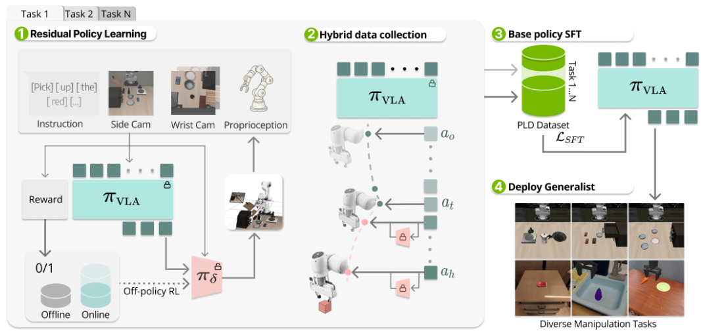

# Self-Improving Vision-Language-Action Models with Data Generation via Residual RL

如图所示，为了缓解 SFT 数据少的问题，本文提出了 PLD 方法，即 Probe、Learn、Distill，是一种三阶段即插即用的框架，可以通过残差 RL 和分布感知的数据采集来改进 VLA 模型。第一阶段专家获取会冻结 VLA 权重，通过 off-policy RL 训练轻量的残差策略，用于接管基础 policy 失效的状态。第二阶段数据收集会采取一种混合 rollout 方案，先让基础 VLA 执行，再由残差策略接管，这样纠正动作主要发生在基础 VLA 经常访问的状态上，使采集轨迹既贴近基础 VLA 的真实运行分布，又包含失败后的恢复行为。第三阶段微调中，经过筛选的轨迹通过标准 SFT 被蒸馏回通用模型，该方法同时适用于 flow-matching 架构和自回归架构的输出 head。

## 监督微调

给定 VLA 模型和数据集 $\mathcal{D} = \{(o_t, g_t, a_t)\}$，其中 $o_t$、$g_t$ 和 $a_t$ 分别表示观测、语言指令和专家动作。为了简化记号，定义 $x_t = (o_t, g_t)$，所以自回归 VLA 要学习的是

$$
\mathcal{L}_{\mathrm{AR}}(\theta) = -\mathbb{E}_{k\sim[K]}[\log p_\theta(u_k|u_{<k}, x)]
$$

这个公式是标准的自回归交叉熵，$x$ 是模型的条件输入，$u_{<k}$ 是第 $k$ 个位置之前的 action token 序列。$p_\theta(u_k|u_{<k}, x)$ 是给定观测、语言指令和前序 action token 时，模型分配给正确 action token $u_k$ 的概率。$k\sim[K]$ 是从 $[K] = \{1, \cdots, K\}$ 中均匀选择一个位置，也就是对所有 action token 取平均。

对于扩散模型，loss 可以表示为：

$$
\mathcal{L}_{\mathrm{diff}}(\theta) = \mathbb{E}_{t, \epsilon, (x, a)}[||\epsilon - \epsilon_\theta(a_t^{\mathrm{noisy}}, x, t)||_2^2]
$$

其含义是，给专家动作加入一份已知的随机噪声，然后要求模型根据带噪动作、当前观测和语言指令，将加入的噪声预测出来。

## 目标感知的强化学习

在标准 RL 中，策略只依赖状态：$\pi(a | s)$，但 VLA 在相同场景下，可能需要执行不同的语言指令，亦即任务目标 $g$，可以表示为 $\pi(a | s, g)$。同时，奖励函数也从 $r(s, a)$ 变为 $r(s, a, g)$。

对于 RL 的优化目标，论文给出的是：

$$
J(\pi) = \mathbb{E}[\sum\limits_{t = 0}^\infty\gamma^tr(s_t, a_t, g)]
$$

其中目标函数中，每一步奖励前面都有 $\gamma^t$。由于 $0 <\gamma \le 1$，所以越晚获得的奖励权重越低，这使得 RL 通常更加偏好使用更短的动作序列完成任务，并减少长时间停顿和无效动作。

而对于奖励函数，PLD 定义为 $r(s, a, g) = \mathbf{1}[d(\phi(s), g)\le \varepsilon]$。其中 $\phi(s)$ 代表从完整状态中提取与任务目标有关的信息，$d(\phi(s), g)$ 代表当前结果与目标之间的距离，$\varepsilon$ 代表成功的容许误差。$\mathbf{1}[\cdot]$ 在条件成立时输出 1，否则输出 0。

## 基于策略先验热启动的数据高效强化学习

策略先验指已经训练好的基础 VLA，热启动指不从完全随机的策略开始学习，也就是希望利用基础 VLA 已经具备的策略能力作为起点，减少残差策略 RL 需要的环境交互数据。训练刚开始时，residual policy 还是随机的，因此需要限制其输出范围，否则可能影响基础 VLA 的行为。论文将 residual action 限制在 $a_\delta\in[-\xi, \xi]$，其中 $\xi$ 用于控制修正动作的最大幅度。同时，PLD 维护两个 replay buffer：offline buffer 用于保留基础 VLA 的成功轨迹 $\mathcal{B}_\mathrm{offline} = \{\tau_1, \tau_2, \cdots\}$。这些轨迹对于稀疏奖励任务比较重要，否则模型在训练初期可能一直失败，因为 critic 几乎只能看到奖励 0。Online buffer 用于记录训练 residual policy 时新产生的成功和失败经验。使用两个 buffer 的好处是：

* Offline 数据持续提供已知的高价值状态和动作，防止训练遗忘。
* Online 数据让策略根据自己的最新试错继续改进。

对于 critic，论文先使用基础 VLA 的成功轨迹，通过 Cal-QL 初始化 critic，而不是让 Q 函数从随机值开始学习。另外，online RL 初期会使用基础 VLA 进行一段 warm-up rollout，为 online buffer 提供一个稳定的起点。

## 利用 RL 专家进行自举式、可扩展的数据生成

Residual policy 通常在训练后可以找到一条稳定的成功路径，但如果将其直接用于数据生成，会导致行为较为单一。为了解决这个问题，PLD 先让基础 VLA 自己执行随机数量的步骤，再让 residual policy 接管并完成任务。这样生成的数据既贴近基础 VLA 的分布，又包含纠错行为，更适合在第三阶段蒸馏回通用 VLA。
