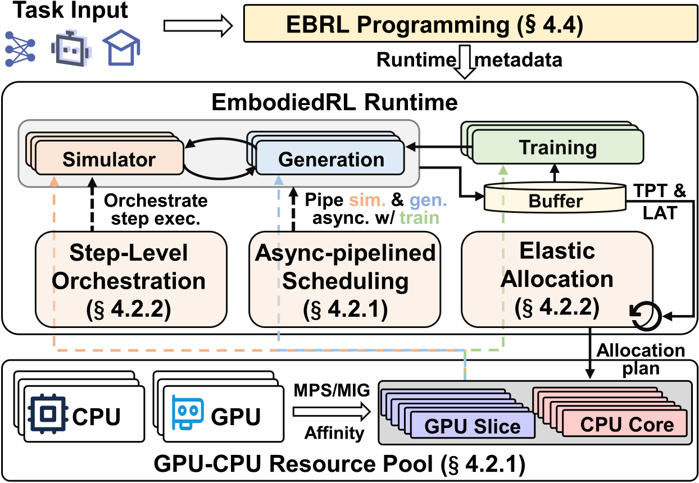
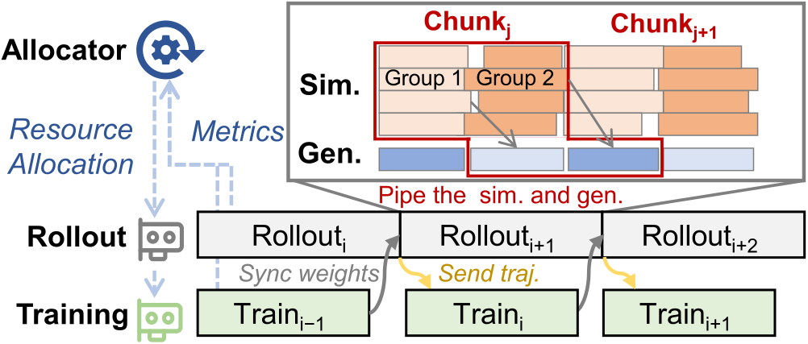
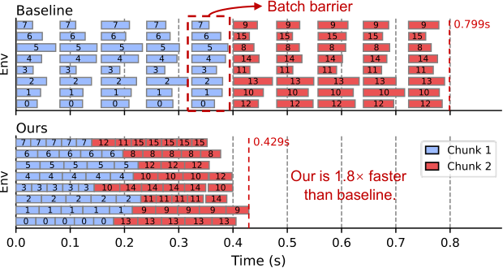

# EBRL: Asynchronous Embodied RL by Multi-Grained Resource Management

## 动机和挑战

具身 RL 包含 simulation、generation 和 training 三个 stage，simulation 依赖 CPU 与 GPU 协同，后两者则重度依赖 GPU，但现有系统都以整卡为粒度把资源分配给某个 stage。EBRL 的 motivation 建立于三点：

1. 异构 stage 导致流水线效率低

   CPU 密集的仿真操作会阻塞 GPU，而扩散 action head 每步去噪只 launch 一些小 kernel，generation 阶段超过 75% 的时间 SM occupancy 低于 20%。

2. CPU 管理薄弱

   Simulation step 中的操作轻量但频繁，56 核中只有 22 核的利用率高于 50%，且 OS 会频繁迁移线程，带来上下文切换开销。

3. 异步机制待调优

   D-VLA、RL-VLA$^3$ 等异步系统只重叠了 rollout 和 training，rollout 内 simulation 和 generation 仍然互相等待，GPU 依然有 47% 的时间空闲。

由此带来两个挑战：一是不同环境的 step 耗时差异大，同步仿真需要等待 straggler；二是最优的 CPU 核与 SM 分配与硬件、policy、任务强相关，难以穷举，而且随着 policy 变好、轨迹变短，各 stage 的负载会持续变化，静态分配很快就会失效。

## 整体架构

如图所示，EBRL 基于 RLinf 实现，核心是异步流水线调度器和细粒度资源管理器。前者在迭代、环境组和 step 三个粒度上重叠各 stage，后者把 CPU 核和 GPU SM 池化，并根据 profile 和运行时吞吐动态调整各 stage 的配额。

## 异步流水线调度

如图所示，迭代间，generation 和 training 按各自的 SM 配额共享 GPU，$\mathrm{Rollout}_i$ 采集新轨迹的同时 trainer 执行 $\mathrm{Train}_{i-1}$，训练完成后再把权重同步给 generation。Rollout 内，环境被划分为若干组，一组在仿真时 generation 为另一组生成下一个 action chunk，从而把 simulation 和 generation 流水化。

## Step 级异步编排

由于每个环境在 chunk 开始时已经拿到了一整段动作，EBRL 让环境在 chunk 内各自推进，不再每个 step 都同步。如图所示，基线在每个 chunk 边界都要等最慢的环境，而 EBRL 中快的环境可以提前进入下一个 chunk。当某个 CPU 核空闲时，调度器会把它重新绑定给就绪的环境，并优先选择历史 step 耗时最长的环境，让潜在的 straggler 尽早开始。

## 细粒度资源管理

EBRL 把 CPU 和 GPU 抽象为统一的资源池：GPU 通过 NVIDIA Multi-Process Service（MPS）按 SM 百分比和显存预算切分给各 stage，需要硬件隔离时也可以使用 Multi-Instance GPU（MIG）；CPU 则以核为单位绑定 worker，避免 OS 随意迁移线程。

在此基础上，EBRL 离线 profile 各 stage 在不同配额和 batch size 下的吞吐。由于 simulation 与 generation 流水化，rollout 又与 training 重叠，端到端吞吐取决于最慢的 stage：

$$
\begin{aligned}
T_r(\mathcal{C}) &= \min\{T_{\mathrm{sim}}(\mathcal{C}_{\mathrm{sim}}), T_{\mathrm{gen}}(\mathcal{C}_{\mathrm{gen}})\} \\
\Theta(\mathcal{C}) &= \min\{T_r(\mathcal{C}), T_{\mathrm{train}}(\mathcal{C}_{\mathrm{train}})\}
\end{aligned}
$$

分配器先为 simulator 分配 CPU 核，以及达到吞吐拐点所需的最小 SM 配额，再在 generation 和 training 之间二分搜索剩余的 SM，使 rollout 和 training 的吞吐尽量平衡。训练过程中，若二者的吞吐差距连续 20 步超过 15%，就用实测数据重新分配。
