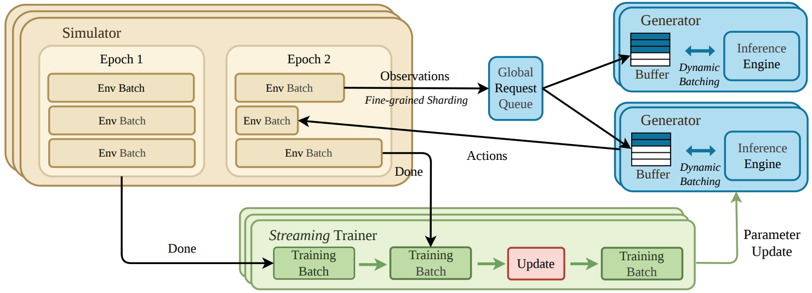
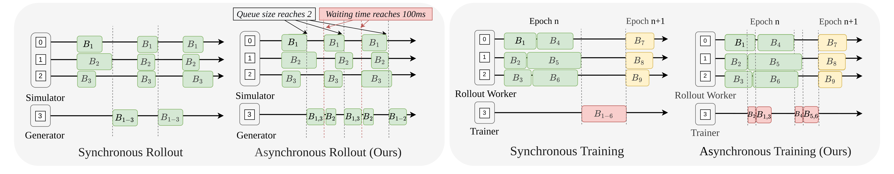
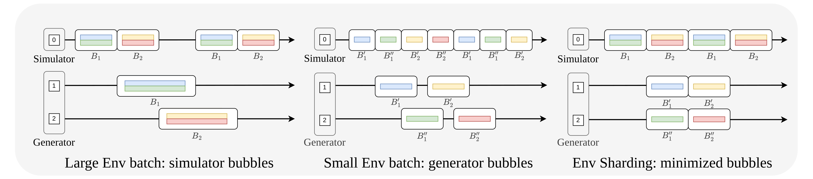

# RL-VLA$^3$: A Flexible and Asynchronous Reinforcement Learning Framework for VLA Training

## 动机和挑战

现有 VLA 的 RL 框架沿用了 LLM RL 的同步设计，把整个 rollout 当作不可分割的单元，在数据采集和策略优化之间严格交替：

$$
(\text{Rollout}\rightarrow\text{Training})^{N},\quad \text{Rollout}=(\text{Simulator}\rightarrow\text{Generator})^{N_e}
$$

其中 $N$ 是训练步数，$N_e$ 是一次 rollout 中与环境的交互次数。但 VLA 的环境是物理 simulator，开销大且耗时不稳定：在 ManiSkill 上，$\pi_{0.5}$ 生成一批 640 个动作需要 9 秒，simulator 计算下一步却要 22 秒，而且不同 simulator 对 CPU 和 GPU 的依赖各不相同。RLinf 虽然提供了 separated 和 hybrid 的资源放置方式，但 rollout 内部以及训练与推理之间仍是同步执行，这些 barrier 严重限制了吞吐。

## 整体架构

如图所示，RL-VLA$^3$ 基于 RLinf，把系统拆为 Simulator、Generator 和 Trainer 三类资源组，三者完全异步地各自推进。每个 Simulator 托管若干 Env Batch，产生的观测经过可选的分片后进入全局请求队列；Generator 加载 VLA 模型，由动态批处理调度器决定何时从队列中取请求推理并返回动作。一个 Env Batch 跑完整个 episode 后，轨迹立即异步发送给 Trainer，Trainer 每完成一定次数的更新就把新参数同步给 Generator。

## 异步 rollout 与训练

如图左半部分所示，同步 rollout 要等所有 Simulator 完成 step 才能凑成一个推理 batch，慢的 env batch 会拖住整体。RL-VLA$^3$ 让每个环境完成 step 后立即把请求放入队列，Generator 不再等待所有 Simulator。为了避免 batch 太小浪费算力，动态批处理调度器设置了最大 batch size 和最长等待时间两个条件，队列长度达到阈值或最早的请求等待超时才触发推理。

如图右半部分所示，同步训练要等所有 rollout worker 收齐一整个 epoch 的数据才开始更新。RL-VLA$^3$ 中一个 env batch 完成 episode 后，轨迹立即推给 Trainer，训练与数据生成重叠进行。

## 细粒度环境分片

对于并行度高的环境，RL-VLA$^3$ 把大的 env batch 切成多个 slot，分发给不同的 Generator。如图所示，大 batch 只交给一个 Generator 时，Simulator 要停下来等推理；env batch 太小又发挥不出 Simulator 的吞吐，导致 Generator 空等。分片既保留了大 batch 的吞吐，又减少了 Simulator 的等待。
