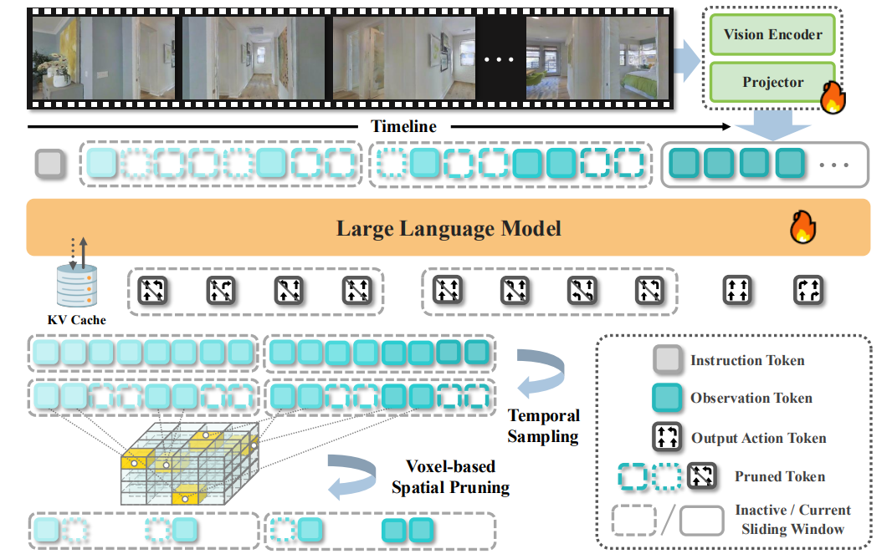

# StreamVLN: Streaming Vision-and-Language Navigation via SlowFast Context Modeling

## 整体架构

StreamVLN 是流式的 VLN 框架，采用快慢混合上下文建模策略以支持交错出现的视觉、语言和动作输入，并进行多模态推理。快链路通过针对活跃上下文的滑动窗口机制，加快了动作生成。慢链路则通过一种三维感知的 token 剪枝策略，对历史视觉状态进行压缩。

如图所示，StreamVLN 基于 LLaVA-Video，输入由一条语言指令和一串 RGB 图像构成，每个 episode 都被构建为多轮对话，agent 在其中持续查询下一步动作。

## 多轮自回归生成

在 VLN 的多轮对话中，每轮输出是一个动作 $a_i$，输入是当前观测 $o_i$以及历史的观测和动作。也就是说，在第 i 步时，输入可表示为 $o_1a_1o_2a_2\cdots o_{i-1}a_{i-1}$ 和 $o_i$。由于 StreamVLN 是基于 Transformers 架构的，因此 $a_i$ 的生成是自回归的，在每一个对话轮中，模型都会经历输入的 prefill，以及输出的 decode，并且能够使用 KV Cache。

## 快链路对话上下文

多轮的 KV Cache 复用可以降低绝大部分 prefill 的时间，但会导致存储的显著占用，不利于长 session。同时，现有的 Video-LLM 在处理过长上下文时，往往表现出推理性能下降的现象。为了解决这个问题，StreamVLN 引入了针对 KV Cache 的滑动窗口机制，定义窗口 $W_j = [o_{i - N + 1}a_{i - N + 1}\cdots o_i a_i]$，当窗口达到容量时，会一次性按窗口长度整体切换窗口，旧窗口的 KV Cache 会被整体清空，不再参与下一窗口的推理，同时像 prompt 以及生成动作之类的非观测信息也会被立刻丢弃。

对于新的窗口，历史窗口中的视觉观测 token 状态会经过时间采样和空间剪枝，被压缩成记忆 token $\{\mathcal{M}_0, \cdots, \mathcal{M}_j\}$，而一次 decode 可以被定义成：

$$
a_i^{W_{j + 1}} = \mathrm{Decoder}(o_i, \{\mathcal{M}_0, \cdots, \mathcal{M}_j\}, \{k_{i - N + 1}v_{i - N + 1}, \cdots, k_{i - 1}v_{i - 1}\})
$$

## 慢链路压缩记忆

由于在训练期间从 feature 层面压缩视频 token 会改变预训练模型的输入分布，导致明显的性能下降，所以 StreamVLN 不直接压缩视觉特征，而是有选择地丢弃在空间和时间上冗余的 token。这种做法可以更好地保留 Video-LLM 的预训练知识和泛化能力。

为了减少时间冗余，StreamVLN 采用固定数量采样策略，这是因为记忆 token 长度的变化可能会引起时间跨度偏差，并降低模型在不同 planning horizon 下的鲁棒性。

为了减少空间冗余，StreamVLN 设计了一种基于 voxel 的空间剪枝策略，将二维图像块反投影到一个共享的三维空间中。如果在给定的时间段内，来自不同帧的多个 token 被投影到同一个 voxel，那么仅保留来自最近一次观测的 token。之后，利用 voxel 剪枝掩码来筛选保留下来的 token 状态。
