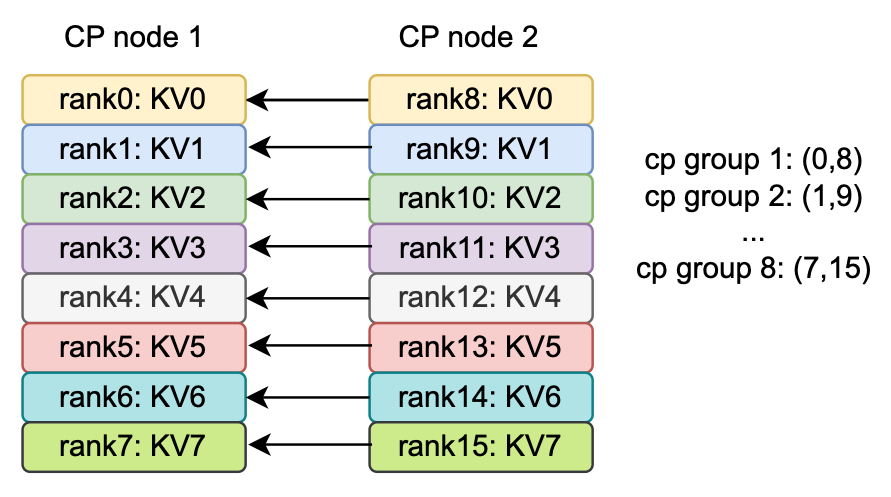
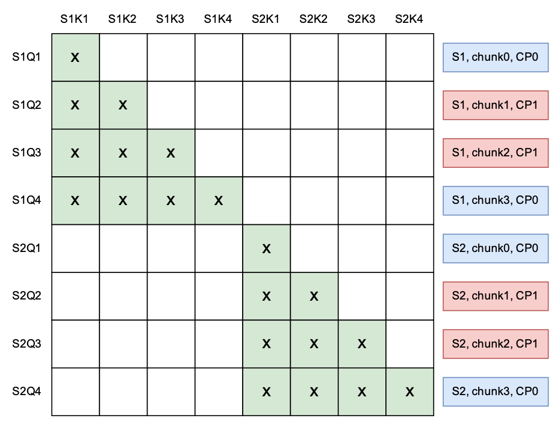
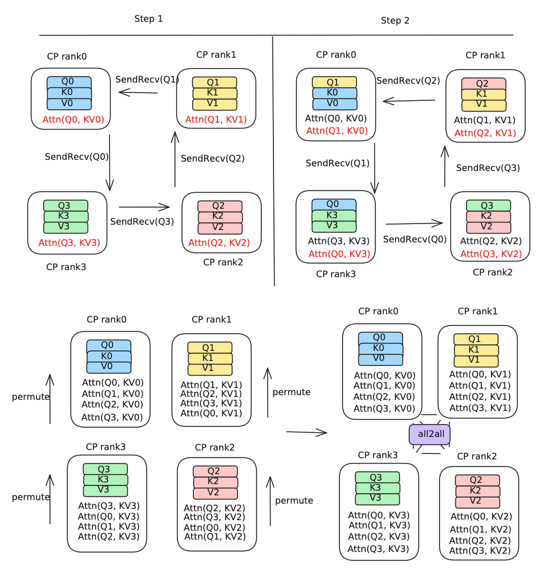

# Context Parallelism for Scalable Million-Token Inference

发表于 MLSys '25（[arXiv:2411.01783](https://arxiv.org/abs/2411.01783)）。

作者：Amy (Jie) Yang、Jingyi Yang、Aya Ibrahim、Xinfeng Xie、Bangsheng Tang、Grigory Sizov、Jeremy Reizenstein、Jongsoo Park、Jianyu Huang（Meta）

## 动机和挑战

百万级上下文推理同时受限于平方级增长的注意力计算量与线性增长的 KV Cache 显存，单台 8 卡 H100 节点处理 Llama3 405B 的 1M prefill 耗时约 1200 s。在线多轮对话包含全量 prefill、复用历史缓存的增量 prefill 和逐 token decode 三个阶段，请求长度与缓存命中率动态变化。面向训练的环形注意力只考虑定长无缓存场景，直接用于推理会导致各卡计算与显存负载失衡。此外，在高缓存命中率下继续传输庞大的历史 KV，还会使跨机通信延迟暴露在关键路径上。

## 跨节点并行架构

如图所示，系统在节点内部采用张量并行切分模型权重，跨节点则沿序列维度采用 Context Parallelism（CP）。不同节点上持有同一 KV 头的 GPU 组成独立的环形通信组，并发收发注意力张量。跨节点张量并行需在每层线性层执行两次 `AllReduce`，跨机通信量随节点数迅速放大。相比之下，CP 仅在注意力层通信，且在 Grouped-Query Attention（GQA）模型中可传递头数更少的 KV 张量，在降低跨机带宽需求的同时分布式扩展了总 KV Cache 容量。

## 负载均衡切分

如图所示，为消除因果掩码下序列首尾计算量悬殊的问题并同时均衡各节点的 KV Cache 占用，系统将输入序列均匀切分为 $2N$ 个分块。第 $i$ 个 CP 节点配对持有首尾对称的两个分块 $(C_i, C_{2N-i-1})$，使各节点的有效注意力计算量保持一致。对于 batch 内拼接的变长序列，全量 prefill 对每条序列独立执行对称切分，增量 prefill 则仅对新增输入 token 维度施加相同的对称切分。

## Ring Pass-KV 与 Pass-Q

如图所示，Ring `pass-Q` 将历史与新增 KV 固定在本地，沿环传递等长 $Q$ 分片并在循环后经一次 `All2All` 归并局部输出，而 `pass-KV` 则沿环传递 KV 并在本地直接归并。设新输入长度为 $T$、历史缓存长度为 $P$、查询头数为 $N_H$、KV 头数为 $N_{KV}$，传递 $Q$ 比传递 KV 通信量更小的条件为：

$$
\frac{T}{T + P} \le 2 \cdot \frac{N_{KV}}{N_H}
$$

系统结合硬件算力带宽比与该未命中率阈值动态切换：全量 prefill 与低命中率选用 `pass-KV`，高命中率增量 prefill 与 decode 选用 `pass-Q`。Decode 阶段还按轮询偏移将新 KV 均匀写入各节点以防单节点显存溢出，并适合配合 prefill-decode 分离架构规避跨机小包延迟。在 128 张 H100 上推理 Llama3 405B 时，1M 上下文精确 prefill 耗时降至 77 s，并行效率达 93%。
