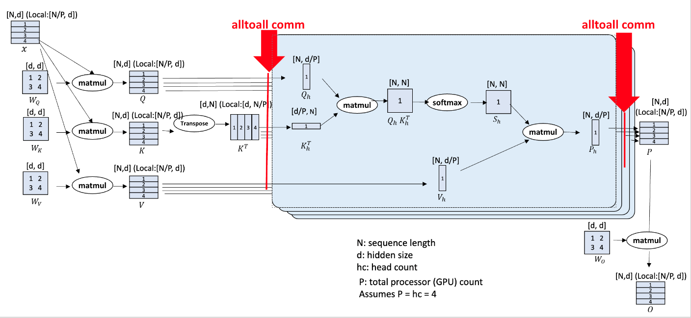

# DeepSpeed Ulysses: System Optimizations for Enabling Training of Extreme Long Sequence Transformer Models

arXiv 预印本（[arXiv:2309.14509](https://arxiv.org/abs/2309.14509)），后发表于 PODC '24。

作者：Sam Ade Jacobs、Masahiro Tanaka、Chengming Zhang、Minjia Zhang、Shuaiwen Leon Song、Samyam Rajbhandari、Yuxiong He（Microsoft）

## 动机和挑战

数据并行、张量并行和流水线并行分别沿 batch、隐藏维度和层数切分，无法直接消除超长序列带来的激活显存瓶颈。若单纯扩大数据并行规模，又会推高全局 batch 大小而损害模型收敛质量。既有序列并行方案仍受限于通信效率，Colossal-AI 环形自注意力与 Megatron-LM 序列并行的单链路通信量均随序列长度线性增长。此外，Megatron-LM 序列并行与张量并行紧耦合，限制了显存效率并需要大量侵入式代码改造。

## 整体架构

如图所示，DeepSpeed-Ulysses 将长度为 $N$ 的输入序列沿序列维度均匀切分到 $P$ 张 GPU 上，各卡独立完成局部序列分片的 $Q, K, V$ 线性投影。进入注意力计算前，系统对 $Q, K, V$ 执行一次 `all-to-all` 集合通信，将切分维度从序列重排为注意力头。重排后每张 GPU 持有完整序列长度，但仅负责互不重叠的一部分注意力头，可在本地并行完成标准注意力计算。随后系统执行第二次 `all-to-all` 将输出还原为序列切分，供后续输出投影、MLP 和 LayerNorm 继续按序列并行执行。

## 通信复杂度分析

在现代 NVSwitch 与胖树 InfiniBand 集群上，总消息量为 $M$ 的 `all-to-all` 在 $P$ 张 GPU 上的单链路传输量为 $M / P$。设序列长度为 $N$、隐藏维度为 $h$，每层对 $Q, K, V$ 和注意力输出各执行一次 `all-to-all`，单层单链路总通信量为：

$$
V_{\text{DS-Ulysses}} = \frac{3Nh}{P} + \frac{Nh}{P} = \frac{4Nh}{P}
$$

当序列长度 $N$ 与并行度 $P$ 按相同比例扩展时，单链路通信量始终保持恒定。相比之下，Megatron-LM 序列并行每层执行两次 `all-gather` 与两次 `reduce-scatter`，单链路通信量恒为 $4Nh$，是 DeepSpeed-Ulysses 的 $P$ 倍，实测中后者可将通信量降低 10 倍以上。

## 显存优化与注意力解耦

由于序列并行本身不减少模型参数与优化器状态显存，DeepSpeed-Ulysses 将 ZeRO-3 的切分域扩展至数据并行与序列并行的联合进程组。模型参数、梯度和优化器状态跨两个并行维度共同切分，并在计算与更新时按联合组按需收集或归约。同时，`all-to-all` 后每张 GPU 拥有对应注意力头的完整序列，本地注意力模块与具体算子实现完全解耦，可直接兼容稠密或稀疏注意力以及 FlashAttention-2。在 256 张 A100 GPU 上，系统支持超过 1M tokens 的序列训练，较 Megatron-LM 序列并行扩展 $4\times$ 序列长度并取得最高 $2.5\times$ 吞吐提升。
