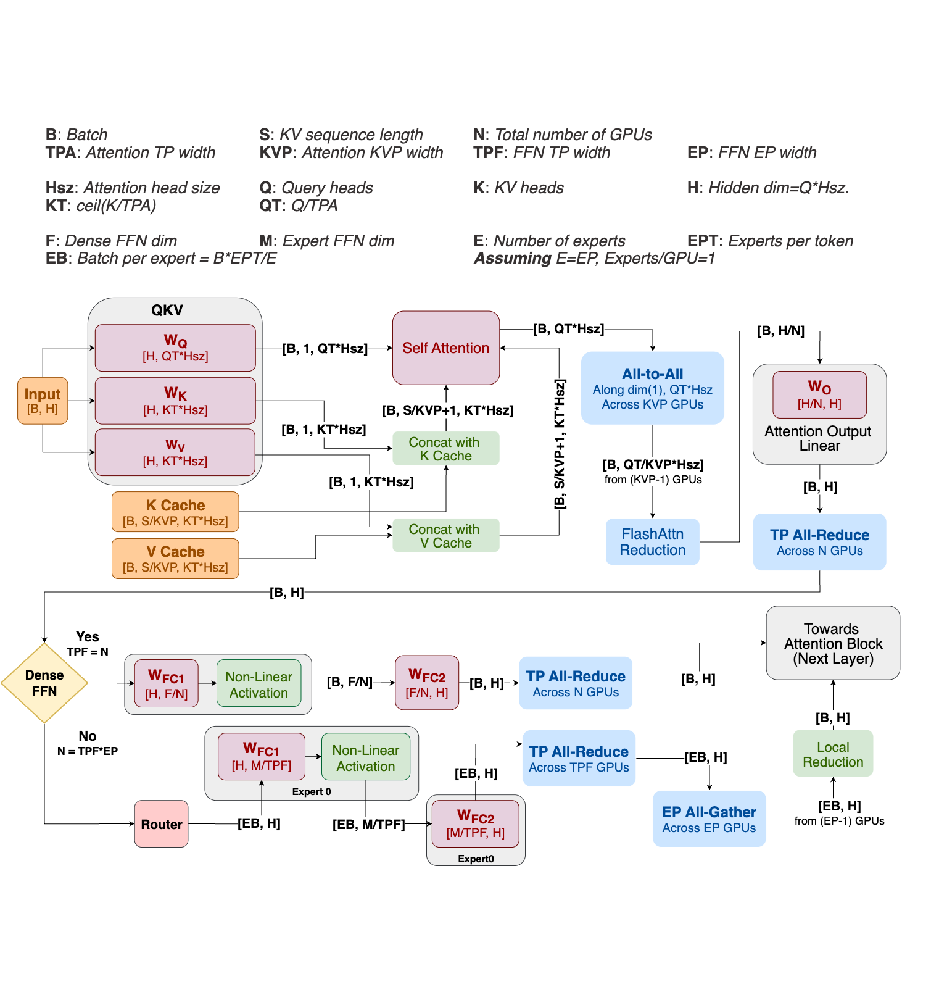
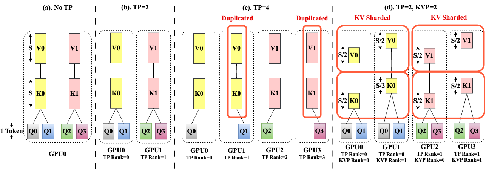
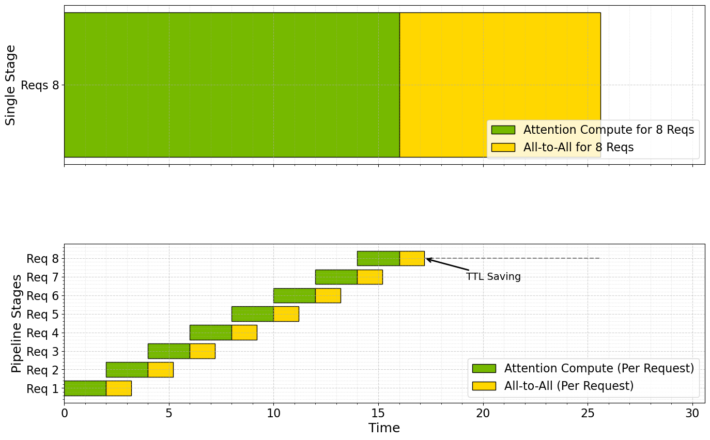

# Helix Parallelism: Rethinking Sharding Strategies for Interactive Multi-Million-Token LLM Decoding

arXiv 预印本（[arXiv:2507.07120](https://arxiv.org/abs/2507.07120)）。

作者：Nidhi Bhatia、Ankit More、Ritika Borkar、Tiyasa Mitra、Ramon Matas、Ritchie Zhao、Max Golub、Dheevatsa Mudigere、Brian Pharris、Bita Rouhani（NVIDIA）

## 动机和挑战

百万 token 上下文的交互式 decode 需在严苛的 Token-to-Token Latency（TTL）下同时克服 KV Cache 读取与前馈网络权重读取两项访存瓶颈。现代模型采用分组查询注意力或 MLA 将 KV 头数 $K$ 大幅压缩，一旦张量并行宽度超过 $K$，新增 GPU 就必须重复保存完整 KV Cache。若为避免冗余将张量并行限制在 $K$ 以内，占模型约三分之二参数的前馈网络又只能在少量 GPU 上切分，使权重加载成为延迟瓶颈。现有 KV 并行虽能沿序列切分缓存，但注意力后仍汇聚回固定规模的张量并行组，大规模并行下依然受限于权重读取。

## 整体架构

如图所示，Helix Parallelism 在单层内构建时间流水线，解耦注意力与前馈网络的并行策略，复用同一组 $N$ 张 GPU 动态切换布局：

$$
N = \mathrm{KVP} \times \mathrm{TPA} = \mathrm{TPF} \times \mathrm{EP} \quad (\mathrm{TPA} \le K)
$$

其中注意力阶段组合序列 KV 并行（KVP）与不超过 $K$ 的张量并行（TPA），前馈网络则重配置为张量并行（TPF）与专家并行（EP）。通过为不同子层匹配各自最优的分片方式，Helix 同时消除了 KV Cache 复制与前馈网络权重读取瓶颈。在 GB200 的 1M 上下文评测中，Helix 在固定 batch 下将单步延迟降低最高 50%，并在相同延迟预算下为 DeepSeek-R1 支撑最高 $32\times$ 的并发 batch。

## 注意力分片与交错 KV 追加

如图所示，Helix 将注意力阶段的张量并行封顶在 $K$ 以切分头维度，其余并行度用于沿序列维度均分历史上下文，构成无复制的二维分片。为省去注意力前跨卡收集 query 的通信开销，每个 KVP 设备直接对完整输入独立计算本地头切片的 QKV 投影，并在各自序列分片上运行 FlashAttention。各设备随后沿 query 头维度执行一次通信量与上下文长度无关的 All-to-All，交换局部输出与统计量并在单轮通信内精确归约。在逐步 decode 时，系统按固定步长在各 KVP 设备间轮询追加新生成的 KV 条目，保证各卡显存占用与访存负载均匀增长。

## HOP-B 批内通信重叠

如图所示，若等待整个 batch 全部算完本地注意力后再发起跨卡通信，All-to-All 延迟将完全暴露在单步关键路径上。为此 Helix 提出 Helix Overlap Pipeline – Batch-wise（HOP-B），在首个请求的局部注意力就绪后立即异步发起其 All-to-All 传输，同时在 GPU 上并行计算下一个请求的注意力。这种批内细粒度流水线将跨卡通信隐藏在后续请求的计算之后，在 Llama-405B 上可避免最高约 12% 的单用户吞吐损失。

## 输出投影与 FFN 重分片

注意力阶段的 All-to-All 完成后，每张 GPU 恰好持有完整 batch 的均匀激活切片，天然对齐宽度为 $N$ 的张量并行布局。全部 $N$ 张 GPU 随即以张量并行方式执行输出投影，并经一次 All-Reduce 汇总结果。稠密模型在前馈网络阶段继续保持宽度为 $N$ 的张量并行，由所有设备共同分摊权重读取。MoE 模型则重划分为最优的 $\mathrm{TPF} \times \mathrm{EP}$ 网格，彻底解除 KV 头数对前馈网络并行宽度的限制。
