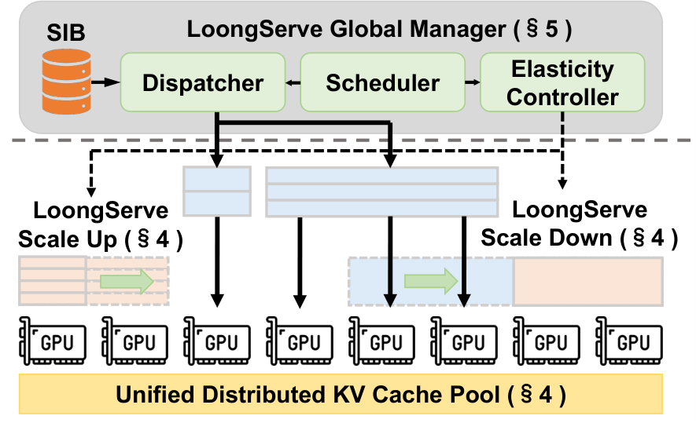
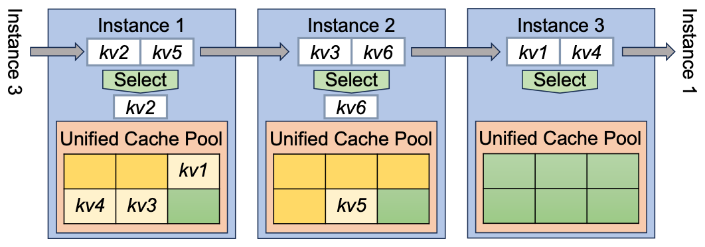
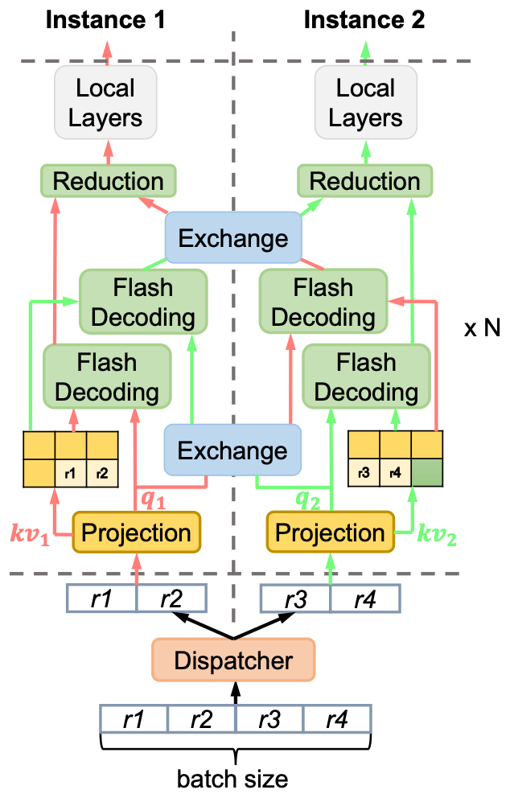

# LoongServe: Efficiently Serving Long-Context Large Language Models with Elastic Sequence Parallelism

发表于 [SOSP '24](https://dl.acm.org/doi/10.1145/3694715.3695948)。

作者：Bingyang Wu¹、Shengyu Liu¹、Yinmin Zhong¹、Peng Sun²、Xuanzhe Liu¹、Xin Jin¹（¹北京大学，²上海人工智能实验室）

## 动机和挑战

长上下文 LLM 在不同请求和不同推理阶段之间的资源需求差异极大。1M 上下文单请求的 KV Cache 超过 488 GB，且计算密集的 prefill 阶段适合多卡并行，而访存受限的 decode 阶段盲目扩大并行度反而增加通信开销。静态模型并行无法在运行时调整并行度，chunked prefill 存在阶段间干扰，prefill-decode 分离则会引入高昂的 KV Cache 迁移开销与跨实例显存碎片。LoongServe 提出 Elastic Sequence Parallelism（ESP），在不重新切分模型参数的前提下按迭代动态调整请求的并行度。

## 整体架构

如图所示，LoongServe 由全局管理器与一组维护相同模型副本的弹性实例组成，所有实例的显存聚合为统一的分布式 KV Cache 池。该缓存池支持以单 token 粒度跨实例任意存放 KV 张量，不受单实例局部性限制，从而消除显存碎片。全局管理器在每轮迭代中联合决策请求分发、合批、并行度与扩缩容计划，使吞吐相比 chunked prefill 和 prefill-decode 分离分别提升最高 $3.85\times$ 和 $5.81\times$。

## 主动缩容机制

如图所示，请求完成 prefill 转入 decode 时需要缩小并行组以释放算力，LoongServe 通过主动迁移复用 prefill 原有的环状通信实现零额外开销缩容。在环状序列并行中，各实例在注意力层本就需逐轮向相邻实例传递局部 KV 张量。主动迁移令目标子集内的实例在接收并转发邻居 KV 张量时，按缩容计划有选择地将其直接写入本地缓存池。因此 prefill 结束时全部 KV 张量已按各实例剩余空间就位，省去了事后跨卡搬运的开销。

## 多主分布式 Decode 与弹性扩容

如图所示，当 decode 阶段因生成序列增长耗尽组内显存或转为计算受限时，LoongServe 采用多主分布式 decode 在不迁移存量 KV Cache 的前提下动态扩容新实例。并行组内指定多个主实例分别负责 batch 中的不同请求，各自将新生成的 KV 张量写入本地缓存池，并并行执行投影与前馈网络等局部层。在注意力层，各主实例向组内其余实例交换 query 张量，所有实例基于本地历史 KV 分片并行执行注意力计算再归约结果。跨实例的 query 交换可与主实例的本地注意力计算重叠执行，进一步降低通信开销。

## 四步实时调度算法

全局管理器将指数级的迭代调度空间解耦为请求分发、实例分配、合批与扩缩容计划生成四个步骤，在数十毫秒内完成在线求解。调度器先按显存容量与抢占收益选出待执行请求并分配实例，再按请求长度降序用动态规划同批打包相近请求：

$$
f[i][k] = \min_{\substack{0 < j \le i,\ 0 < l \le k \\ D[j,i] \le V[l,k]}} \big(f[j][l] + T(R[j,i], E[l,k])\big)
$$

其中 $f[i][k]$ 为前 $i$ 个请求在 $k$ 个实例上的最小输入延迟和，$D[j,i]$ 与 $V[l,k]$ 为区间 token 数与空闲槽位数，$T$ 为预测耗时。最后系统在 prefill 后缩容至能容纳缓存的最小并行度，并在 decode 显存或算力不足时触发多主扩容。
