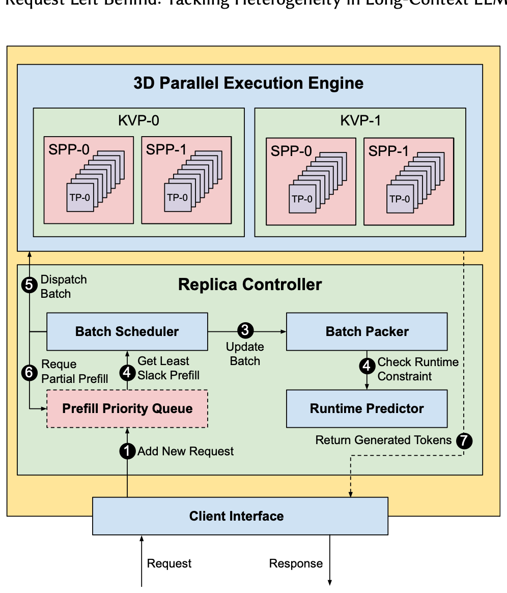
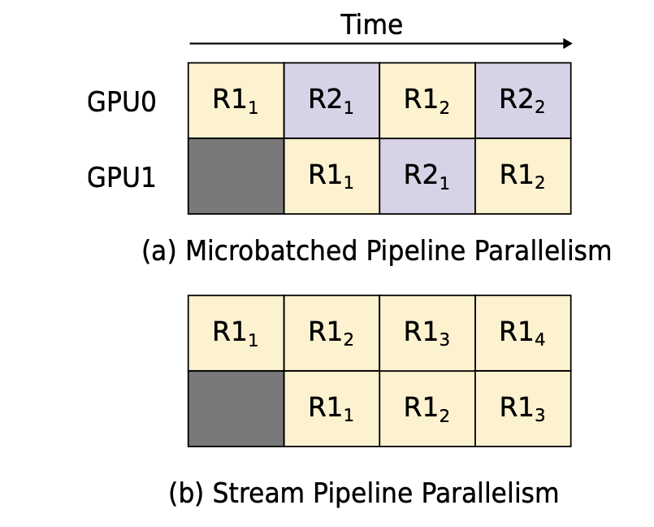

# No Request Left Behind: Tackling Heterogeneity in Long-Context LLM Inference with Medha

arXiv 预印本（[arXiv:2409.17264](https://arxiv.org/abs/2409.17264)），早期版本题为 Mnemosyne。

作者：Amey Agrawal¹、Haoran Qiu²、Junda Chen³、Íñigo Goiri²、Chaojie Zhang²、Rayyan Shahid¹、Ramchandran Ramjee²、Alexey Tumanov¹、Esha Choukse²（¹Georgia Institute of Technology，²Microsoft，³UC San Diego）

## 动机和挑战

生产环境的长上下文推理常混合短对话与百万 token 文档请求，自注意力的二次复杂度使长短请求的计算量相差数千倍。在非抢占式系统中，单个长 prefill 会持续阻塞后续短请求而引发护航效应，仅混入 5% 的长请求即可使短请求的中位和尾部 Time-to-First-Token（TTFT）恶化 $30\times$ 和 $174\times$。采用 chunked prefill 拆分长输入虽可支持抢占，但长上下文后期分块的注意力开销剧增，仍会严重拖慢同批 decode 请求的延迟。此外，沿空间切分序列的上下文并行也难以直接兼容沿时间顺序推进的分块抢占执行。

## 整体架构

如图所示，Medha 由集中式的 Replica Controller 与底层的 3D 并行执行引擎组成，协同支撑百万 token 异构负载的细粒度抢占推理。Replica Controller 通过基于松弛度的调度器维护 prefill 优先级队列，并由装箱器结合运行时预测器在单步时间预算内构造混合 batch。未完成全部输入的请求在单个分块执行后重回队列，从而允许紧急的短请求随时插队执行。在异构混合负载下，Medha 相比非抢占式系统提升 $5.7\times$ 吞吐，并将中位和 P99 延迟分别降低 $30\times$ 和 $174\times$。

## 分块注意力与自适应分块

Medha 分析表明，分块注意力的算术强度仅取决于分块大小而与上下文总长无关，极小分块即可打满现代模型的 GPU 算力。真正的吞吐与延迟矛盾源于不同算子的瓶颈转移：prefill 初期由算术强度较低的前馈层主导，需要大分块保证吞吐。随着 KV Cache 不断增长，二次复杂度的注意力逐渐成为主导开销，此时必须缩小分块才能避免阻塞同批的 decode 请求。Medha 据此提出自适应分块策略，以大分块启动长 prefill 并随上下文增长动态缩减分块，兼顾高吞吐与稳定的单步延迟。

## 流式流水线与 KV-Cache 并行

如图所示，传统微批次流水线并行依赖交错不同请求填充气泡而无法加速单请求，Medha 提出的 Stream Pipeline Parallelism（SPP）则让同一长请求的连续分块跨流水线 stage 流式重叠执行。由于后一分块在某层仅依赖前一分块在该层生成的 KV Cache，前一分块进入下一 stage 后，后一分块即可立即在当前 stage 启动。SPP 将长 prefill 关键路径按流水线深度线性缩短，在 128 张 H100 上处理 1M 上下文时比上下文并行快 $1.64\times$。针对超长上下文的 decode 延迟，Medha 还提出 KV-Cache Parallelism（KVP），沿序列维度切分 KV Cache 并随生成规模渐进扩容。各设备复制 query 并行读取本地 KV 分片计算局部注意力，经 online-softmax 归约输出，从而为输出延迟提供可控上界。

## LARS 调度与动态装箱

传统先来先服务会引发护航阻塞，最早截止期优先则会饿死长请求，为此 Medha 提出 Length-Aware Relative Slack（LARS）指标：

$$
\rho_i = \frac{a_i + d_i - t - w_i(t)}{w_i^{\text{total}}}
$$

其中 $a_i$、$d_i$、$w_i^{\text{total}}$ 和 $w_i(t)$ 分别为到达时刻、相对截止期、总工作量与剩余工作量，归一化松弛度使长短请求按比例推进。单步预算内装箱器先放入活跃 decode 请求，再按 LARS 顺序二分搜索最大可行分块，自然落实自适应分块。装箱器还利用长请求后期小分块留下的前馈层算力余量，令充裕的长请求让出部分预算拼入短请求分块，提升 $1.8\times$ 吞吐。
