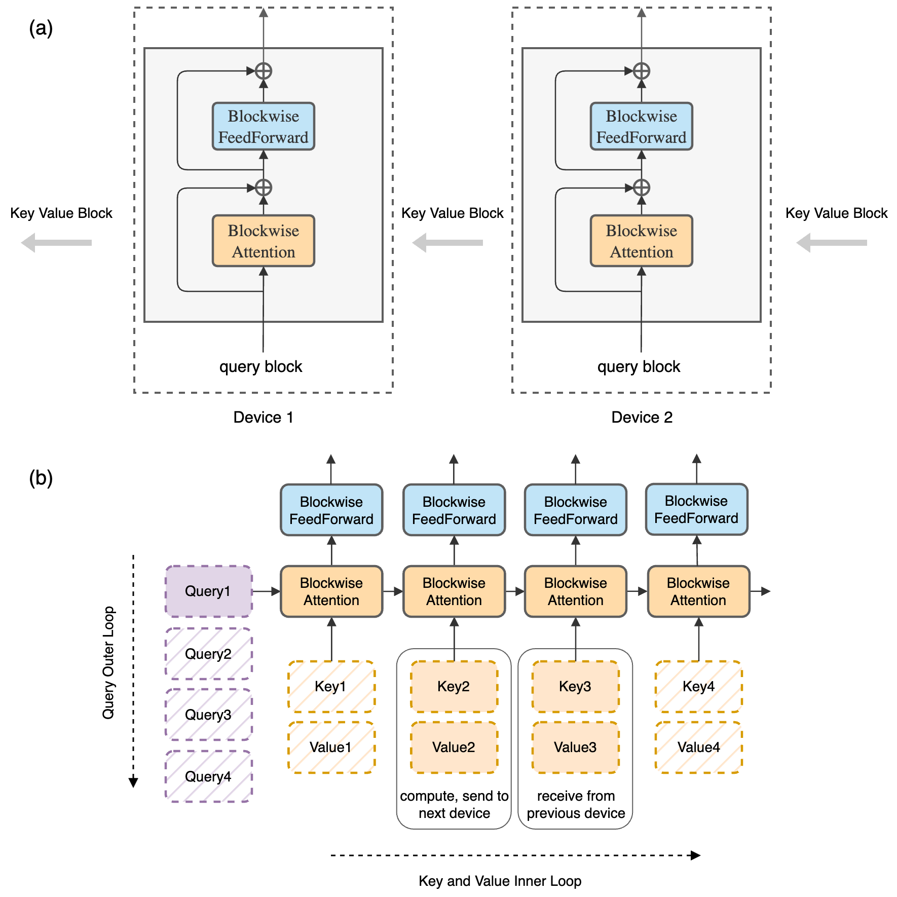

# Ring Attention with Blockwise Transformers for Near-Infinite Context

发表于 ICLR '24（[arXiv:2310.01889](https://arxiv.org/abs/2310.01889)）。

作者：Hao Liu、Matei Zaharia、Pieter Abbeel（UC Berkeley）

## 动机和挑战

标准自注意力的激活显存随序列长度二次方增长，限制了超长上下文的训练与推理。Blockwise Parallel Transformer（BPT）虽能分块计算自注意力和 FFN 以避免物化完整注意力矩阵，但每层仍须保存完整序列输出供下一层交互。若不保存该输出，重计算将带来三次方计算开销，而单卡 HBM 远不足以容纳上亿 token 的层间激活。已有序列并行方案又引入了无法被计算掩盖的跨机通信开销。

## 环形分块注意力

如图所示，Ring Attention 将输入序列切分为 $N_h$ 个分块，分布到组成逻辑环的 $N_h$ 台主机上。在 (a) 中，每台主机固定持有一个局部 query 分块并独立完成本地注意力与 FFN 计算，KV 分块则沿环依次传递。在 (b) 的内层循环中，分块自注意力只需正确重缩放各块统计量即可保证结果与计算顺序无关。主机 $i$ 在计算当前分块注意力的同时向主机 $i+1$ 发送 KV 分块，并从主机 $i-1$ 接收下一组 KV 分块。前向与反向传播均采用这一邻点并发收发机制，既无需在单机累积全序列 KV，又将通信隐藏在分块计算之内。

## 通信重叠条件

只要单步分块注意力计算耗时不小于 KV 分块传输耗时，跨机通信延迟即可被完全掩盖。设分块大小为 $c$、隐藏维度为 $d$、单机峰值算力为 $F$、主机间单向带宽为 $B$，单步注意力计算与 KV 传输需满足：

$$
\frac{4dc^2}{F} \ge \frac{4cd}{B} \implies c \ge \frac{F}{B}
$$

当分块大小不小于设备算力与互联带宽之比时，环形通信不会引入任何额外时间开销。在 NVLink 互联的 A100 和 TPUv4 上该最小分块仅约 1K tokens，而在带宽较低的 InfiniBand 网络上则需更大分块。

## 显存开销与并行扩展

Ring Attention 将单机单层峰值激活显存控制在 $6bch$ 字节，仅随分块大小 $c$ 线性增长，与总序列长度彻底解耦。该方法无需任何近似计算，可直接复用单卡内存高效注意力实现。同时它与 FSDP 和张量并行正交组合，使模型支持的最大上下文长度随设备数量线性扩展。在 TPUv4-1024 上，其最大训练序列长度较 BPT 提升 500 倍以上，可扩展至超过 1 亿 tokens 且不损失算力利用率。
