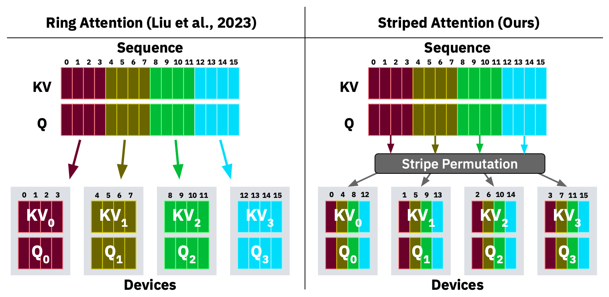
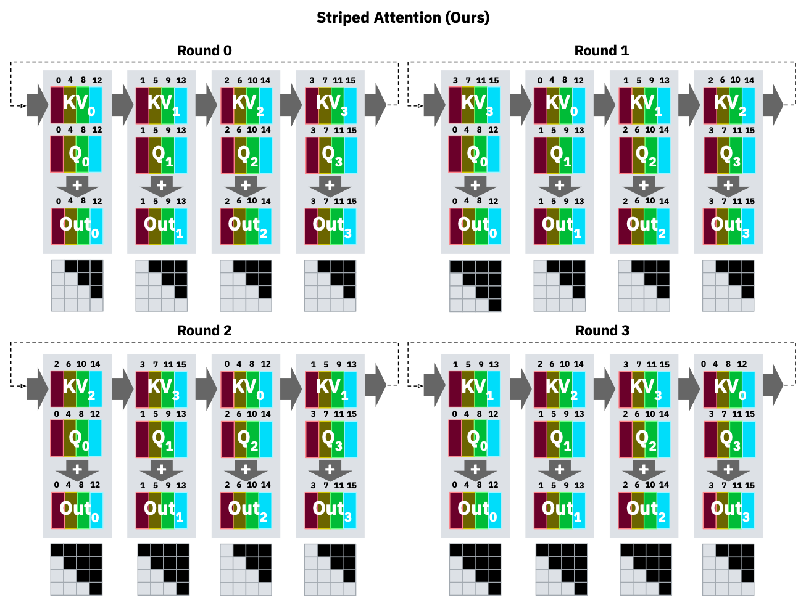
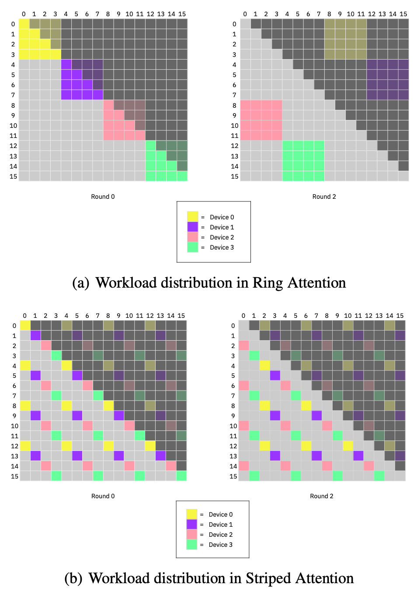

# Striped Attention: Faster Ring Attention for Causal Transformers

arXiv 预印本（[arXiv:2311.09431](https://arxiv.org/abs/2311.09431)）。

作者：William Brandon¹、Aniruddha Nrusimha¹、Kevin Qian¹、Zachary Ankner¹²、Tian Jin¹、Zhiye Song³、Jonathan Ragan-Kelley¹（¹MIT CSAIL，²MosaicML，³MIT EECS）

## 动机和挑战

因果自注意力只需计算下三角区域，单卡融合 kernel 可借此节省约一半计算量。然而 Ring Attention 无法利用因果掩码的三角结构获得吞吐提升。原因在于 Ring Attention 按连续子序列切分输入，除首轮外，各设备的分块交互要么完全无掩码，要么完全被掩码。由于每轮环形同步延迟受最慢设备制约，单轮耗时始终等于完整无掩码分块的计算时间，造成严重的负载失衡。

## 条带置换切分

如图所示，Ring Attention 按连续区间切分序列，而 Striped Attention 在首层 embedding 之前对输入序列执行一次条带置换。系统按 token 原始位置对设备数 $N$ 取模的余数分配数据，使每台设备持有均匀遍布全序列的非连续 token 子集。位置编码索引与训练目标序列也同步完成相同重排，以保持相对位置关系正确。利用注意力计算的置换等变性，该分块布局在前向与反向传播中始终保持不变，无需在层间引入额外重排通信。

## 环形执行与因果掩码

如图所示，Striped Attention 沿用 Ring Attention 的环形通信调度，各设备固定持有本地 $Q$ 分块。在每一轮迭代中，各设备一边计算局部注意力，一边向邻居设备传递 $K, V$ 分块以掩盖通信延迟。由于因果掩码仍按 token 在原始序列中的先后顺序判定，每台设备在每一轮遇到的局部掩码均呈上三角结构。因此所有设备在每一轮都能稳定跳过约一半被掩码的无效交互，消除了设备间的空闲等待。

## 负载均衡与分块跳过

如图所示，Ring Attention 在部分轮次有设备完全落入灰色掩码区，而 Striped Attention 将下三角有效计算交错均摊到所有设备。设单设备分块大小为 $c$，分块 $Q_i$ 与 $K_j, V_j$ 的有效交互数为：

$$
\mathrm{Work}(i, j) = \begin{cases} \dfrac{c(c + 1)}{2} & i \ge j \\ \dfrac{c(c - 1)}{2} & i < j \end{cases}
$$

不同设备同轮计算量至多相差对角线上的 $c$ 个元素，随 $c$ 增大负载趋于完全均衡，注意力核心计算的理论加速上限趋近 $2\times$。实现上将分块进一步细分为固定尺寸的 tile 并整块跳过全掩码 tile，在 A100 256K 序列和 TPUv4 786K 序列训练上分别取得最高 $1.45\times$ 和 $1.65\times$ 的端到端加速。
