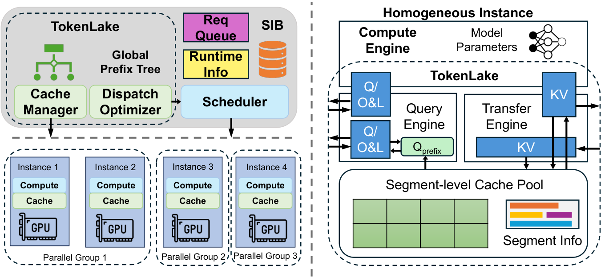
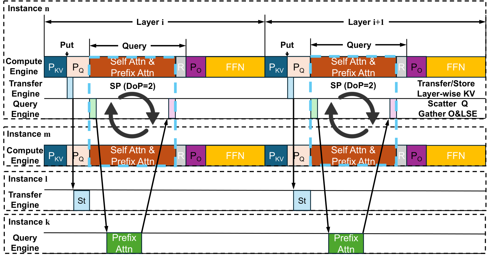
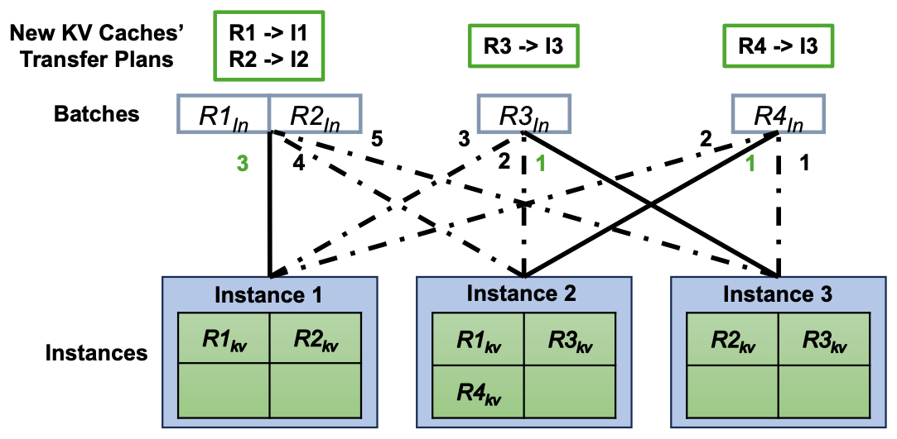

# TokenLake: A Unified Segment-level Prefix Cache Pool for Fine-grained Elastic Long-Context LLM Serving

arXiv 预印本（[arXiv:2508.17219](https://arxiv.org/abs/2508.17219)）。

作者：Bingyang Wu¹、Zili Zhang¹、Yinmin Zhong¹、Guanzhe Huang²、Yibo Zhu²、Xuanzhe Liu¹、Xin Jin¹（¹北京大学，²阶跃星辰）

## 动机和挑战

长上下文 Agent 与多轮对话的前缀缓存命中率可达 75%–95%，但现有缓存系统通过命令式读写与迁移接口将缓存管理与请求调度紧耦合。无论是缓存感知路由还是预填充-解码（PD）分离，都会导致高命中实例带宽过载、共享前缀重复存储与跨实例显存碎片。将集群显存聚合为统一内存池虽能打破隔离，但命令式接口只能随对话轮数增长跨实例搬运愈发庞大的完整前缀缓存。由于推理中除前缀注意力外其余算子均不依赖历史缓存，将前缀注意力的缓存池化从计算调度中剥离即可兼顾两侧效率。

## 整体架构与声明式接口

如图所示，TokenLake 将所有实例的显存抽象为统一的段级前缀缓存池，在控制面维护全局前缀树并透明接管缓存段的放置、去重与通信规划。声明式控制面向调度器暴露全局命中信息与缓存负载，并根据给定的合批方案自动生成查询与传输计划。数据面仅需计算引擎把 query 或新生成的单层 KV 张量写入共享缓冲区，无需感知前缀段的物理位置与跨机传输细节。相比缓存感知路由 SGLang-Router 和 PD 分离方案 MoonCake，TokenLake 分别提升最高 $2.6\times$ 和 $2.0\times$ 吞吐，并将命中率提升最高 $2.0\times$ 和 $2.1\times$。

## 对等异步引擎与通信隐藏

如图所示，每个实例借助 NVIDIA Multi-Process Service（MPS）在同一 GPU 上共置运行独立的计算引擎、查询引擎与传输引擎，构成全对等异步流水线。各引擎通过注册为网络缓冲区的进程间共享显存实现零拷贝交互，使单层新 KV 的异步写入可与当前层后续计算重叠。查询引擎跨实例分发 query 并回收局部前缀注意力结果的过程仅具有线性通信量，能够隐藏在二次复杂度的本地自注意力计算之后。当计算侧启用序列并行时，系统还结合环形传递 query 的变体消除组内重复发送，错开不同引擎的通信时机以降低网络争用。

## 分段级重热点感知负载均衡

由于前缀注意力可在各个缓存段上独立计算再精确归约，TokenLake 摒弃严格局部性策略，将前缀切分为固定大小的段跨实例分布。只要段尺寸使节省的本地计算与访存耗时覆盖网络往返开销，池化即可在不引入显著通信代价的前提下聚合多卡容量与带宽。针对越靠近前缀树根部访问越集中的偏斜负载，系统用哈希映射将普通段均匀打散至所有实例，实现无迁移去重。对于靠近树根的高频重热点段，系统仅在实例过载时按需复制到空闲实例，并以二选一随机采样路由查询与全局 LRU 淘汰副本。

## 二分图分发与无状态弹性调度

如图所示，不同实例持有的相关前缀段与新 KV 目标槽位数量决定了跨机通信量，TokenLake 将 batch 指派建模为二分图匹配问题。系统将待执行 batch 与实例分别作为左右顶点，以跨机查询和写入通信量为代价，在每轮迭代初用匈牙利算法透明求出最小通信量的放置方案。依托这一底层池化抽象，上层调度器无需维护前缀局部性，只需查询缓存池占用的资源比例即可在剩余预算上自由组合 PD 分离、chunked prefill 与弹性序列并行。TokenLake 据此实现了面向有效吞吐的无状态弹性调度器，在输出延迟约束下通过动态规划联合求解合批边界与各批并行度。
