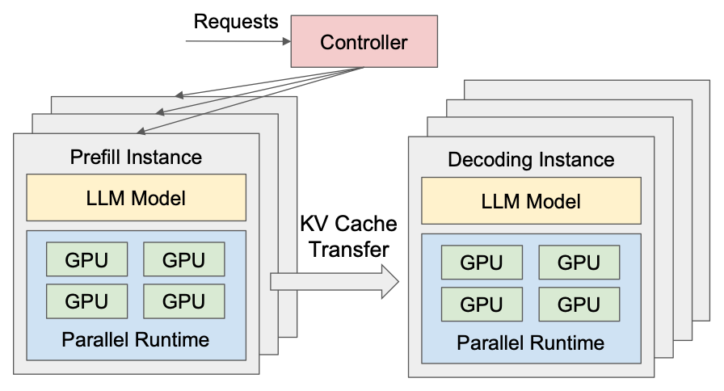

# DistServe: Disaggregating Prefill and Decoding for Goodput-optimized Large Language Model Serving

发表于 [OSDI '24](https://www.usenix.org/conference/osdi24/presentation/zhong-yinmin)。

作者：Yinmin Zhong¹、Shengyu Liu¹、Junda Chen²、Jianbo Hu¹、Yibo Zhu³、Xuanzhe Liu¹、Xin Jin¹、Hao Zhang²（¹北京大学，²UC San Diego，³阶跃星辰）

## 动机和挑战

在线 LLM 服务需同时满足 prefill 阶段的 Time To First Token（TTFT）与 decoding 阶段的 Time Per Output Token（TPOT）约束，以最大化单卡有效吞吐（goodput）。现有系统将两阶段共置混批会产生严重干扰：长 prefill 会阻塞同批的 decoding，而分块 prefill 将序列切为 $N$ 块又会引入 $O(N^2)$ 次历史 KV Cache 显存读取。此外，共置迫使两阶段绑定相同的资源配比与模型并行策略，系统只能按更严苛的一项指标过度配置 GPU。

## 整体架构

如图所示，DistServe 将 prefill 与 decoding 解耦到各自持有完整模型权重的独立实例上运行，彻底消除跨阶段干扰。中心控制器将请求发往排队最短的 prefill 实例生成首个 token，再将 KV Cache 传至负载最低的 decoding 实例完成自回归生成。解耦架构支持多个 prefill 实例向单个 decoding 实例汇聚流量，在不牺牲 TPOT 的前提下攒出更大解码批次以提升利用率。两类实例还能按各自延迟目标独立配置并行策略，相比现有系统最高可服务 $7.4\times$ 的请求速率或满足 $12.6\times$ 更严格的 SLO。

## 并行度与批处理权衡

DistServe 通过排队论与吞吐剖析揭示了解耦后两类实例不同的批处理和并行度偏好。prefill 实例在输入达到算力饱和阈值后继续合批只会成比例拉长延迟，因此仅对短请求合批。在均匀执行时间 $D$、到达率 $R$ 下，2 路算子间（inter-op）并行与加速比为 $K$ 的 2 路算子内（intra-op）并行的平均 TTFT 分别为：

$$
\mathrm{Avg\_TTFT}_{\mathrm{inter}} = D + \frac{R D^2}{4(2 - R D)}, \qquad \mathrm{Avg\_TTFT}_{\mathrm{intra}} = \frac{D}{K} + \frac{R D^2}{2 K (K - R D)}
$$

两式表明低负载或严苛 TTFT 下缩减执行时间的算子内并行更优，而高负载下缓解排队延迟的算子间并行占优。decoding 实例在大批次下呈现相同规律：先用必要的算子内并行满足 TPOT 约束，再用算子间并行或实例复制线性扩展吞吐。

## 带宽感知放置算法

DistServe 利用离散事件模拟器与带宽感知放置算法，在不同集群网络条件下搜索单卡 goodput 最优的实例配置。在具备高速跨机互联的集群中，算法独立枚举两阶段的并行度组合，通过二分模拟找出各自最优单卡配置后按流量比例复制实例。在跨节点带宽受限的集群中，算法利用 KV Cache 仅在同层间传输的性质，沿流水线阶段将模型切分为实例分段。同一流水线阶段的 prefill 与 decoding 分段被强制共置于同一节点内，使跨阶段传输全部经高速 NVLink 完成，通信耗时占比低于 0.1%。

## 在线调度与动态重规划

运行时调度器在先进先出策略之上引入三项机制，以应对真实负载的长度差异与流量突发。为减少流水线气泡，调度器将多条短请求拼批至接近算力饱和阈值，长请求则单独调度以均衡各微批耗时。为防止突发流量挤爆解码端显存，decoding 实例按需主动从 prefill 实例拉取 KV Cache，将源端显存用作天然的排队缓冲。此外，剖析器持续监测输入输出长度与到达率，一旦负载分布显著漂移便重新运行放置算法调整部署。
