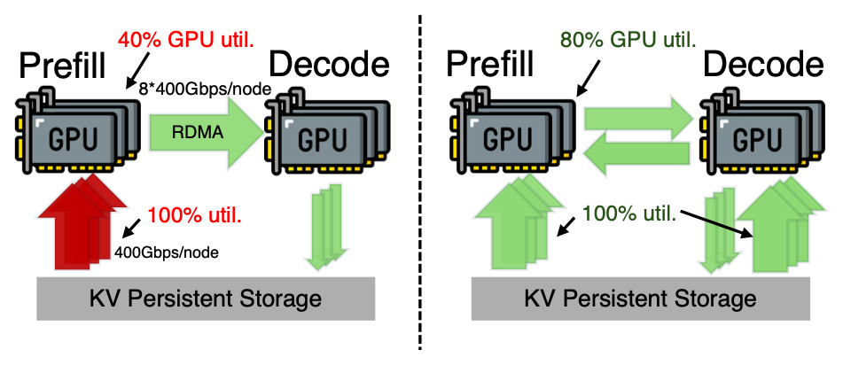
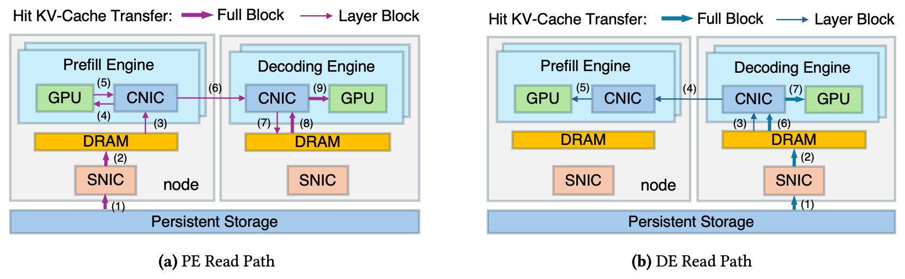
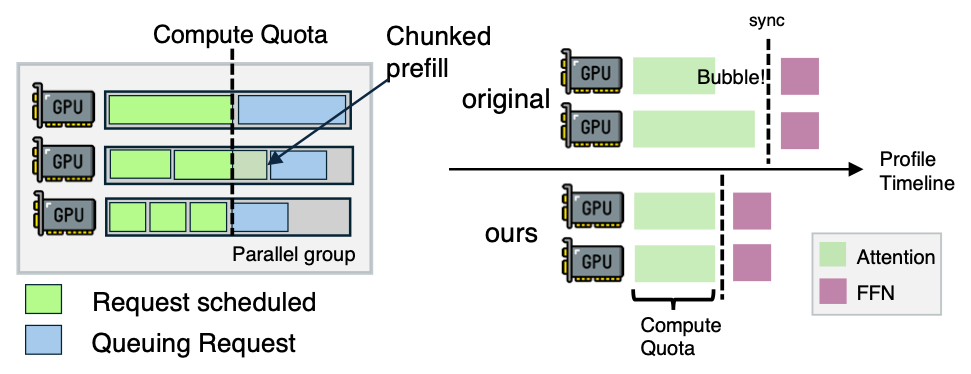

# DualPath: Accelerating Agentic LLM Inference by Harvesting Disaggregated KV-Cache Storage I/O

发表于 [SIGCOMM '26](https://dl.acm.org/doi/10.1145/3789240.3829159)。

作者：Yongtong Wu¹³、Shaoyuan Chen²³、Yinmin Zhong¹³、Rilin Huang¹、Yixuan Tan³、Wentao Zhang³、Liyue Zhang³、Shangyan Zhou³、Yuxuan Liu³、Shunfeng Zhou³、Mingxing Zhang²、Xin Jin¹、Panpan Huang³（¹北京大学，²清华大学，³DeepSeek）

## 动机和挑战

如图所示，多轮智能体与 RL rollout 负载呈“长上下文、短追加”特征，高达 98.7% 的 KV Cache 命中率使推理瓶颈从算力转向外部存储读取。同时，近几代 GPU 的 I/O 与算力比下降了 $14.4\times$，进一步加剧了外部持久化缓存的加载瓶颈。现代 AI 集群物理隔离了多网卡计算网络与单网卡存储网络，每台机器配备多张 Compute NIC（CNIC）但仅共享一张 Storage NIC（SNIC）。现有解耦系统仅由 prefill 引擎（PE）从存储读取命中缓存，导致 PE 侧 SNIC 持续满载而 decode 引擎（DE）侧 SNIC 闲置。

## 双路径加载与无瓶颈条件

如图所示，DualPath 在传统“存储→PE”路径（a）之外新增“存储→DE→PE”读取路径（b），将全集群所有节点的 SNIC 汇聚为统一带宽池。系统以全层块读写外部存储，在节点内存缓冲与显存间则按单层块流式传输以同逐层 prefill 计算重叠。走 DE 读取路径时，命中缓存先读入 DE 内存缓冲，PE 经计算网络 RDMA 按层拉取数据，算完仅把新增缓存传回 DE 合并。设 prefill 与 decode 节点数为 $P$ 和 $D$、单机 GPU 数为 $g$、单卡计算带宽为 $B$、单机存储带宽为 $s B$、内存带宽为 $M$，无内部瓶颈的配比条件为：

$$
\frac{s}{g - s} \le \frac{P}{D} \le \min\left\{\frac{g - 2s}{s},\ \frac{g - s}{2s},\ \frac{M / (B s) - 3}{2}\right\}
$$

在典型八卡节点配置下，该式给出的无瓶颈区间为 $\frac{1}{7} \le P/D \le \frac{7}{2}$，覆盖绝大多数实际部署比例。

## 以计算网卡为中心的流量隔离

DualPath 采用以 CNIC 为中心的传输机制，隔离细粒度 KV Cache 流量与延迟敏感的模型集合通信。由于 GPU 缺乏 PCIe 服务质量机制，直接使用本地拷贝引擎或存储直通会抢占专家并行 AllToAll 等亚毫秒级突发通信。系统强制包括本地内存与显存互拷在内的所有 GPU 数据流均绕经配对 CNIC 的 GPUDirect RDMA 路径，将 CNIC 作为统一的硬件流量仲裁点。网络层为推理通信的高优先级 Virtual Lane（VL）预留约 99% 带宽，令 KV Cache 在低优先级通道仅利用空闲带宽，同时借助用户态 RDMA 提交降低小块拷贝开销。

## 跨引擎负载均衡调度

中心调度器联合感知各节点的磁盘读队列与 GPU 负载，动态完成引擎配对与读取路径选择。各引擎分组定期上报未完成请求数、未完成总 token 数及所属节点的磁盘读队列长度。PE 调度先剔除过载引擎，优先在短读队列节点中挑选未完成 token 最少的引擎以防 SNIC 断流闲置。DE 调度先将请求分往总负载最轻的引擎组，组内则在显存充足且未超均载阈值的候选者中挑选并发请求最少的一方。确定引擎配对后，调度器直接指派当前磁盘读队列更短的一侧执行持久化 KV Cache 读取。

## 引擎内计算配额调度

如图所示，DualPath 在 PE 侧引入基于计算配额的引擎内调度，消除注意力数据并行下的跨卡同步等待气泡。采用 MLA 等注意力数据并行时，各 GPU 处理不同请求却须在注意力层后同步进入前馈网络，负载差异会造成严重空闲等待。调度器依据已命中与待计算长度累加估算注意力耗时；若整条加入会超出配额，则二分切分待计算长度以分块 prefill 填满剩余配额。结合双路径加载与两级调度，DualPath 将离线推理吞吐最高提升 $1.87\times$、在线服务吞吐平均提升 $1.96\times$，并在千卡规模下保持近线性扩展。
