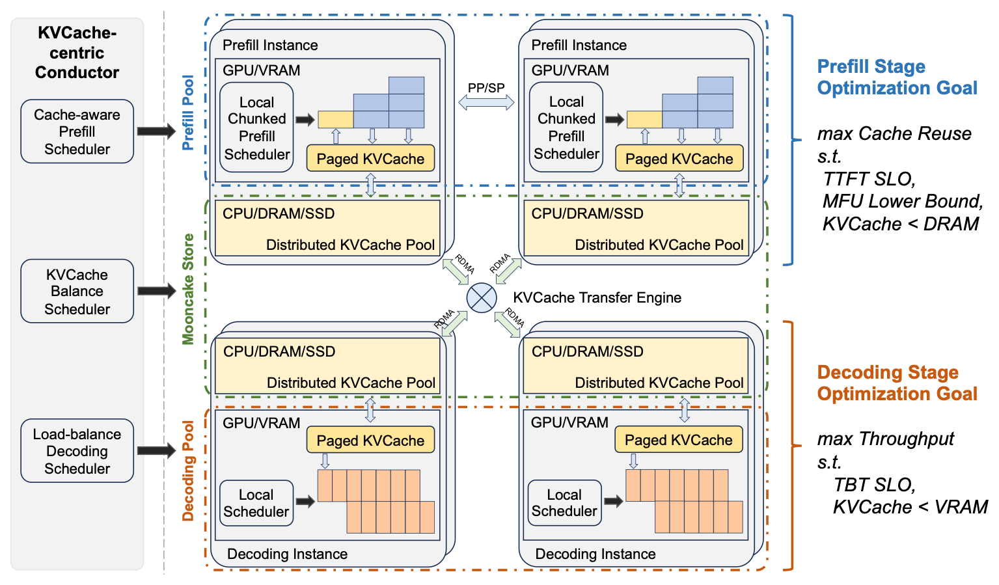
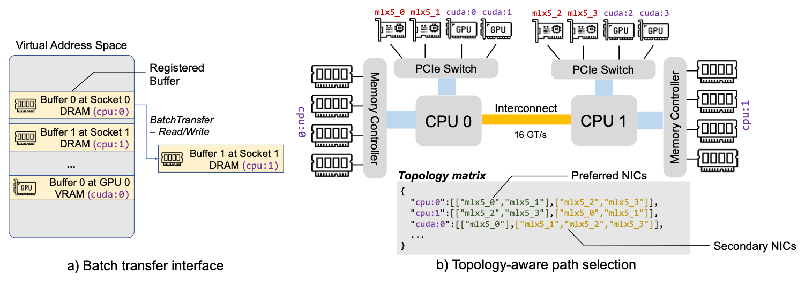
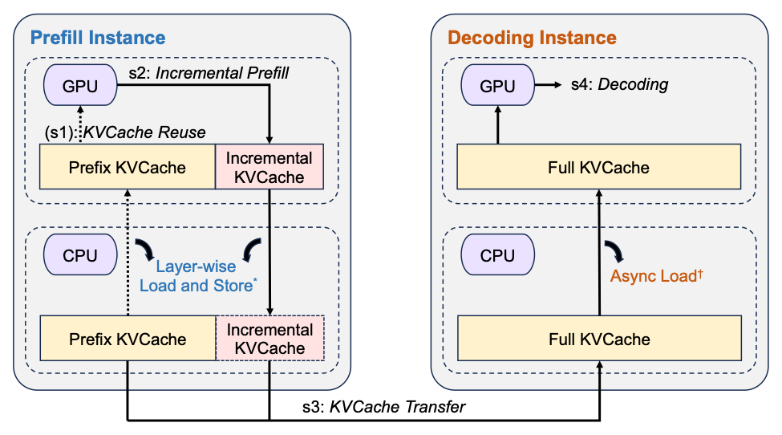

# Mooncake: Trading More Storage for Less Computation — A KVCache-centric Architecture for Serving LLM Chatbot

发表于 [FAST '25](https://www.usenix.org/conference/fast25/presentation/qin)。

作者：Ruoyu Qin¹²、Zheming Li¹、Weiran He¹、Jialei Cui¹、Feng Ren²、Mingxing Zhang²、Yongwei Wu²、Weimin Zheng²、Xinran Xu¹（¹月之暗面，²清华大学）

## 动机与以存储换计算

长上下文对话服务亟需复用前缀 KV Cache 以削减计算开销，但单机本地内存容量有限，命中率不足理论上限的 50%。Mooncake 提出聚合集群内未充分利用的 CPU、DRAM、SSD 与网卡构建全局缓存，实现“以存储换计算”。在计算吞吐 $G$、加载带宽 $B$ 与匹配前缀长度 $p$ 下，跨机复用能缩短 Time To First Token（TTFT）的判据为：

$$
\frac{B}{G} > \frac{2 d s}{\mathit{gqa} \times (a p d + b d^2)}
$$

式中 $d$、$s$、$\mathit{gqa}$ 分别为隐藏维数、元素字节数和分组注意力头数比，$a$、$b$ 为常数系数。模型规模与匹配前缀越长该条件越易满足，单张 100 Gbps 网卡即可让跨机缓存复用同时节省算力与首字延迟。

## 整体架构

如图所示，Mooncake 以 KV Cache 调度为核心，在分离 Prefill Pool 与 Decoding Pool 的同时构建了分布式缓存池 Mooncake Store。全局调度器 Conductor 统一编排计算实例与缓存副本，平衡缓存命中、节点负载与延迟约束。prefill 阶段在满足 TTFT 与算力利用率约束下最大化缓存复用，decoding 阶段则在 Time Between Tokens（TBT）与显存上限内扩大批次提升吞吐。该架构支撑 Kimi 日处理逾千亿 token，使生产集群的请求承载量提升超过一倍，真实轨迹下有效请求容量提升 59%–498%。

## Mooncake Store 与传输引擎

如图所示，Mooncake Store 将分页 KV Cache 组织为按链式前缀哈希去重的分布式对象，并提供零拷贝批量传输能力。存储层在缓存满池时采用跳过在途访问块的最近最少使用策略淘汰旧块，并向上层暴露对象读写与副本调整接口（a）。传输引擎在启动时构建硬件拓扑矩阵，为每段内存划分本地 NUMA 或同 PCIe Switch 下的首选网卡与备选网卡，规避跨插槽互联瓶颈（b）。单次请求被切分为细粒度分片在多张 RDMA 网卡间并行传输，配合基于 SIEVE 的端点池与自动故障切换，传输带宽较 TCP 提升最高 $4.6\times$。

## 请求执行流与分块流水线并行

如图所示，单次请求依次经历前缀复用、增量 prefill、跨机缓存流式传输与异步加载解码四个步骤。prefill 节点逐层异步加载前缀缓存并写回新增缓存，同时将生成的各层 KV Cache 重叠流式传往目标 decoding 节点内存。针对超长上下文，跨节点张量并行通信昂贵，序列并行则对短请求利用率偏低且扩缩复杂。Mooncake 采用 Chunked Pipeline Parallelism（CPP），将超长未命中输入切块交由多节点并发流水处理，仅在阶段边界跨机通信即可兼顾长短上下文。

## KV Cache 感知调度与热点迁移

Conductor 联合评估前缀匹配长度与排队负载，将请求派往预计 TTFT 最短的实例，并在无法满足 SLO 时提前拒绝请求。调度器根据各实例的本地前缀匹配长度，利用离线拟合的回归模型估算执行耗时并叠加排队等待时间。若远程最长匹配显著优于本地且计入传输耗时后总 TTFT 更短，调度器便将请求派往轻载节点并触发跨机拉取缓存。该启发式策略无需预测未来热度即可将高频前缀自动复制到多个节点，相比本地缓存将命中率最高提升 $2.36\times$ 并节省 48% 的 prefill 计算时间。
