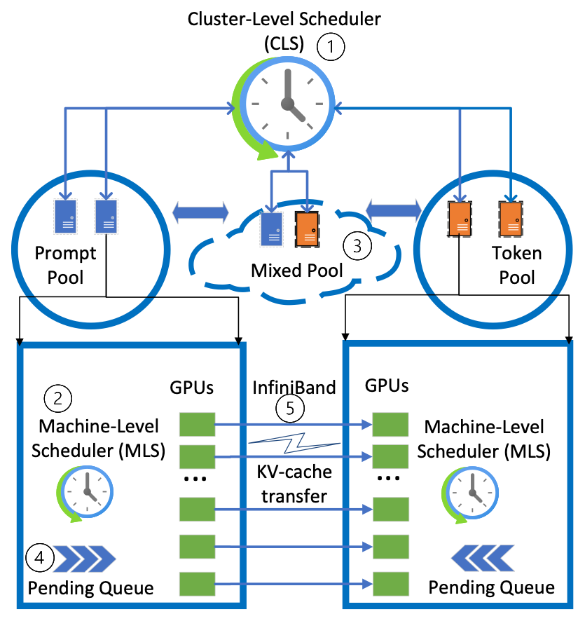
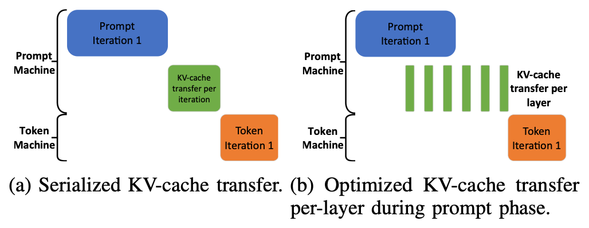

# Splitwise: Efficient Generative LLM Inference Using Phase Splitting

发表于 ISCA '24（[arXiv:2311.18677](https://arxiv.org/abs/2311.18677)）。

作者：Pratyush Patel¹、Esha Choukse²、Chaojie Zhang²、Aashaka Shah²、Íñigo Goiri²、Saeed Maleki²、Ricardo Bianchini²（¹University of Washington，²Microsoft）

## 动机和挑战

生成式 LLM 推理包含计算密集的 prompt 阶段与访存受限的 token 生成阶段，分别决定 Time To First Token（TTFT）和 Time Between Tokens（TBT）。现有系统在同一机器上混跑两阶段会产生相互干扰：抢占式批处理会拉高 TBT 尾延迟，混合批处理则会拖慢流式生成。同时，新一代 GPU 的算力增长远快于显存带宽与容量，H100 相比 A100 算力提升 $3.43\times$，但显存带宽仅提升 $1.64\times$。线上负载分析表明，token 阶段长期处于算力欠利用状态，即使将单卡功耗上限削减 50% 也几乎不增加延迟。

## 整体架构

如图所示，Splitwise 将请求的 prompt 阶段与 token 生成阶段拆分到不同机器执行，以支持分阶段的精细化资源管理。集群维护预加载模型权重的 Prompt Pool、Token Pool 和弹性伸缩的 Mixed Pool。全局 Cluster-Level Scheduler（CLS）与单机 Machine-Level Scheduler（MLS）共同构成两级调度架构。新请求到达时，CLS 同时指派一对机器：prompt 机器算出首 token 后经 InfiniBand 将 KV Cache 传至 token 机器完成后续生成。

## 两级调度与混合资源池

Splitwise 通过两级调度在低负载下降低延迟，并在高负载下借由 Mixed Pool 消除静态分池的资源碎片。CLS 按待处理 token 数采用最短队列优先路由请求；当目标池排队过长时，便将请求导向 Mixed Pool 甚至临时借用对侧池机器。借调机器按混合批处理运行，待异类任务排空后即可无开销退回原池。单机 MLS 按角色差异化组批：prompt 机器限制批大小以防算力饱和，token 机器尽量扩大批次直至显存上限，mixed 机器优先运行 prompt 并用账龄机制防止饥饿。

## KV Cache 逐层异步传输

如图所示，Splitwise 通过逐层异步传输将跨机 KV Cache 通信隐藏在 prompt 计算过程中。朴素串行传输（a）必须等整个 prompt 阶段结束后才发送状态，会直接拉长第二个输出 token 的延迟。逐层传输（b）在每算完一层 Transformer 后立即利用单边原语异步发送该层 KV Cache，使 token 机器能够提前启动并尽早释放源端显存。针对短输入同步开销偏高的问题，系统按输入长度自适应切换串行与逐层传输，将端到端延迟开销控制在 0.8%。

## 异构与功耗感知集群配置

阶段拆分使两类机器池能够分别匹配契合自身瓶颈的硬件型号与功耗预算。Splitwise 据此设计了由 H100 处理 prompt、A100 处理 token 的异构方案，以及对 token 池实施单卡降功的同构限功方案。系统结合分段线性性能模型与事件驱动模拟器，在给定流量分布和 SLO 约束下自动搜索最优的机器配比。相比同构混部基线，Splitwise 在满足延迟 SLO 的前提下可提升 $1.4\times$ 吞吐并降低 20% 成本，或在相同成本与功耗预算下提升 $2.35\times$ 吞吐。
