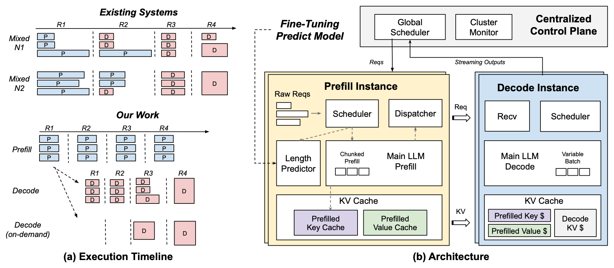
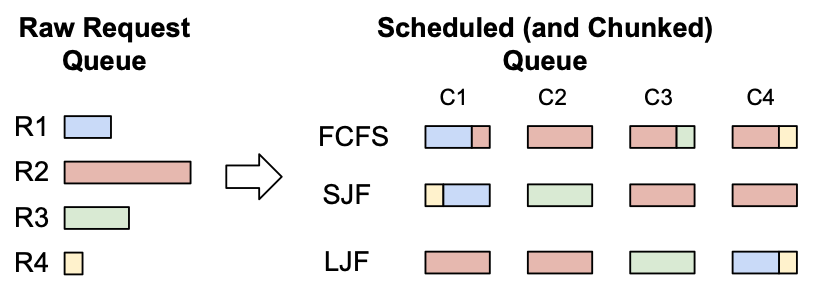
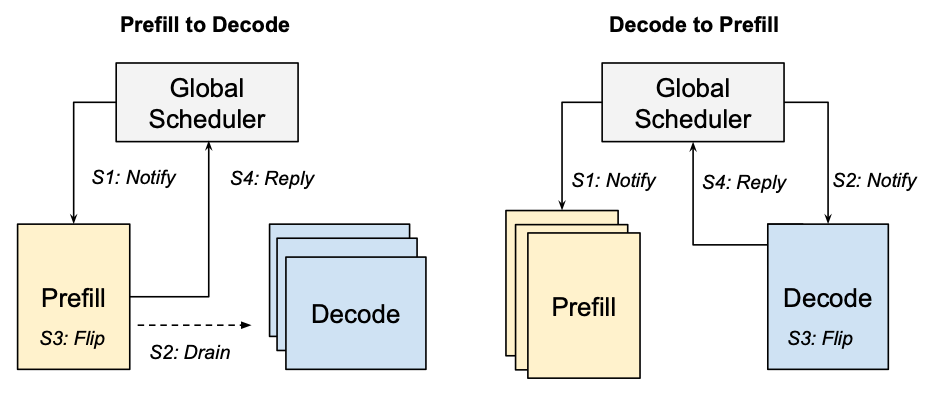

# Inference without Interference: Disaggregate LLM Inference for Mixed Downstream Workloads

arXiv 预印本（[arXiv:2401.11181](https://arxiv.org/abs/2401.11181)）。

作者：Cunchen Hu¹²、Heyang Huang¹²、Liangliang Xu³、Xusheng Chen³、Jiang Xu³、Shuang Chen³、Hao Feng³、Chenxi Wang¹²、Sa Wang¹²、Yungang Bao¹²、Ninghui Sun¹²、Yizhou Shan³（¹中国科学院大学，²中国科学院计算技术研究所，³华为云）

## 动机和挑战

不同下游任务的输入与输出长度相差逾两个数量级，共置混跑会在三个层面引发严重的性能干扰。多个 prefill 请求合批一旦超过硬件算力饱和点，短请求的 prefill 延迟可劣化 $10\times$ 以上。在连续批处理中混入单条长 prefill 请求，便会使延迟敏感的单步 decode 耗时暴涨 $5\times$。不同生成长度的 decode 请求盲目同批也会加剧显存争用与队头阻塞；静态划分专属集群成本过高，亟需按请求特征解耦调度。

## 整体架构

如图所示，TetriInfer 将推理集群虚拟解耦为专职的 prefill 实例与 decode 实例，以避免跨阶段干扰并支持负载均衡。系统由中心化控制面、prefill 实例、decode 实例与长度预测模型四个核心模块组成。控制面中的集群监控器定期汇总各实例状态，并将 decode 负载广播给所有 prefill 实例。全局调度器仅将新请求发往最空闲的 prefill 实例并流式回传输出，目标 decode 实例的选择则交由各 prefill 实例去中心化完成。

## Prefill 调度与分块执行

如图所示，TetriInfer 通过请求排序与固定块切分，在不引入额外排队惩罚的前提下打满 prefill 阶段算力。本地调度器支持先进先出、最短作业优先与最长作业优先策略，并限制单次参与排序的窗口大小以消除饥饿。排序后的序列被切分拼接为等于算力饱和阈值的固定块逐块前向计算，末尾不足部分补零对齐。区别于混合分块方案，每个计算块内仅包含纯 prefill token，从源头杜绝了对 decode 阶段的干扰。

## 长度预测与两级 Decode 调度

TetriInfer 利用轻量级长度预测指导跨实例与实例内两级调度，从而消除 decode 热点与显存颠簸。每个 prefill 实例与主模型并行运行一个小型分类模型，将预计生成长度归入固定宽度的区间桶以估算显存上下界。跨实例分发时，dispatcher 先筛出显存充足的候选实例，再用 power-of-two 算法挑选接纳后长短请求比例最均衡的 decode 实例发送 KV Cache。实例内调度在分页显存管理之上采用工作集感知的预留策略，仅在预计显存余量充足时准入新请求，避免后续迭代耗尽显存触发换出。

## 实例角色动态翻转

如图所示，TetriInfer 支持在线翻转实例角色，以在固定硬件规模下适应混合负载的剧烈波动。由于两类实例共享同一套模型权重，控制面检测到某类实例持续低负载时即可触发角色切换。prefill 转 decode 只需停止派发并排空本地队列，decode 转 prefill 则需先通知所有 prefill 实例停止转发再排空在途任务。切换本身仅修改进程内部状态而无需重载权重，在常见混合负载下较 vLLM 将平均首字延迟与作业完成时间分别降低 85% 和 50%。
