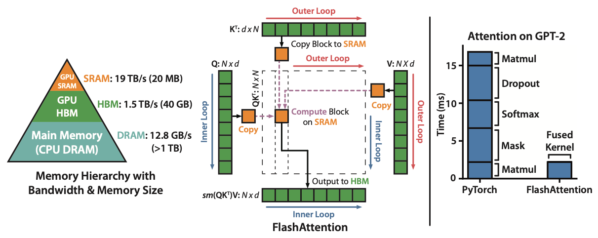

# FlashAttention: Fast and Memory-Efficient Exact Attention with IO-Awareness

发表于 NeurIPS '22（[arXiv:2205.14135](https://arxiv.org/abs/2205.14135)）。

作者：Tri Dao¹、Daniel Y. Fu¹、Stefano Ermon¹、Atri Rudra²、Christopher Ré¹（¹Stanford University，²University at Buffalo）

## 动机和挑战

FlashAttention 从减少显存读写而非削减浮点计算量入手，解决了长序列精确注意力的速度与显存瓶颈。现代 GPU 的算力增速远超显存带宽，注意力算子主要受限于访存开销。标准实现必须将尺寸随序列长度二次方增长的中间注意力矩阵反复读写至片外 High-Bandwidth Memory（HBM），并保存至反向传播。现有近似注意力虽降低了计算复杂度，但因忽略了数据搬运开销，往往难以取得实际加速。

## 分块计算与在线 Softmax

如图所示，FlashAttention 利用分块计算将全部注意力子操作融合进单个 CUDA kernel，避免了中间注意力矩阵落盘 HBM。GPU 片上 SRAM 带宽比片外 HBM 高出一个数量级，但容量远小于 HBM。算法在外层循环将键值矩阵分块加载至 SRAM，在内层循环分块加载查询矩阵并在片上完成矩阵乘、softmax、dropout 与加权求和。针对行向 softmax 耦合整行元素的问题，算法为每个分块维护局部最大值与指数和并递推重缩放历史输出，在 GPT-2 注意力计算上取得最高 7.6 倍加速。

## 反向传播重计算

反向传播通过在片上重计算注意力矩阵替代从 HBM 读取中间激活，将额外显存占用降至序列长度的线性级别。算法在前向传播中仅保存最终输出、每行的归一化统计量以及随机数生成器状态，不再存储庞大的注意力矩阵与 dropout 掩码。反向传播分块加载输入张量至 SRAM 后，直接结合统计量当场恢复注意力权重并完成梯度归约。尽管重计算略微增加了浮点运算量，但因大幅消除了慢速 HBM 读写，反向传播实际运行反而显著变快。

## IO 复杂度分析

理论分析表明，FlashAttention 相比标准注意力大幅降低了 HBM 访存次数，并在渐近意义下达到精确注意力的访存下界。设序列长度为 $N$、头维度为 $d$、片上 SRAM 容量为 $M$，其前向与反向传播的 HBM 访存复杂度均为：

$$
\Theta\left(\frac{N^2 d^2}{M}\right)
$$

由于典型硬件下头维度的平方远小于 SRAM 容量，该算法相比标准注意力可减少最高约 9 倍的 HBM 读写。论文同时证明不存在在任意 SRAM 容量下渐近优于该界的精确注意力算法，并在 GPT-2 端到端训练中相比 HuggingFace 实现最高 3 倍加速。

## Block-Sparse FlashAttention

将分块内核扩展为跳过全零分块的近似原语，可使稀疏注意力的理论复杂度优势转化为实际运行加速。Block-Sparse FlashAttention 根据预定义的块级稀疏掩码，在循环中直接跳过零块的数据加载与片上计算。其 HBM 访存量随非零分块占比成比例下降，配合结构化稀疏掩码即可降至次二次方级别。该方法比稠密 FlashAttention 再快 2 至 4 倍，并将 Transformer 可训练的序列长度推进至 64K。
