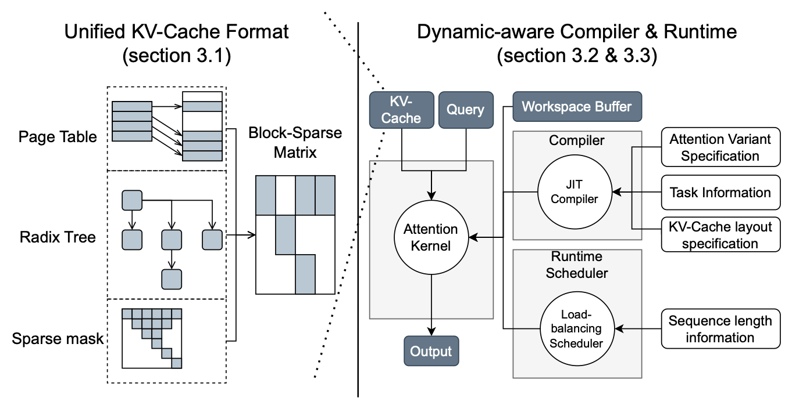
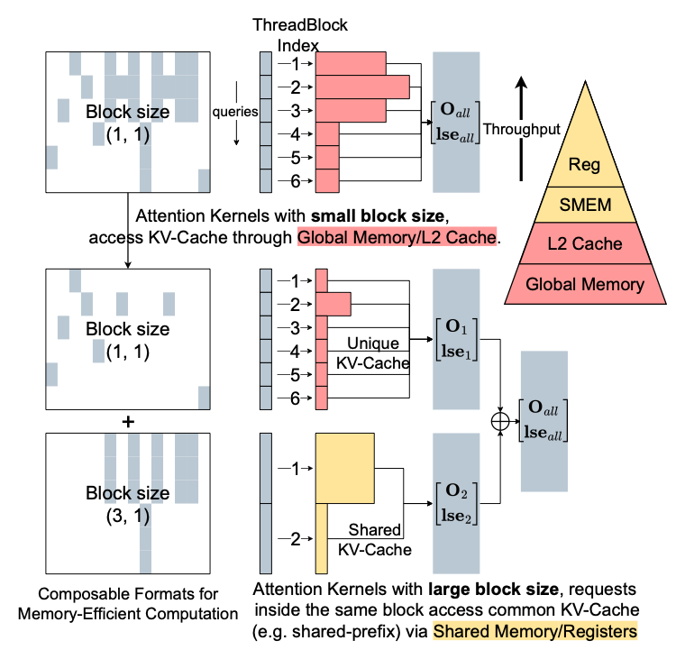
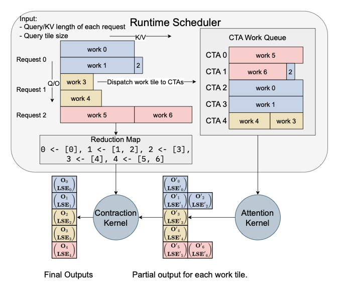

# FlashInfer: Efficient and Customizable Attention Engine for LLM Inference Serving

发表于 MLSys '25（[arXiv:2501.01005](https://arxiv.org/abs/2501.01005)）。

作者：Zihao Ye¹²、Lequn Chen³、Ruihang Lai⁴、Wuwei Lin²、Yineng Zhang⁵、Stephanie Wang¹、Tianqi Chen²⁴、Baris Kasikci¹、Vinod Grover²、Arvind Krishnamurthy¹、Luis Ceze¹²（¹University of Washington，²NVIDIA，³Perplexity AI，⁴Carnegie Mellon University，⁵独立研究者）

## 动机和挑战

LLM 推理服务中的注意力计算同时面临工作负载动态性与软硬件异构性两重挑战。一方面，prefill、decode、前缀共享与投机树解码并存，batch 内序列长度差异悬殊，极易造成 SM 负载失衡。另一方面，页表、radix tree 与稀疏掩码等 KV Cache 布局各异，叠加 GQA、RoPE 融合等注意力变体与多代 GPU 架构差异，逐一维护手写 kernel 成本极高。

## 整体架构

如图所示，FlashInfer 将异构 KV Cache 统一表示为块稀疏矩阵，在编译期由 JIT 编译器生成定制 kernel，在运行期按序列长度动态调度任务。集成至 SGLang、vLLM 等引擎后，端到端 Inter-Token Latency（ITL）降低 29%–69%。为支持分块并行归约，系统同时保存局部注意力输出 $\mathbf{O}$ 与对数指数和 $\mathrm{LSE}$，按满足交换律与结合律的算子合并两个不相交 KV 子集：

$$
\mathbf{O}(\mathcal{I} \cup \mathcal{J}) = \frac{e^{\mathrm{LSE}(\mathcal{I})}\mathbf{O}(\mathcal{I}) + e^{\mathrm{LSE}(\mathcal{J})}\mathbf{O}(\mathcal{J})}{e^{\mathrm{LSE}(\mathcal{I})} + e^{\mathrm{LSE}(\mathcal{J})}}
$$

任意切分的局部注意力结果均可通过各自的 $\mathrm{LSE}$ 重加权，无损合成为完整注意力输出。

## 块稀疏与可组合格式

如图所示，FlashInfer 用无填充的 ragged tensor 打包变长 query，并用支持任意块尺寸的 Block Compressed Sparse Row（BSR）矩阵统一表达页表、radix tree 与稀疏掩码。针对共享前缀形成的局部稠密结构，可组合格式无需搬移物理 KV Cache，仅通过重建索引将矩阵拆分为大行块前缀子矩阵与小行块后缀子矩阵。同块请求在高速 shared memory 与寄存器中复用公共前缀，独有后缀经全局显存读取后再合并状态，使并行生成加速 13%–17%。

## 可定制模板与 JIT 编译

FlashInfer 基于 CUDA/CUTLASS 为不同 GPU 架构提供 FlashAttention-2 与 FlashAttention-3 模板。访存阶段先用异步拷贝指令将非连续全局显存中的稀疏块聚集到连续 shared memory，再复用稠密 Tensor Core 流水线，并按平均 query 长度与片上资源约束自动选择 tile 尺寸。用户可通过 query、key、logits、mask 等自定义 functor 声明注意力变体，由 JIT 编译器注入模板生成融合算子，在 StreamingLLM 长上下文推理中降低 28%–30% 延迟。

## 负载均衡调度

如图所示，运行时调度器将超长 KV 序列切分为多个工作块，按长度降序贪心分配给负载最低的 Cooperative Thread Array（CTA），并生成确定性的归约映射表。系统采用 Inspector-Executor 模式，将 CPU 端跨层复用的 `plan` 与 GPU 端执行的 `run` 解耦。注意力计算与分块归约融合为网格大小固定的单一 persistent kernel。调度计划与中间结果均写入固定偏移的 workspace buffer，从而在变长输入下兼容静态 CUDAGraph。
