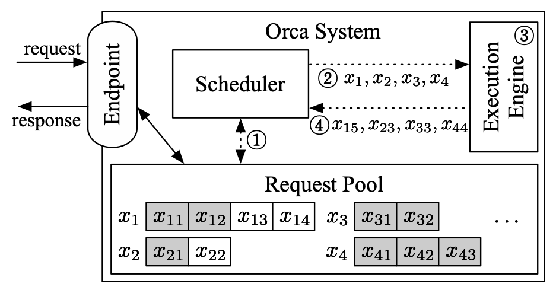
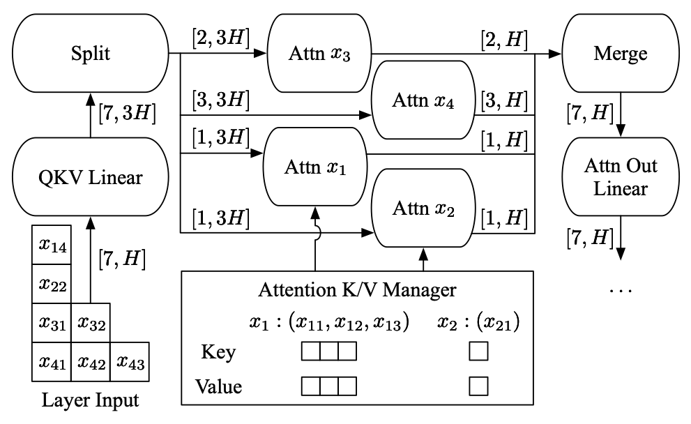
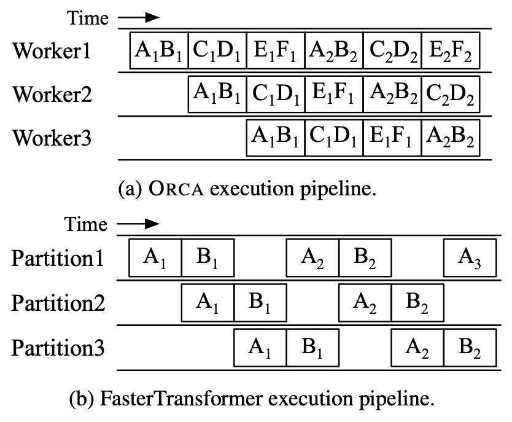

# Orca: A Distributed Serving System for Transformer-Based Generative Models

发表于 [OSDI '22](https://www.usenix.org/conference/osdi22/presentation/yu)。

作者：Gyeong-In Yu¹、Joo Seong Jeong¹、Geon-Woo Kim¹²、Soojeong Kim²、Byung-Gon Chun¹²（¹Seoul National University，²FriendliAI）

## 动机和挑战

传统请求级批处理无法适应自回归模型的变长多轮生成特性，会造成严重的尾延迟与算力浪费。生成式 Transformer 处理单个请求需先在 initiation 阶段并行编码全部输入 token，再经多轮 increment 阶段逐个生成输出 token。现有推理系统一旦组好批次便固定成员运行，直到批内最长的请求生成完毕才统一返回。提前结束的请求既无法及时响应客户端又持续产生无效计算，而新到达的请求也必须等待整个当前批次执行完毕。

## 迭代级调度与系统架构

如图所示，ORCA 将调度粒度从请求级细化至单轮迭代级，使请求能够按轮次动态进出执行批次。客户端请求经 Endpoint 进入 Request Pool 托管，Scheduler 在每轮前向计算前从池中选出一组活跃请求交由 Execution Engine 执行单轮迭代。引擎每生成一步输出 token 便立即交回调度器更新请求状态。已完成生成的请求可当即移出请求池并返回客户端，新到达的请求也只需等待当前单轮迭代结束即可加入后续批次。

## 选择性批处理

如图所示，选择性批处理仅对非注意力算子合并批次，解决了迭代级调度下异构状态请求无法常规批处理的难题。同一轮迭代中的请求往往处于不同阶段或拥有不同长度的历史上下文，无法拼成规则的三维批次张量。ORCA 将批内所有待处理 token 展平为二维张量，统一送入线性层与归一化层以跨请求复用模型权重，仅在 Attention 前通过 Split 按请求拆分。各请求结合 Attention K/V Manager 维护的历史键值独立完成注意力计算后再经 Merge 合并，因 Attention 不含模型参数，拆分执行几乎不损失访存效率。

## 分布式执行引擎

ORCA 通过解耦控制面与数据面通信通道，消除了多机多卡推理在每轮迭代中的 CPU-GPU 同步开销。系统结合层内张量并行与层间流水线并行切分大模型，由每个 Worker 进程负责一个层间分区并驱动组内多张 GPU。传统分布式引擎复用 NVIDIA Collective Communications Library（NCCL）传递控制元数据，每轮迭代都会触发同步阻塞。ORCA 改用 gRPC 在主节点与各 Worker 控制器之间异步转发调度消息，仅用 NCCL 在 GPU 间传输中间激活，在 GPT-3 175B 微基准中降低最高 47% 的引擎耗时。

## 调度算法与流水线并行

如图所示，迭代级调度使流水线无需切分微批次即可消除空闲气泡，同时通过显存预留机制避免运行死锁。调度器按 First-Come-First-Served（FCFS）顺序选取请求，并在请求首次准入时按其最大长度一次性预留键值显存槽位，兼顾显存利用率与死锁防护。在多层间分区的流水线上，调度器连续注入与分区数相等的迭代批次使所有 Worker 持续满载，避免了 FasterTransformer 因切分 microbatch 带来的批处理效率下降与流水线气泡。在 GPT-3 175B 端到端评测中，ORCA 在同等延迟下实现了 FasterTransformer 36.9 倍的吞吐。
