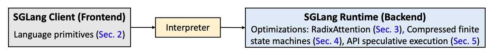
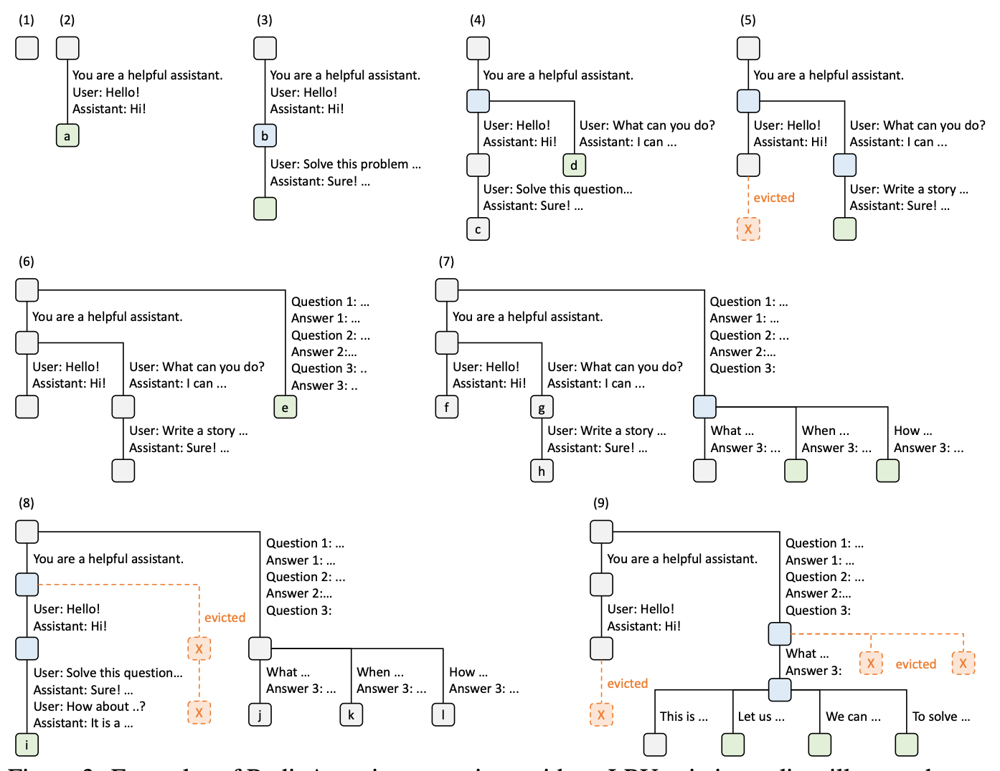
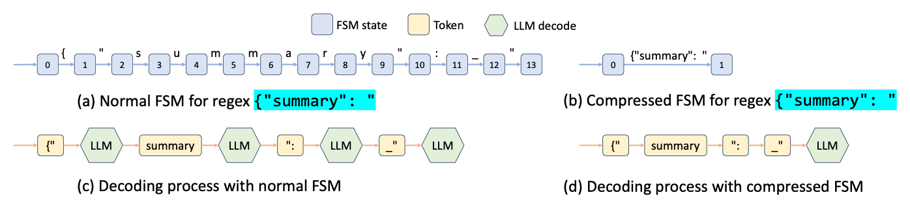

# SGLang: Efficient Execution of Structured Language Model Programs

发表于 NeurIPS '24（[arXiv:2312.07104](https://arxiv.org/abs/2312.07104)）。

作者：Lianmin Zheng¹、Liangsheng Yin²、Zhiqiang Xie³、Chuyue Sun³、Jeff Huang⁴、Cody Hao Yu⁵、Shiyi Cao¹、Christos Kozyrakis³、Ion Stoica¹、Joseph E. Gonzalez¹、Clark Barrett³、Ying Sheng³（¹UC Berkeley，²上海交通大学，³Stanford University，⁴Texas A&M University，⁵独立研究者）

## 动机和挑战

Agent、多轮推理与少样本学习等应用常包含多次依赖的 LLM 调用、控制流和结构化输出，构成复杂的语言模型程序。编程层面，开发者需手动编写繁琐的字符串拼接、输出解析与并发控制代码。执行层面，现有推理引擎在请求结束后即丢弃 KV Cache 而无法跨调用复用前缀，且约束解码每步只能生成单个 token。

## 整体架构与编程模型

如图所示，SGLang 由嵌入 Python 的前端原语、解释器与后端运行时协同组成，吞吐最高提升 6.4 倍、延迟最高降低 3.7 倍。前端提供 `extend`、`gen`、`select` 等生成原语及 `fork`、`join` 并行原语。解释器将每个 prompt 状态抽象为异步 stream，非阻塞地提交原语操作以发掘程序内并行性，仅在读取生成结果时阻塞同步。

## RadixAttention

如图所示，RadixAttention 在请求结束后保留 prompt 与生成结果的 KV Cache，在 CPU 端用 radix tree 维护 token 序列到分页 KV Cache 的映射。该缓存与运行中的 batch 共享同一显存池，支持节点动态分裂及前端 `fork` 前缀提示。显存不足时，系统按 LRU 策略优先淘汰引用计数为 0 的叶子节点，从而保留多分支共享的公共祖先前缀。

## 缓存感知调度

等待队列较长时，频繁切换无关请求会导致缓存抖动并降低命中率。SGLang 改按匹配的共享前缀长度降序调度等待请求。当缓存容量不小于最大请求长度时，该顺序等价于对请求 radix tree 执行深度优先遍历，使离线批处理的 KV Cache 总计算量 $C$ 达到理论下界：

$$
C = \sum_{e \in \mathrm{edges}(T)} |e|
$$

树中每条边 $e$ 的 KV Cache 仅在首次进入子树时计算一次，在线场景下平均可达理论最优命中率的 96%。

## 压缩有限状态机

如图所示，传统正则约束解码将语法转为字符级 Finite State Machine（FSM）并逐 token 屏蔽非法词表，固定字符串仍需多次前向传播。SGLang 递归合并仅有唯一后继与单一接受字符的转移边，构建压缩 FSM。解码遇到压缩边时在单次前向传播中直接跳步追加整段确定性文本，并调用原始 tokenizer 重新分词以对齐词表边界，使 JSON 解码吞吐提升 1.6 倍。

## API 投机执行

面向 GPT-4 等黑盒 API 模型时，连续多次 `gen` 原语若逐个发起调用，会对相同上下文重复计费并叠加网络延迟。SGLang 在首次 API 调用时忽略终止条件，投机多生成若干后续 token 缓存在解释器中。后续原语可直接匹配并复用缓存结果，在多字段抽取任务上将输入 token 成本降低约 3 倍。
