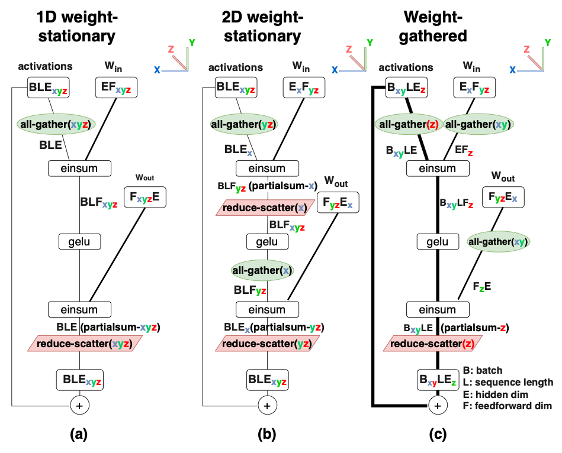
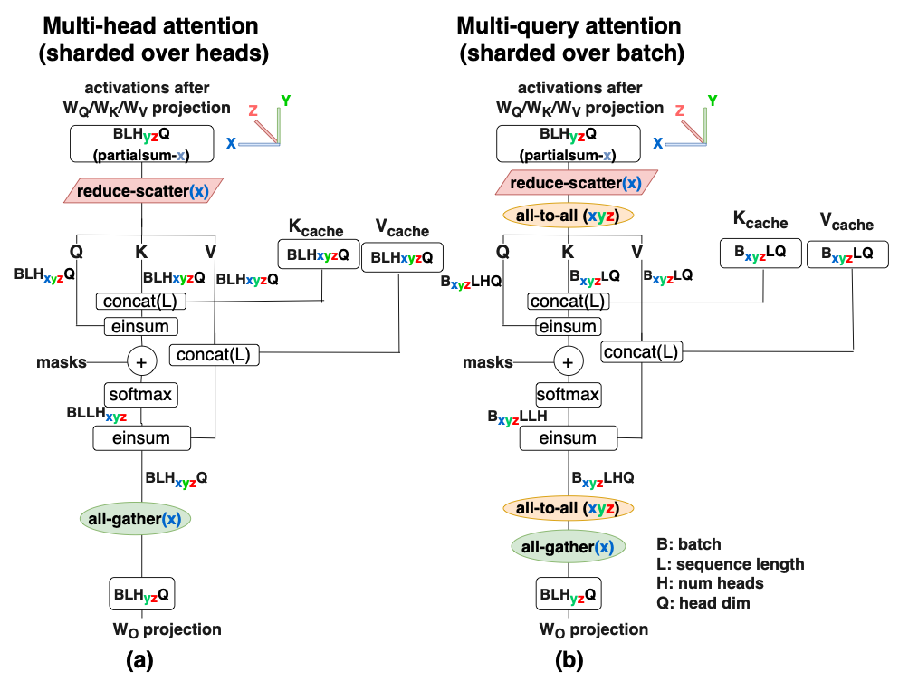

# Efficiently Scaling Transformer Inference

发表于 MLSys '23（[arXiv:2211.05102](https://arxiv.org/abs/2211.05102)）。

作者：Reiner Pope、Sholto Douglas、Aakanksha Chowdhery、Jacob Devlin、James Bradbury、Anselm Levskaya、Jonathan Heek、Kefan Xiao、Shivani Agrawal、Jeff Dean（Google）

## 动机和挑战

百亿至五千亿参数模型的生成式推理受限于显存容量、High-Bandwidth Memory（HBM）带宽与跨芯片通信开销。推理分为并行处理输入序列的 prefill 阶段和逐 token 串行生成的 decode 阶段，两阶段的计算与访存特征截然不同。小规模批次下延迟主要由权重读取主导，大规模批次与长上下文下则转向 KV Cache 读取主导，其容量甚至可超过模型参数本身。多芯片切分虽能分摊计算与访存，但集合通信随芯片数增加难以下降，因此需建立解析模型按阶段选择切分策略。

## 前馈层多维切分

如图所示，系统根据单步处理的 token 总量在 TPU v4 的三维拓扑上切换三种前馈层切分布局。(a) 1D weight-stationary 仅沿单一维度切分权重，每层聚合完整激活，通信耗时不随芯片数增加而缩减。(b) 2D weight-stationary 同时沿输入与输出维度切分权重并交替聚合激活分片，通信耗时随芯片数平方根反比下降，在超过 16 张芯片时优于一维切分，适合单步 token 少的 decode 阶段。(c) weight-gathered 复用相同的初始权重布局以支持阶段间零开销切换，在大规模 prefill 阶段保持激活驻留并改为跨芯片收集权重，使 PaLM 540B 的 Model FLOPS Utilization（MFU）达到 76%。

## Multi-Query Attention 按 Batch 切分

如图所示，在 decode 阶段将 Multi-Query Attention（MQA）改为按 batch 维切分，可充分释放其显存带宽优势。MQA 让所有查询头共享单一键值头以成倍缩小 KV Cache，但若沿用 (a) 多头注意力的按头切分，每张芯片仍需完整复制该键值头而抵消访存收益。(b) 按 batch 切分方案在投影前后通过 `all-to-all` 重排单步小激活，使每张芯片仅存储并读取各自批次分片的 KV Cache。该布局将单芯片 KV Cache 读取量按芯片数成比例缩减，使 PaLM 540B 支持的最大上下文长度提升 32 至 64 倍，而 prefill 阶段因键值读取由长序列均摊仍保留按头切分。

## 并行层结构与底层优化

协同模型层结构、通信重叠与权重量化可进一步压低大模型生成延迟。PaLM 采用注意力层与前馈层并行计算再求和的结构，既融合了输入与输出投影矩阵，又将每层跨芯片归约通信次数减半。底层执行使用 Looped CollectiveEinsum 将集合通信与矩阵乘流水重叠，相比编译器默认调度获得约 1.4 倍加速。结合 int8 权重量化减半小批次下的权重加载耗时，PaLM 540B 在 64 张芯片上实现了 29 ms/token 的生成延迟。
