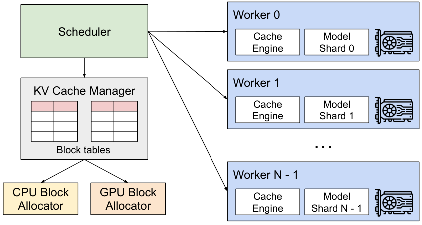
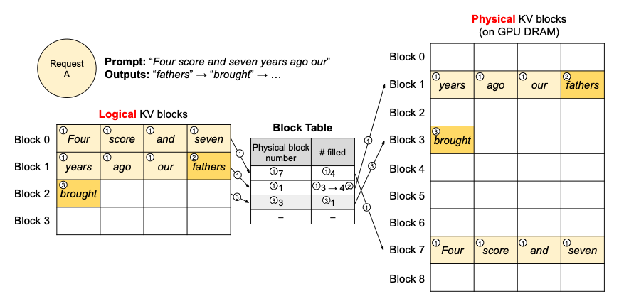
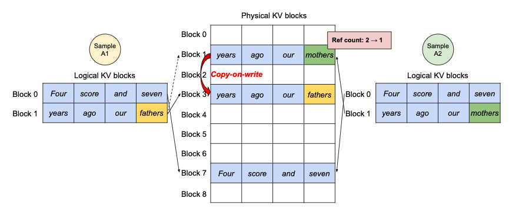

# Efficient Memory Management for Large Language Model Serving with PagedAttention

发表于 SOSP '23（[arXiv:2309.06180](https://arxiv.org/abs/2309.06180)）。

作者：Woosuk Kwon¹、Zhuohan Li¹、Siyuan Zhuang¹、Ying Sheng¹²、Lianmin Zheng¹、Cody Hao Yu³、Joseph E. Gonzalez¹、Hao Zhang⁴、Ion Stoica¹（¹UC Berkeley，²Stanford University，³独立研究者，⁴UC San Diego）

## 动机和挑战

LLM 自回归解码受显存容量限制，吞吐取决于单次 batch 能容纳的请求数。现有系统受限于连续张量假设，只能按请求最大长度预分配连续的 KV Cache 显存。由于输出长度未知，这种分配方式造成严重的预留闲置与内外碎片，有效显存利用率仅 20.4%–38.2%。此外，独立的连续空间也阻碍了同一请求多条序列或跨请求之间的前缀共享。

## 整体架构与 PagedAttention

如图所示，vLLM 由集中式 scheduler 统一管理 block table 与显存分配器，协调分布式 GPU worker 执行。相比 FasterTransformer 和 Orca，系统在相同延迟下将推理吞吐提升 2–4 倍。核心算法 PagedAttention 借鉴操作系统分页机制，将 KV Cache 切分为固定容纳 $B$ 个 token 的非连续块 $K_j$、$V_j$ 并按块计算注意力：

$$
A_{ij} = \frac{\exp(q_i^\top K_j / \sqrt{d})}{\sum_{t=1}^{\lceil i/B \rceil} \exp(q_i^\top K_t \mathbf{1} / \sqrt{d})}, \quad o_i = \sum_{j=1}^{\lceil i/B \rceil} V_j A_{ij}^\top
$$

查询向量 $q_i$ 依次读取非连续物理显存中的键块计算注意力分数 $A_{ij}$，再对值块加权求和得到输出 $o_i$。

## 块级 KV Cache 管理

如图所示，vLLM 通过 block table 维护每个请求的逻辑块到物理块的映射及已填充槽位数。prefill 阶段仅分配容纳输入 prompt 所需的物理块，decode 阶段优先写入末尾块的空闲槽位，写满后才按需申请新块。等大块与按需分配彻底消除了外部碎片，并将每个请求的内部碎片限制在单个块以内。

## 解码共享与写时复制

如图所示，parallel sampling 中多条采样序列将共享 prompt 映射到同一组物理块，并通过引用计数跟踪共享状态。当某条序列需修改引用计数大于 1 的末尾块时，系统触发块级 Copy-on-Write（CoW），分配新物理块拷贝原内容并将原块引用计数减 1。该机制同样支持跨请求的公共前缀复用，并在 beam search 动态分支共享中节省最高 66.3% 的 KV Cache 显存。

## 抢占调度与状态恢复

请求负载超出显存容量时，vLLM 按先来先服务原则调度，并以 sequence group 为粒度整组驱逐最晚到达请求的物理块。状态恢复支持 swapping 与 recomputation 两种方式。前者将物理块换出至 CPU 内存并在显存空闲后换回，后者在重调度时将已生成 token 拼回 prompt 单次并行重算。

## 分布式执行

多 GPU 场景采用 Megatron-LM 风格的张量并行，各 worker 按注意力头切分模型但处理相同的 token 序列。集中式 scheduler 只需维护单一 KV Cache manager，每步开始时向全体 worker 广播输入 token 与共用 block table。各 worker 独立存放对应注意力头的物理块数据并通过 all-reduce 同步激活值，无需额外的显存协调通信。
