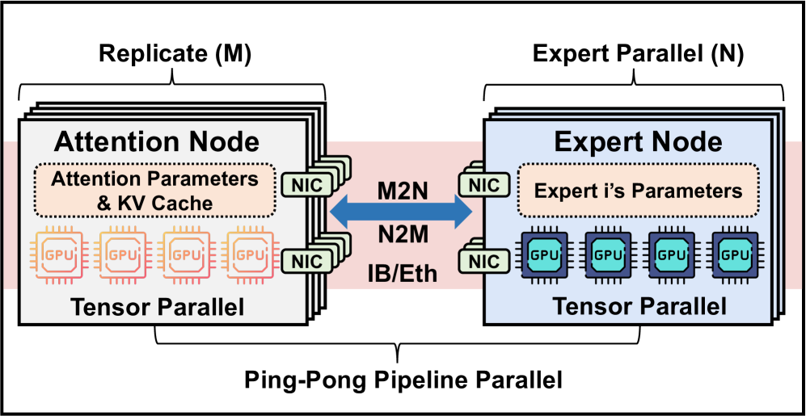
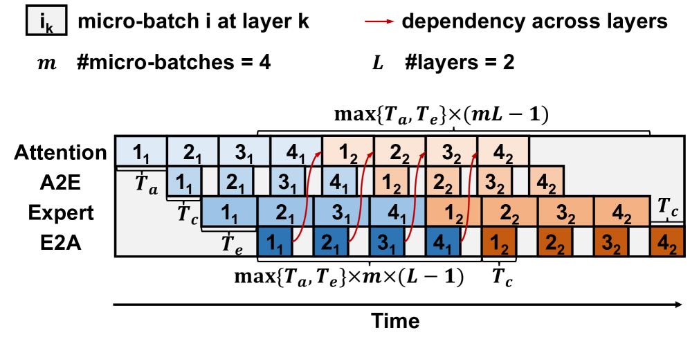
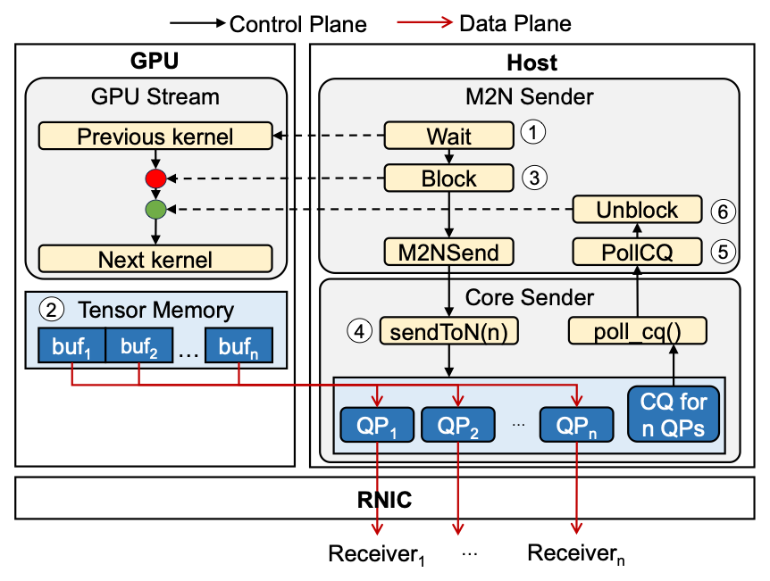

# MegaScale-Infer: Efficient Mixture-of-Experts Model Serving with Disaggregated Expert Parallelism

发表于 [SIGCOMM '25](https://dl.acm.org/doi/10.1145/3718958.3750506)。

作者：Ruidong Zhu¹²、Ziheng Jiang¹、Chao Jin¹²、Peng Wu¹、Cesar A. Stuardo¹、Dongyang Wang¹、Xinlei Zhang¹、Huaping Zhou¹、Haoran Wei¹、Yang Cheng¹、Jianzhe Xiao¹、Xinyi Zhang¹、Lingjun Liu¹、Haibin Lin¹、Li-Wen Chang¹、Jianxi Ye¹、Xiao Yu¹、Xuanzhe Liu²、Xin Jin²、Xin Liu¹（¹字节跳动 Seed，²北京大学）

## 动机和挑战

MoE 的稀疏激活使 decode 阶段的 FFN 从计算密集退化为访存受限，导致 GPU 利用率低下。decode 阶段中 attention 需逐请求读取 KV Cache 而受限于显存带宽，dense 模型通常靠增大 batch 复用 FFN 权重来打满算力。然而 MoE 每层仅激活少数专家，分摊到单个专家的 token 数大幅减少，而延迟约束与 KV Cache 显存上限又限制了全局 batch 的扩大。若将 attention 与 FFN 拆到不同节点独立扩缩容，还会引入跨节点串行等待，并将 all-to-all 路由变为动态的 M2N 通信。

## 整体架构

如图所示，MegaScale-Infer 将 decode 实例内每层的 attention 与 FFN 解耦到独立节点，构成解耦专家并行。attention 节点采用数据并行复制权重并维护各自的 KV Cache，expert 节点采用专家并行分别持有不同专家参数，两类节点内部均使用张量并行。通过汇聚多个 attention 副本的请求，expert 节点可拼出足够大的有效 batch 以恢复计算密集特性。两类节点之间通过定制的 M2N 通信库收发激活，并配合乒乓流水线隐藏跨节点等待。

## 乒乓流水线并行

如图所示，MegaScale-Infer 将全局请求切分为 $m$ 个 micro-batch，在 attention 节点、expert 节点与双向网络之间交替推进以消除空闲等待。设单个 micro-batch 在两类节点的计算耗时分别为 $T_a$ 和 $T_e$，记 $T_f = \max\{T_a, T_e\}$，单向通信耗时为 $T_c$，掩盖通信并消除跨层气泡需满足：

$$
T_a \approx T_e, \qquad T_c < T_f, \qquad m T_f \ge 2(T_f + T_c)
$$

上述条件要求两类节点计算耗时匹配、单次通信快于计算，且单层总计算时间足以覆盖单个 micro-batch 往返一层的延迟。

## 部署规划与异构硬件适配

MegaScale-Infer 在满足 Time-Between-Tokens（TBT）延迟约束下搜索单位成本吞吐最高的并行与硬件配置。规划器枚举显存允许的节点内张量并行度，利用算子性能模型按计算时间均衡原则确定 attention 副本数，再二分搜索满足延迟上限的最大全局 batch。解耦架构还允许为访存密集的 attention 节点配置高带宽大显存 GPU，为计算密集的 expert 节点配置高性价比算力 GPU。该设计在同构集群上最高提升 1.90 倍单卡 decode 吞吐，在异构部署下将单位流量服务成本降低 1.5–2.0 倍。

## 高性能 M2N 通信

如图所示，MegaScale-Infer 构建了精简同步路径的 M2N 通信库，消除了 NCCL 在点对点分组通信中的代理拷贝与同步抖动。发送端待前序 kernel 写满预注册显存后阻塞 stream，由主机侧发起 GPUDirect RDMA 写入并轮询 Completion Queue（CQ）唤醒后续计算。接收端轮询完成后经 GDRCopy 刷新显存，全程不占用 GPU SM 资源。通信库还将确认报文隔离至高优先级队列并微调拥塞控制以应对专家负载倾斜，相比 NCCL 提升 4.2 倍吞吐并降低 68.2% 中位延迟。
