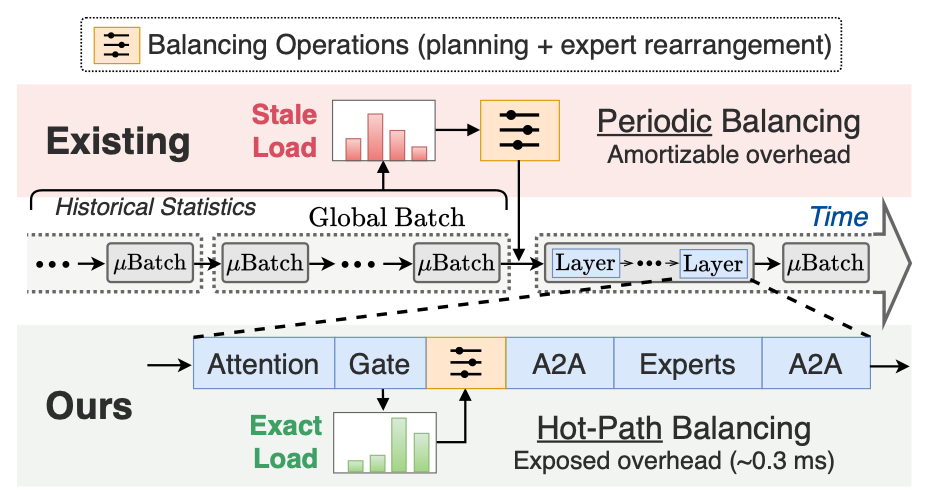
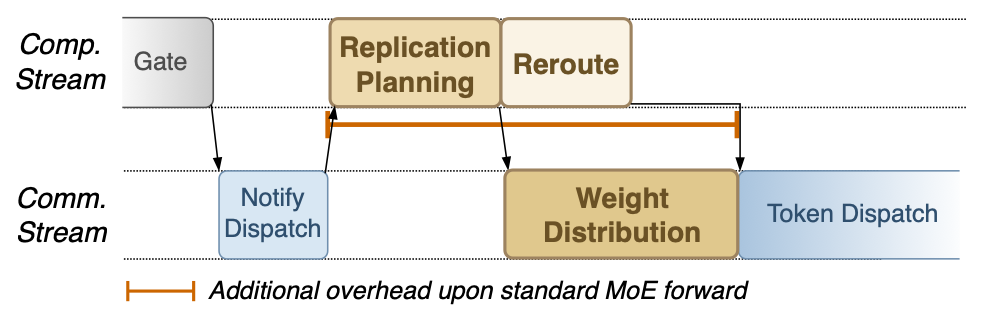
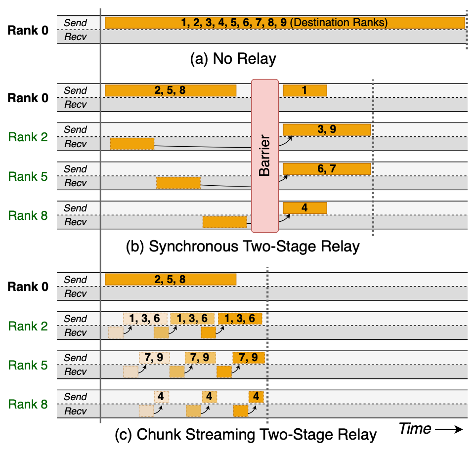

# UltraEP: Unleash MoE Training and Inference on Rack-Scale Nodes with Near-Optimal Load Balancing

arXiv 预印本（[arXiv:2606.04101](https://arxiv.org/abs/2606.04101)）。

作者：Xinming Wei¹、Chao Jin¹、Tuo Dai²、Yinmin Zhong¹、Shan Yu³、Chengxu Yang⁴、Bingyang Wu¹、Zili Zhang¹、Jing Mai¹、Qianchao Zhu⁴、Zhouyang Li⁴、Yuliang Liu⁴、Guojie Luo¹（¹北京大学，²小红书，³上海人工智能实验室，⁴独立研究者）

## 动机和挑战

如图所示，UltraEP 放弃基于历史负载的周期性专家重排，改在每层门控之后依据精确负载于关键路径上实时均衡。大规模专家并行下，动态路由会引发跨卡慢节点与显存尖峰，而 EPLB 等依赖历史统计的方案在负载突变时容易失准。机柜级超节点 Rack-Scale Node（RSN）以高带宽 scale-up 互联覆盖数十张 GPU，使整个专家并行组内热路径均衡的暴露开销仅约 0.3 ms。这要求控制面在极短窗口内解出复制方案，并由数据面高效传输稀疏动态的专家状态。

## 专家布局与计算通信流水线

如图所示，UltraEP 采用“只复制、不重排”的槽位布局，将规划与权重分发紧凑嵌入前反向流水线并大幅压缩冗余显存。每个 rank 固定保留主专家槽位与少量冗余槽位，冗余槽位不存优化器状态并在所有 MoE 层之间复用同一份权重与梯度缓冲区。前向阶段复用路由元数据获取精确负载，各卡在 GPU 上独立求出相同方案，并发完成权重分发与重路由后再分发 token。反向阶段复用前向缓存的方案，在权重梯度计算期间重叠恢复冗余权重，并在输入梯度算完后将副本梯度归约回主专家。

## 配额驱动的联合规划

UltraEP 以各物理实例的最终负载配额为耦合变量，在单个 GPU SM 内联合求解专家复制与 token 重路由。设 rank $r$ 上主专家的初始总负载为 $\ell_r$，对于候选负载上界 $\tau$，各卡需迁出的超额负载与可接纳的余量定义为：

$$
\mathrm{exc}_r(\tau) = \max(\ell_r - \tau,\, 0), \qquad \mathrm{slk}_r(\tau) = \max(\tau - \ell_r,\, 0)
$$

规划器对 $\tau$ 执行二分搜索，每次探测按超额负载降序贪心将热点主专家的流量划拨给余量最大的可用卡，并设置最小配额下限以剔除低效副本。配额确定后，重路由优先用本地 token 抵扣本卡配额以减少跨卡流量，再按剩余配额比例切分跨卡请求。

## 持久化分块流式传输

UltraEP 通过持久化分块流式 kernel 隐藏动态传输的控制开销，充分打满 RSN scale-up 带宽。系统将专家权重与梯度切分为固定大小的 tile 并编译为设备端任务流，由常驻线程块借助共享内存双缓冲流水化执行单边读写。该 kernel 还按重叠窗口调节常驻线程块规模，在前向关键路径占满带宽，在反向重叠路径限制资源占用以避免干扰并发算子。

## 面向热点扇出的分块流式中继

如图所示，UltraEP 采用无全局屏障的分块流式两级中继，消除了单个热点主专家向多卡复制时的源端扇出瓶颈。当专家副本数超过阈值时，系统挑选当前发送负载最轻的部分副本卡作为一级中继，并将剩余叶子副本均衡挂载其下以分摊出向流量。数据按连续若干 tile 组成的 chunk 流式推进，一级中继收齐单个 chunk 后立即向叶子节点转发，使专家权重分发较主流通信后端提速 3.1–5.5 倍。在最高 256 卡集群上，UltraEP 将跨卡不均衡度从 1.30–4.01 压至 1.01–1.04，在训练与 prefill 推理上平均达到理想均衡吞吐的 94.3%。
