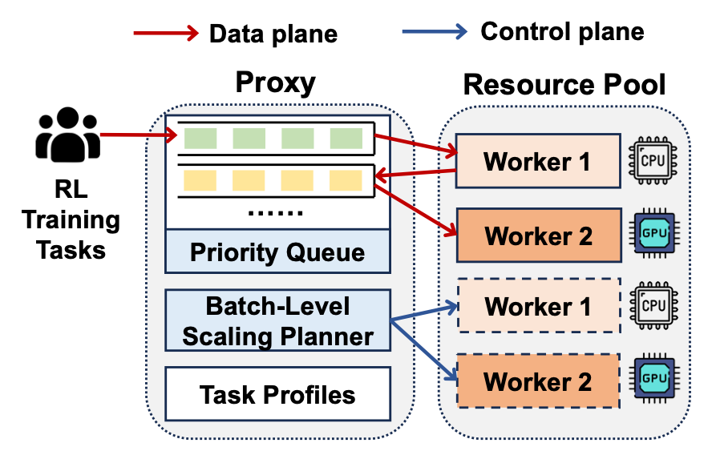
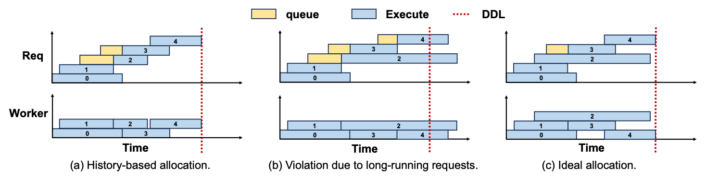

# DistRS: Disaggregated Reward Service for RLVR with Batch-Level Constraint

发表于 [NSDI '26](https://www.usenix.org/conference/nsdi26/presentation/zhu-ruidong)。

作者：Ruidong Zhu¹、Mingcong Han²、Yinmin Zhong¹、Wencong Xiao²、Xuanzhe Liu¹、Xin Jin¹（¹北京大学，²字节跳动 Seed）

## 动机和挑战

Reinforcement Learning with Verifiable Rewards（RLVR）通过代码编译与运行测试等可验证流程计算奖励，资源消耗规模接近训练本身，促使奖励计算解耦为独立服务。真实 CUDA 代码生成任务的奖励负载具有强动态性，共置训练阶段和 rollout 初期无请求到达，随后请求骤增并拖出明显长尾。随着模型在训练中逐步学会通过语法与编译检查并进入 GPU 执行，单轮迭代消耗的 CPU 和 GPU 机时持续攀升。同时死循环等异常输出直至触发超时才终止，个体耗时无法事前预测，使静态资源配置要么闲置浪费，要么阻塞训练。

## 请求级弹性与 Batch 级约束

DistRS 利用奖励服务逐条到达、整批返回的交互特征，将单请求延迟目标松弛为整批延迟约束以换取调度弹性。rollout 自回归生成使样本错峰完成并逐条发往奖励服务，但训练阶段必须等当前 batch 全部奖励返回后才能启动。设请求 $i$ 的 rollout 完成时间为 $r_i$、第 $j$ 阶段奖励执行时间为 $s_{ij}$，整批奖励无排队时的最早完成时间为：

$$
T = \max_i \left(r_i + \sum_j s_{ij}\right)
$$

其中决定 $T$ 的最晚完成请求为关键请求，仅关键请求必须零排队执行，其余请求只需在 $T$ 前完成即可灵活排队而不拖慢训练。

## 整体架构

如图所示，DistRS 由中心 Proxy 与弹性 Resource Pool 组成，支持多个 RLVR 训练任务以多租户模式共享服务。Resource Pool 以容器化微服务承载各奖励阶段的异构 worker，分别使用 CPU 编译代码与独占 GPU 执行核函数，支持按阶段独立扩缩容。Proxy 在数据面为各阶段维护优先级队列以缓冲和派发请求，在控制面依托历史任务画像运行批级扩缩容规划器。训练器在每轮 rollout 启动时提前发信通知，使 Proxy 在首条奖励请求到达前完成扩缩容与 worker 预热以隐藏冷启动开销。

## 单任务资源扩缩容

如图所示，(a) 纯按历史耗时分配最少 worker 时，(b) 新批次中触发超时的慢请求会因排队突破截止线 DDL，(c) 适度补充 worker 避免高风险排队即可满足约束。利用相邻 batch 到达曲线相似的性质，DistRS 按阶段单价从高到低依次在历史轨迹上执行模拟二分查找，搜索满足整批额外延迟上限的最少 worker 数。为应对无法预知的异常慢请求，模拟器引入超时感知校验，对排队请求按当前时刻加上后续阶段超时阈值估算最坏完成时间。一旦该最坏时间超出整批截止线，模拟器便判定当前配额不足并增加 worker，以少量资源余量防止慢请求拖累训练进度。

## 多任务共享与批优先级调度

多训练任务共享奖励服务时各任务的 batch 周期相互交错，DistRS 结合跨任务采样重规划与批级优先级调度提升资源复用率。每当有 batch 到达或完成，系统汇总未到达、排队中与运行中三类活跃请求，从历史数据条件采样估计剩余阶段耗时以更新配额。针对不同任务当前 batch 紧迫度不一的问题，各阶段队列采用 Earliest Batch First（EBF）策略，优先调度所属 batch 预期最早完成时间更近的请求。在并发 CUDA 代码生成训练任务上，DistRS 将奖励服务 GPU 机时最高降低 3.79 倍、CPU 机时最高降低 2.16 倍，单批平均额外延迟不足 1 秒。
