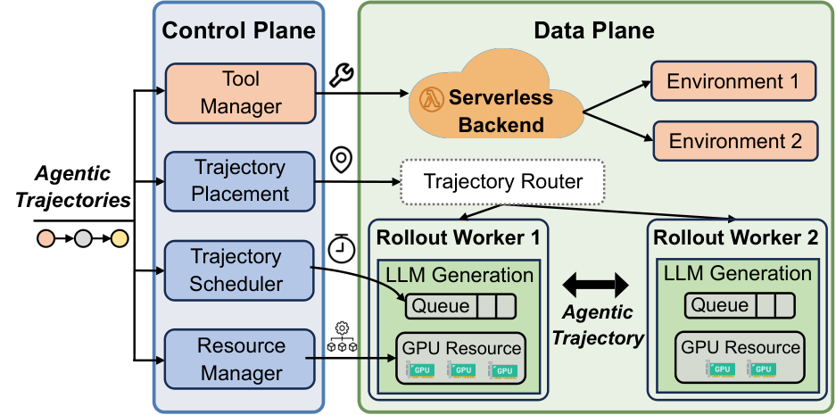
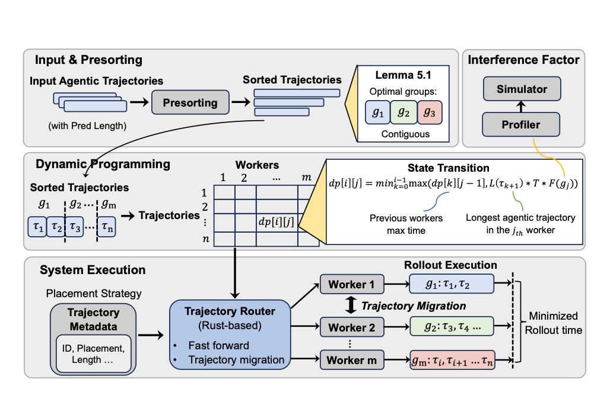
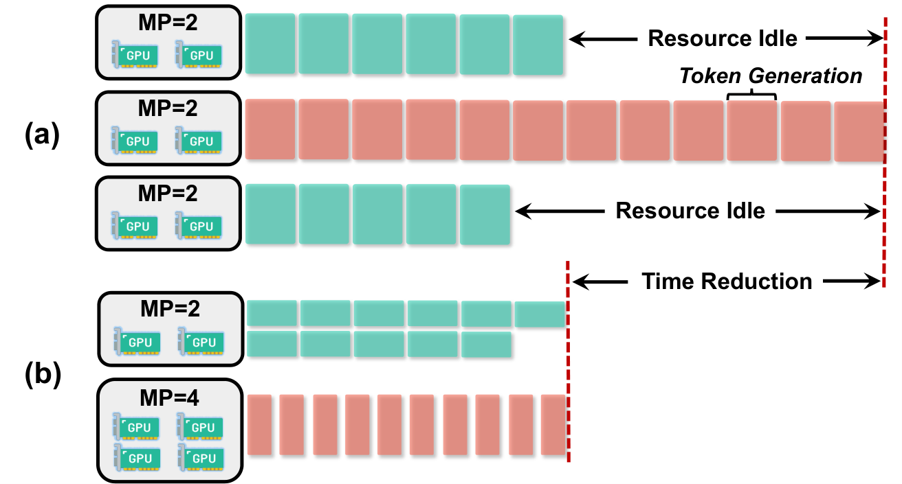

# Heddle: A Distributed Orchestration System for Agentic RL Rollout

arXiv 预印本（[arXiv:2603.28101](https://arxiv.org/abs/2603.28101)）。

作者：Zili Zhang¹、Yinmin Zhong¹、Chengxu Yang²、Chao Jin¹、Bingyang Wu¹、Xinming Wei¹、Yuliang Liu²、Xin Jin¹（¹北京大学，²独立研究者）

## 动机和挑战

Agentic RL 在 rollout 阶段由 LLM 与外部工具多步交互生成轨迹，占训练总耗时的 80% 以上，少数复杂长尾轨迹严重拖慢整批进度。批次 $\mathcal{T}$ 中最慢轨迹耗时超过中位数 4 倍，主导整批 rollout 完成时间：

$$
T = \max_{i \in \mathcal{T}} \left(T_{\text{queue}}^{(i)} + N_{\text{tokens}}^{(i)} \cdot T \cdot \alpha^{(i)} + T_{\text{tool}}^{(i)}\right)
$$

等式右侧依次为轨迹 $i$ 的累计排队延迟 $T_{\text{queue}}^{(i)}$、token 数 $N_{\text{tokens}}^{(i)}$、无竞争单 token 基础耗时 $T$、并发争用干扰系数 $\alpha^{(i)}$ 与工具耗时 $T_{\text{tool}}^{(i)}$。现有框架以单步请求为中心，丢失轨迹上下文，使调度退化为轮询并令多步长尾轨迹在每次工具返回后重排入队尾累积延迟。同时静态缓存亲和放置易致负载失衡，按步最少负载路由又将长尾轨迹与短轨迹混批放大干扰，同构并行配置也难以兼顾高吞吐与低延迟。

## 整体架构

如图所示，Heddle 采用控制面与数据面解耦的以轨迹为中心架构，协同优化轨迹执行的调度时机、放置位置与并行资源配置。控制面维护全局状态，由轨迹调度器、轨迹放置器、资源管理器以及基于弹性 serverless 后端编排外部环境的工具管理器组成。数据面包含异构并行配置的 Rollout Worker 与轨迹路由器，交替执行模型推理与工具调用，并利用工具执行释放 GPU 的窗口异步迁移 KV Cache。数据面同时向控制面流式回传轨迹上下文、工具耗时与缓存占用，闭环驱动运行期长度预测与调度更新。

## 轨迹级渐进优先级调度

Heddle 通过运行期渐进轨迹预测与抢占式优先级调度，消除长尾轨迹跨多步累积的排队延迟。高采样温度与动态工具反馈使同组轨迹长度分化显著，系统在历史上下文样本上微调轻量回归模型预测剩余长度。预测推理在每步工具执行期间异步完成，不占用关键路径，并随上下文累积单调提高识别精度。Progressive Priority Scheduling（PPS）据此近似执行最长处理时间优先准则，动态重排等待队列并在推理引擎中引入保留前缀 KV Cache 的低优先级请求抢占。

## 轨迹感知放置与迁移

如图所示，Heddle 结合初始预排序动态规划与运行期在线迁移，隔离长尾轨迹与大量短轨迹的混批干扰。当组干扰因子随并发轨迹数单调递增时，按预测长度降序排列的轨迹存在由连续子段构成的全局最优 worker 划分。控制面利用该连续性先验通过预排序动态规划快速求解最小化全局完成时间的初始分组，并对短轨迹聚合以压缩问题规模。运行期预测排序变化时，路由器按剩余活跃轨迹比例缩放各组容量以定位目标节点，趁工具调用窗口经 GPUDirect RDMA 并行迁移无端点冲突的 KV Cache。

## 轨迹自适应资源管理

如图所示，(a) 同构模型并行配置使短轨迹提前完成后等待慢速解码的长尾轨迹，(b) Heddle 引入异构并行配置缩短整批完成时间。系统为延迟敏感的长尾轨迹分配高模型并行度以压缩单 token 基础耗时，为吞吐受限的短轨迹分配低模型并行度以保持高并发效率。资源管理器将降序轨迹分组与降序并行度 worker 确定性对齐，再通过排序初始化模拟退火在重分配、拆分与合并扰动下搜索近优 GPU 划分。在代码、搜索与数学三类 Agentic RL 负载上，Heddle 相比现有最优系统取得最高 2.5 倍的端到端 rollout 吞吐提升。
