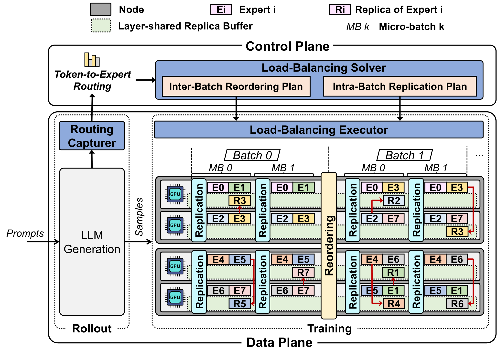
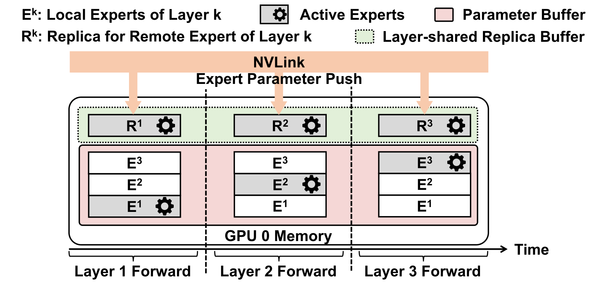

# ReLibra: Routing-Replay-Guided Load Balancing for MoE Training in Reinforcement Learning

arXiv 预印本（[arXiv:2605.08639](https://arxiv.org/abs/2605.08639)）。

作者：Chao Jin¹、Xinming Wei¹、Yinmin Zhong¹、Chengxu Yang²、Bingyang Wu¹、Ruidong Zhu¹、Zili Zhang¹、Yuliang Liu²、Xin Jin¹（¹北京大学，²独立研究者）

## 动机和挑战

采用跨节点 Expert Parallelism（EP）的 MoE 模型在 RL 后训练中面临剧烈波动的微批次负载失衡，使依赖历史负载统计的预训练均衡方案失效。RL 训练聚焦特定或混合窄领域且移除了负载均衡辅助损失，相邻 micro-batch 间超过半数热点专家发生切换，单层前向耗时增至均衡路由的 1.4 倍。与此同时，rollout 与训练阶段使用相同参数处理同一批 token 序列，使系统可通过路由重放在训练开始前获知精确的专家路由决策。为规避频繁跨节点重排的高昂通信代价，ReLibra 按分层网络带宽将问题解耦为 batch 间跨节点专家重排与 batch 内节点内动态专家复制。

## 整体架构

如图所示，ReLibra 采用控制面与数据面协同架构，在训练关键路径之外完成微批次粒度的负载均衡规划与执行。数据面在 rollout 阶段通过路由捕获器逐 token 记录生成序列激活的专家编号，并异步拷回主机内存。控制面求解器与奖励计算和 KL 散度评估等 rollout 后处理并行运行，离线生成跨节点重排计划与节点内复制计划。进入训练阶段后，负载均衡执行器先按 batch 重排跨节点专家与样本分布，再在每个 micro-batch 中利用共享缓冲区于节点内动态复制热点专家。

## Batch 间专家重排

ReLibra 在训练 batch 边界重排跨节点专家与数据样本，在摊销跨节点重配置开销的同时实现批级粗粒度均衡。求解器汇总整批路由流量，结合集群分层网络的 NVLink 与 RDMA 带宽，联合最小化整个 EP 组的计算与通信瓶颈耗时：

$$
T_{\mathrm{MoE}} = \max_{g \in \mathcal{G}} T_g^{\mathrm{comp}} + \max_{g \in \mathcal{G}} T_g^{\mathrm{comm}}
$$

其中 $\mathcal{G}$ 为 EP 组 GPU 集合，$T_g^{\mathrm{comp}}$ 与 $T_g^{\mathrm{comm}}$ 分别为单卡专家计算时间与双向通信时间。算法以贪心放置为初值运行交换式模拟退火，用光滑函数消除嵌套最大值的平坦区，再交换样本提升数据局部性。

## 层间共享副本缓冲区

如图所示，ReLibra 设计层间共享副本缓冲区并重叠节点内同步与计算，以极低显存和通信开销支持微批次动态专家复制。由于前向传播逐层串行访问专家参数，每张 GPU 仅开辟少量副本槽位并跨所有 MoE 层循环覆盖复用，额外参数显存占比降至 0.13%–1.62%。前向计算前由源 GPU 经节点内 NVLink 将热点专家参数推送至目标卡的共享缓冲区，反向传播时再将副本梯度推回源卡累加。同步过程采用仅占少量 SM 的持久化异步传输 kernel，与注意力计算完全重叠而不干扰关键路径。

## 微批次专家复制规划

在跨节点专家布局固定后，ReLibra 为每个 micro-batch 的每一层联合规划节点内副本放置与连续 token 切分比例以吸收瞬时热点。系统在单卡副本槽位上限约束下将最小化微批次 MoE 耗时建模为 Mixed-Integer Linear Program（MILP），兼顾离散容量扩展与细粒度流量分配。为规避分支定界开销，增量贪心算法每轮为瓶颈卡上的最热专家在同节点最轻载卡加副本，再用线性规划求切分比例。在 30B 至 235B 规模 MoE 模型的多领域 RL 训练中，ReLibra 相比 Megatron-LM 提升训练吞吐最高 1.6 倍，达到理想均衡基线的 90%–94%。
