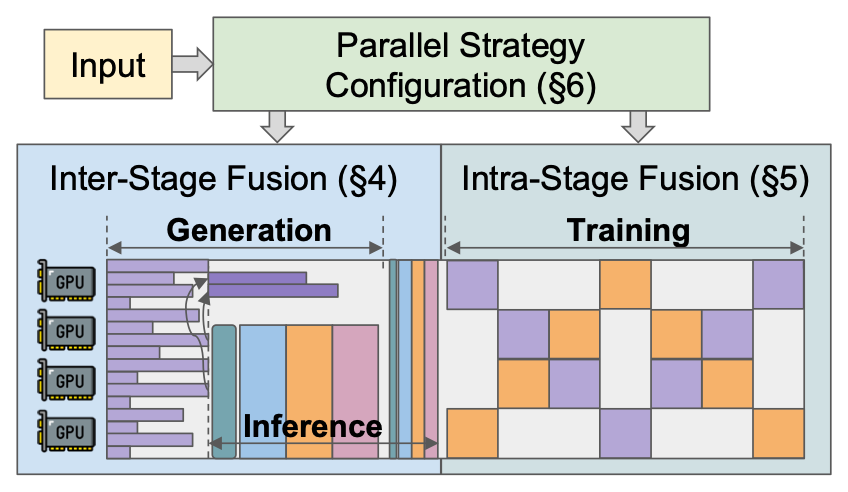
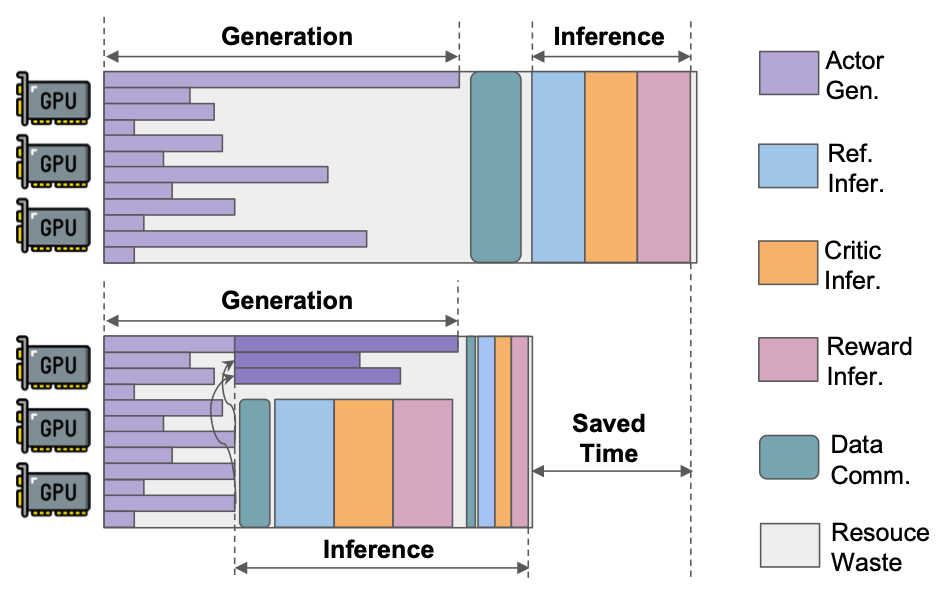
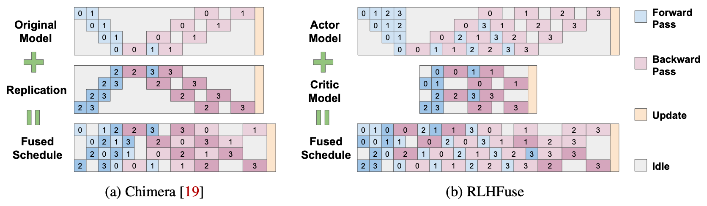

# Optimizing RLHF Training for Large Language Models with Stage Fusion

发表于 [NSDI '25](https://www.usenix.org/conference/nsdi25/presentation/zhong)。

作者：Yinmin Zhong¹、Zili Zhang¹、Bingyang Wu¹、Shengyu Liu¹、Yukun Chen²、Changyi Wan²、Hanpeng Hu²、Lei Xia²、Ranchen Ming²、Yibo Zhu²、Xin Jin¹（¹北京大学，²阶跃星辰）

## 动机和挑战

现有 RLHF 训练框架以完整 task 为最小调度单元，受困于生成阶段的长尾倾斜与训练阶段的流水线气泡。一轮 PPO 迭代依次串行执行 Actor 自回归生成、多模型前向推理评分以及 Actor 与 Critic 参数更新三个阶段。生成阶段样本长度呈显著长尾分布，P99.9 长度超过中位数的 10 倍，不足 1% 的长尾样本占去过半生成耗时并阻塞后续推理。训练阶段依赖大跨度流水线并行扩展大模型，而有限的 micro-batch 数导致高达约一半的 GPU 时间浪费在气泡上，两个模型串行训练进一步放大了空闲开销。

## 整体架构

如图所示，RLHFuse 将各阶段拆分为细粒度 subtask，通过跨阶段融合与阶段内融合提升整轮训练的 GPU 利用率。系统先基于性能模拟器为六个 RLHF task 分别选定最优三维并行策略，再按依赖关系调度执行。在生成与推理之间，系统按样本级 subtask 提前腾出空闲实例重叠运行前向推理。在训练阶段内部，系统按 micro-batch 级 subtask 将独立的 Actor 与 Critic 双向交错调度在同一组 GPU 上互补填充气泡。

## 数据感知的跨阶段融合

如图所示，RLHFuse 利用生成与推理仅在单样本内存在依赖的特性，集中迁移尾部样本并提前释放实例重叠执行推理。当未完成样本数降至阈值 $R_t$ 时，系统经 RDMA 将剩余样本连同 KV Cache 聚拢至 $m$ 个实例继续生成，其余实例立即切换运行推理。为保证迁移后单步 decode 不变慢且显存不溢出，目标实例数 $m$ 需满足：

$$
m \ge \max\!\left(\frac{R_t}{\mathit{BS}_{\max}},\, \frac{R_t \cdot M}{C}\right)
$$

其中 $\mathit{BS}_{\max}$ 为不拉长单步耗时的最大 decode batch，$M$ 为最长样本的 KV Cache 占用，$C$ 为单实例可用 KV Cache 显存。

## 模型感知的阶段内融合

如图所示，RLHFuse 通过异构双向流水线融合同时训练相互独立的 Actor 与 Critic，无需额外复制模型即可消除大部分气泡。当两模型张量并行度不同时，系统先合并较窄模型的连续流水线阶段以对齐单阶段 GPU 数，再将多组反向流水线映射到统一网格上。算法以优先调度大模型的贪心方案为初值，在数据依赖、无死锁和显存上限约束下执行两轮多核并行模拟退火。第一轮随机交换相邻 subtask 以最小化总耗时，第二轮在不劣化延迟的前提下继续搜索以压低峰值激活显存。

## 系统实现与优化

RLHFuse 基于 Megatron-LM 扩展多设备网格异步调度，并针对各阶段瓶颈引入工程优化。生成阶段集成 continuous batching 与 chunked prefill 加速自回归采样；推理阶段将 Generalized Advantage Estimation（GAE）的序列递归展开为单次矩阵乘法以减少小 kernel 开销。训练阶段按序列长度均衡切分数据并行负载，并在阶段切换时减少跨节点权重通信、将冻结模型常驻主机内存按需异步换入。在 256 卡集群上，RLHFuse 较现有 RLHF 系统最高提升 3.7 倍训练吞吐。
