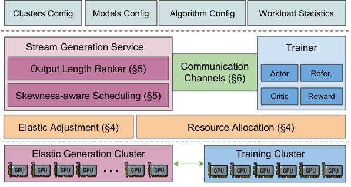
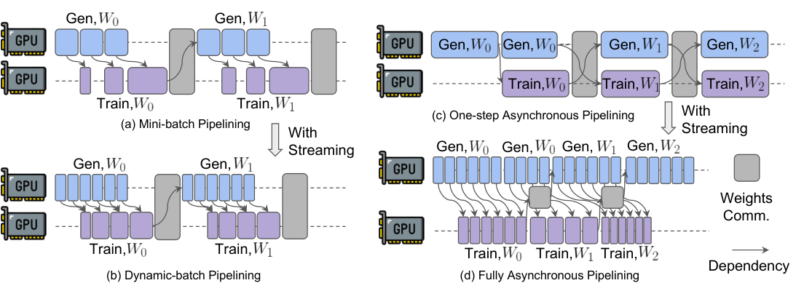
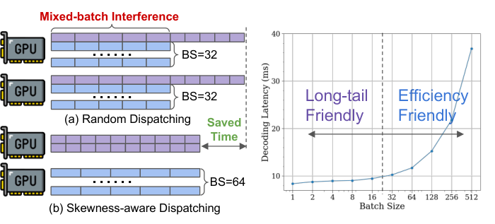

# StreamRL: Scalable, Heterogeneous, and Elastic RL for LLMs with Disaggregated Stream Generation

arXiv 预印本（[arXiv:2504.15930](https://arxiv.org/abs/2504.15930)）。

作者：Yinmin Zhong¹、Zili Zhang¹、Xiaoniu Song²、Hanpeng Hu²、Chao Jin¹、Bingyang Wu¹、Nuo Chen²、Yukun Chen²、Yu Zhou²、Changyi Wan²、Hongyu Zhou²、Yimin Jiang³、Yibo Zhu²、Daxin Jiang²（¹北京大学，²阶跃星辰，³独立研究者）

## 动机和挑战

LLM 的 RL 后训练串联在线生成与模型更新两个阶段，主流共置架构强制两阶段分时复用同一组 GPU，在大规模扩展时受制于资源耦合。生成阶段的 decode 受显存带宽限制，跨节点扩展加速很快饱和，而计算受限的训练阶段随算力扩展收益显著。共置架构既无法为生成阶段单独选用高带宽低成本的推理卡，也难以跨数据中心承受训练阶段的全连接集合通信开销。分离架构将两阶段解耦至独立硬件，但必须解决阶段串行依赖带来的流水线气泡与长尾输出导致的偏斜气泡。

## 整体架构

如图所示，StreamRL 将生成与训练阶段分别抽象为物理隔离的 Stream Generation Service（SGS）和 Trainer，支持单集群与跨数据中心异构部署。Trainer 下发提示词并回传新权重，SGS 每完成单条样本即以流式方式发回 Trainer，打破阶段间的整批同步屏障。内部结合输出长度排序器、偏斜感知调度与弹性资源管理，消除两阶段间的流水线空闲与长尾等待。跨阶段通信基于 GPUDirect RDMA 实现张量零拷贝直传，跨数据中心场景仅向远端单实例传一次权重再做本地广播。

## 流式重叠消除流水线气泡

如图所示，StreamRL 利用流式样本传输提升同步与异步 RL 的阶段重叠效率。同步 RL 的传统固定 mini-batch 流水线需攒满批次才启动训练，末尾长尾批次易溢出至生成结束后执行。StreamRL 改用动态 batch 流水线，样本一完成即送入 Trainer 先行计算参考模型前向与奖励，凑足饱和算力的样本量便立即训练。在允许一步陈旧度的全异步流水线中，流式缓冲使权重传输与下一轮训练和当前轮生成完全并行，将权重同步移出关键路径。

## 阶段均衡与弹性扩缩容

流式流水线的重叠效率取决于 SGS 与 Trainer 的执行耗时保持匹配。StreamRL 在训练前用性能剖析器建模各并行策略耗时，搜索最小化较慢阶段耗时的 GPU 配比，跨数据中心时则缩减较快阶段的冗余卡数。随着 RL 训练推进，模型输出长度自发增长，生成耗时的增幅显著快于训练阶段。由于重配 3D 并行的 Trainer 需重启运行时，系统持续监测两阶段耗时差，一旦达到新增单个生成实例可缩短的预期耗时便在线扩容 SGS。

## 偏斜感知调度消除长尾气泡

如图所示，随机分发将长尾样本与常规样本混批，大 batch 推高单步解码延迟拖慢长尾样本，后期仅剩少量长尾样本又造成 GPU 空转。StreamRL 在历史数据上用 SFT 微调轻量输出长度排序器，在训练前离线识别最长的 20% 长尾样本，召回率最高达 87%。调度器据此将单实例生成延迟建模为单步延迟、样本均长与执行轮数的乘积：

$$
\mathrm{Latency} = \mathrm{PTL}(\mathit{BS}) \times L_{\text{avg}} \times \left\lceil \frac{M}{\mathit{BS}} \right\rceil
$$

其中 $\mathrm{PTL}(\mathit{BS})$ 为受 KV Cache 显存限制的 batch size $\mathit{BS}$ 下的 Per-Token Latency（PTL），$L_{\text{avg}}$ 与 $M$ 为该实例样本的估计均长和数量。系统据此将长尾样本隔离至专用实例以小 batch 快速解码，常规样本以大 batch 保吞吐，端到端吞吐最高提升 2.66 倍。
