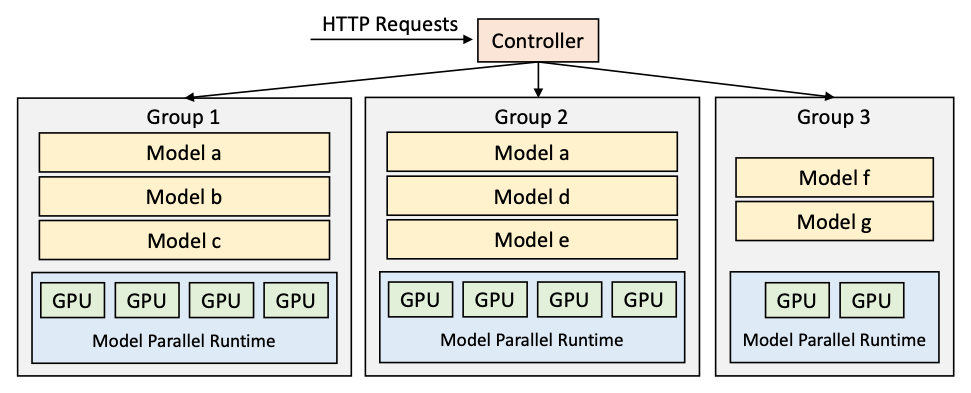
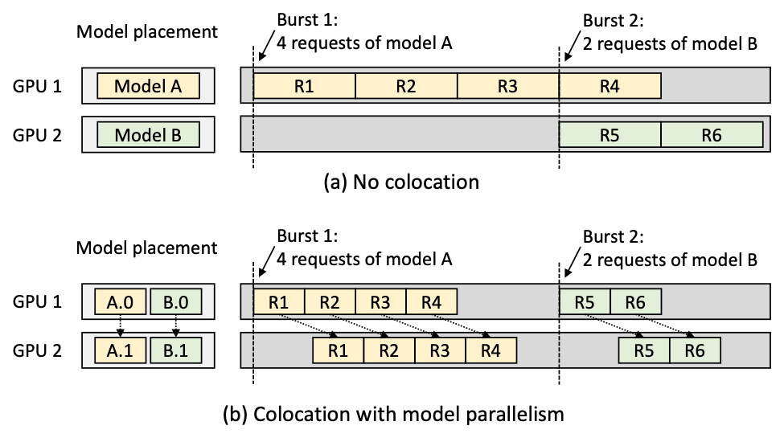

# AlpaServe: Statistical Multiplexing with Model Parallelism for Deep Learning Serving

发表于 [OSDI '23](https://www.usenix.org/conference/osdi23/presentation/li-zhouhan)。

作者：Zhuohan Li¹、Lianmin Zheng¹、Yinmin Zhong²、Vincent Liu³、Ying Sheng⁴、Xin Jin²、Yanping Huang⁵、Zhifeng Chen⁵、Hao Zhang⁶、Joseph E. Gonzalez¹、Ion Stoica¹（¹UC Berkeley，²北京大学，³University of Pennsylvania，⁴Stanford University，⁵Google，⁶UC San Diego）

## 动机和挑战

多模型在线推理同时受限于高显存占用与强突发流量，单靠整模型复制难以兼顾资源利用率与延迟 Service-Level Objective（SLO）。生产负载的瞬时请求峰值可达均值的 50×，而大模型权重从主机内存换入 GPU 耗时数秒，无法在关键路径上按需动态换入。传统系统仅在单模型超出单卡显存时才启用模型并行，导致单卡可放置的模型种类受限，突发流量下极易出现热点模型排队而其余 GPU 空闲的浪费。

## 整体架构

如图所示，AlpaServe 将集群划分为多个设备组，在组内共享的模型并行运行时上跨卡切分并共置多个模型副本以最大化 SLO 达成率。离线阶段，系统根据集群规格、模型集合与周期性历史流量画像，联合搜索单模型推理并行方案与跨组放置策略。运行时，中心 Controller 按最短队列策略将 HTTP 请求分发至持有目标副本的设备组，组内按先来先服务顺序执行并提前丢弃预计超时的请求。

## 模型并行统计复用与权衡分析

如图所示，即使单卡足以容纳完整模型，引入模型并行进行跨卡共置仍能通过统计复用显著降低突发请求延迟。双卡服务两模型时，独立放置下 4 个突发请求的平均耗时为 $2.5y$，而两阶段流水线共置即便引入 10% 开销仍可将平均耗时降至 $1.85y$。算子间流水线并行吞吐更高但受限于 stage 负载不均，算子内张量并行可缩短单请求延迟但集合通信开销更大。在总到达率 $\lambda$、单卡耗时 $D$ 且两模型流量均分的 M/D/1 排队模型下，无开销时两种放置的平均延迟分别为：

$$
W_{\mathrm{simple}} = D + \frac{\lambda D^2}{4 - 2\lambda D}, \quad W_{\mathrm{pipeline}} = D + \frac{\lambda D^2}{8 - 4\lambda D}
$$

可见两阶段流水线共置将平均排队时间减半，在单卡显存受限、到达率偏低、突发度较高或 SLO 较紧时显著优于纯复制。

## 推理自动并行

AlpaServe 针对前向推理改造自动并行编译器 Alpa 的算子间与算子内两级流程，以生成低开销的候选切分方案。由于前向推理无反向传播与梯度同步，算子间动态规划改为直接最小化最慢流水线 stage 的执行延迟。各层边界仅通信一次激活，因此只需逐层剖析并累加延迟，无需像训练那样重复剖析平方级层区间组合。算子内整数线性规划同时剔除数据并行选项，在 8 阶段流水线下相比按层数均分将总并行开销降低最高 46.7%。

## 模拟器引导的两级模型放置

AlpaServe 通过离散事件模拟器引导的两级搜索算法，在指数级组合空间中求解最大化 SLO 达成率的放置方案。外层算法先按延迟差异将模型分桶以消除护航效应，再枚举设备组划分与并行配置并剪除吞吐失衡的候选。内层算法迭代选择模型与设备组组合并用模拟器评估 SLO 达成率，同时提供优先放置未满足请求最多模型的快速启发式。在 64 卡集群评测中，AlpaServe 在保证 99% 以上请求满足 SLO 的前提下，最高可提升 10× 请求处理率或承受 6× 突发流量。
