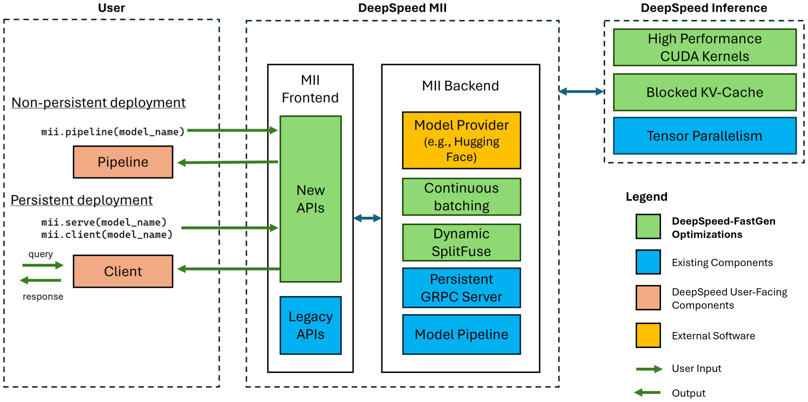
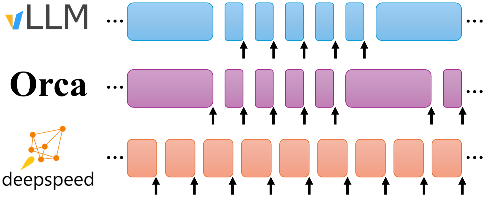

# DeepSpeed-FastGen: High-throughput Text Generation for LLMs via MII and DeepSpeed-Inference

arXiv 预印本（[arXiv:2401.08671](https://arxiv.org/abs/2401.08671)）。

作者：Connor Holmes、Masahiro Tanaka、Michael Wyatt、Ammar Ahmad Awan、Jeff Rasley、Samyam Rajbhandari、Reza Yazdani Aminabadi、Heyang Qin、Arash Bakhtiari、Lev Kurilenko、Yuxiong He（Microsoft）

## 动机和挑战

现有连续批处理系统在长 prompt 负载下难以兼顾高吞吐与平稳的流式生成延迟。尽管分块 KV Cache 与连续批处理消除了显存碎片和填充浪费，现有系统在处理并行 prompt 与逐 token 生成时仍存在阶段冲突。vLLM 与 TGI 在新请求到达时会挂起在途生成以优先处理完整 prompt，而 Orca 则将完整长度的长 prompt 直接并入运行批次。这两种策略都会在长 prompt 到来时造成流式输出长时间停顿，进而违反交互式服务的 Service Level Agreement（SLA）。

## 整体架构

如图所示，DeepSpeed-FastGen 由前端服务框架 DeepSpeed-MII 与底层推理引擎 DeepSpeed-Inference 协同构建。DeepSpeed-MII 提供持久化 gRPC 服务、多副本负载均衡以及集成连续批处理与 Dynamic SplitFuse 的调度后端。DeepSpeed-Inference 在设备侧提供非连续分块 KV Cache、张量并行以及融合注意力与 MoE 的高性能算子。在同时约束首 token 速率与流式生成速率的有效吞吐指标上，系统相比 vLLM 最高提升 2.3 倍有效吞吐，并将 token 级 P95 尾部延迟降低 3.7 倍。

## 前向性能洞察

Dynamic SplitFuse 的设计建立在单次前向传播的三项性能规律之上。首先，单步延迟主要由前向总 token 数决定而与序列条数无关，调度器只需以前向总 token 数作为单一控制信号。其次，模型吞吐随前向 token 数增加从访存受限陡峭过渡至算力受限的饱和区，使每次前向传播落在饱和区即可保持高效率。最后，对齐输入下的吞吐映射 $f(x)$ 为凹函数：

$$
2f(x) \ge f(x + h) + f(x - h)
$$

因此将固定总量的待处理 token 均匀切分到多次前向传播中执行，能够最大化整体吞吐。

## Dynamic SplitFuse 调度

如图所示，相比 vLLM 的抢占切换与 Orca 混入完整长 prompt 引发的耗时波动，Dynamic SplitFuse 使每次前向传播维持恒定的 token 规模。具体而言，系统将长 prompt 拆解为更小的块跨多轮前向传播调度，仅在最后一个块所在轮次产出首个生成 token。同时，多条短 prompt 会被拼接组合，必要时同样拆分部分短 prompt 以精确填满目标 token 预算并保证维度对齐。借此，每次前向传播都稳定运行在高吞吐饱和区且耗时高度一致，无需中断在途生成即可兼顾高吞吐与低延迟抖动。
