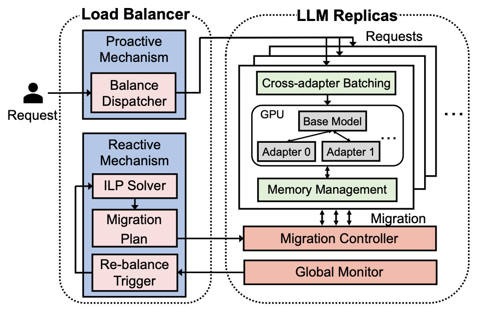
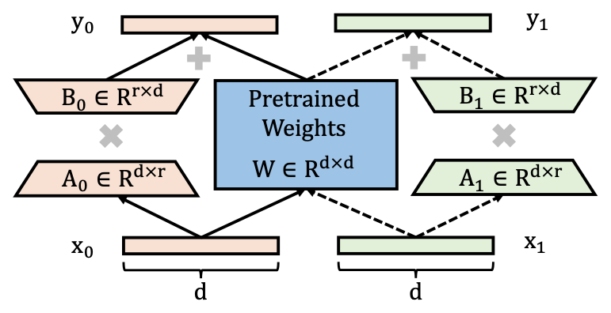
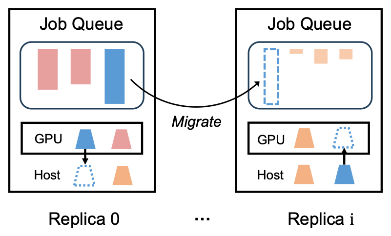

# dLoRA: Dynamically Orchestrating Requests and Adapters for LoRA LLM Serving

发表于 [OSDI '24](https://www.usenix.org/conference/osdi24/presentation/wu-bingyang)。

作者：Bingyang Wu¹、Ruidong Zhu¹、Zili Zhang¹、Peng Sun²、Xuanzhe Liu¹、Xin Jin¹（¹北京大学，²上海人工智能实验室）

## 动机和挑战

在共享基座 LLM 的多 Low-Rank Adaptation（LoRA）微调模型服务场景中，现有系统同时面临副本内算力浪费与跨副本负载失衡。合并推理（merged inference）虽无额外算子开销，但单次 batch 只能处理同一 adapter 请求，请求分散时 GPU 利用率低。非合并推理（unmerged inference）可跨 adapter 批处理基座计算，但 adapter 分支耗时达基座的 38.9%，请求集中时反而降低吞吐。跨副本层面，单实例显存仅能驻留部分 adapter，热点突发会导致副本间排队延迟差距高达 8.0×。此外，自回归请求的输入与输出长度差异悬殊，即便均匀分发仍会造成运行时间与 KV Cache 占用的严重倾斜。

## 整体架构

如图所示，dLoRA 通过副本内与跨副本两级动态编排协同调度请求与 LoRA adapter。每个工作副本内部由 Cross-adapter Batching 动态切换合并与非合并推理模式，并由 Memory Management 统一协调 adapter 与 KV Cache 的显存分配及主机内存换页。集群层 Load Balancer 结合基于历史规律的主动预加载分发，以及由 Global Monitor 触发、整数线性规划求解器规划的请求与 adapter 跨副本被动迁移。

## 动态跨 Adapter 批处理

如图所示，非合并推理将共享基座计算合并为批矩阵乘法 $W [x_0, x_1]$，同时并行计算各请求的低秩分支 $B_i A_i x_i$ 并求和以扩大有效 batch。dLoRA 每轮比较最多请求 adapter 的可合并批大小与先来先服务批大小之比，通过双阈值滞回区间动态决定合并或拆分。系统在周期断点处回溯历史请求并计入切换耗时，对比两种模式的实际吞吐以自适应微调切换阈值。为避免冷门请求饥饿，偏离先来先服务顺序时获益 adapter 需向被延迟方转移信用值，信用超限时强制优先调度。

## 主动分发与请求-Adapter 协同迁移

如图所示，dLoRA 结合主动分发与被动迁移，将长上下文聚集导致的过载副本请求连同所需 adapter 迁往轻载副本。主动阶段按长期负载预加载突发容忍度最低的 adapter，并在请求到达时综合排队与加载耗时发往预计等待最短的副本。当副本显存或排队延迟越界时，系统联合决策请求驻留位置 $x_{i,j}$（含主机换出项 $x_{i,j}^H$）与 adapter 放置 $y_{k,j}$ 以最小化最大副本完成时间：

$$
\min \max_j \sum_i \left(\gamma L_i x_{i,j} + \frac{M_i^R x_{i,j}^H}{B}\right) + \eta \sum_k y_{k,j}
$$

其中三项分别对应带迁移惩罚 $\gamma$ 的执行耗时、按状态大小 $M_i^R$ 与带宽 $B$ 折算的换页开销及同类请求亲和性项，且请求所在副本须加载对应 adapter。dLoRA 仅在过载与轻载各 top-$K$ 副本间作连续松弛的选择性迁移并通过传输历史 token 重建 KV Cache，在 32 卡集群延迟 Service-Level Objective（SLO）下相比 vLLM 与 PEFT 分别提升最高 57.9× 和 26.0× 吞吐，较 S-LoRA 降低最高 1.8× 平均延迟。
