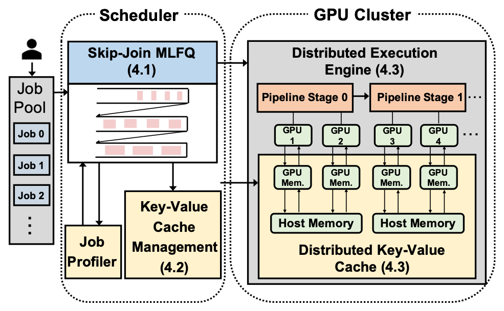
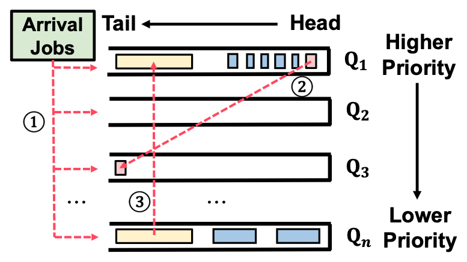
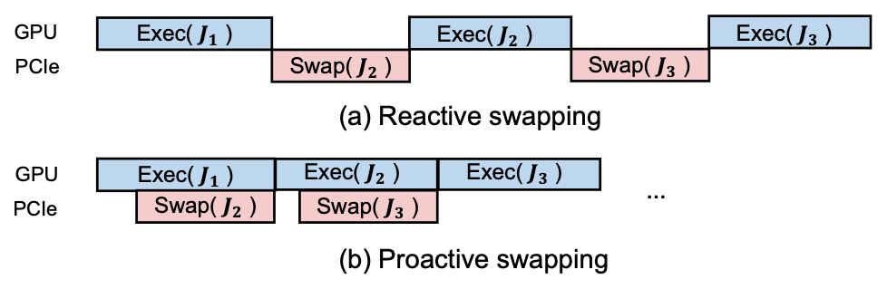

# FastServe: Iteration-Level Preemptive Scheduling for Large Language Model Inference

发表于 [NSDI '26](https://www.usenix.org/conference/nsdi26/presentation/wu-bingyang)。

作者：Bingyang Wu、Yinmin Zhong、Zili Zhang、Shengyu Liu、Fangyue Liu、Yuanhang Sun、Gang Huang、Xuanzhe Liu、Xin Jin（北京大学）

## 动机和挑战

现有 LLM 推理系统普遍采用 First-Come-First-Served（FCFS）与运行至完成策略，在真实长尾负载下存在严重的队头阻塞，排队延迟占端到端总延迟高达 90%。LLM 自回归生成每轮迭代仅产出一个输出 token，天然支持在单 token 粒度实施抢占式调度。然而迭代级抢占面临两项核心挑战：一是输出序列长度先验未知，无法直接应用经典的 Shortest Remaining Processing Time（SRPT）策略。二是系统必须保留所有挂起作业的 KV Cache，极易耗尽有限的 GPU 显存。

## 整体架构

如图所示，FastServe 由调度器与分布式 GPU 集群执行后端两部分组成。新到达作业经 Job Profiler 预测首轮耗时后进入 Skip-Join Multi-Level Feedback Queue（MLFQ）队列，调度器每轮按优先级选出一批作业交由执行引擎完成单步推理。KV Cache 管理模块在 GPU 显存与主机内存之间主动换入换出挂起作业的状态，配合张量并行与流水线并行支持大模型部署。在相同延迟 Service-Level Objective（SLO）下，FastServe 相比 vLLM 最高提升 6.1 倍吞吐。

## Skip-Join MLFQ 调度

如图所示，FastServe 设计了带防饥饿机制的 Skip-Join MLFQ，以利用输入长度已知、输出长度未知的半信息未知特性。传统 MLFQ 让所有新作业进入最高优先级队列，长输入作业在首轮 prefill 便耗尽时间片，陷入抢占浪费算力或不抢占阻塞短作业的两难。FastServe 维护时间片翻倍递增的多级队列 $Q_1$ 至 $Q_n$，步骤 ① 根据离线预测的 prefill 耗时跳过高优先级队列，直接将新作业加入时间片足以容纳首轮执行的队列。步骤 ② 将耗尽当前时间片仍未完成的作业逐级降级，步骤 ③ 将等待超时的低优先级作业提升回 $Q_1$ 以防止饥饿。

## 主动式 KV Cache 管理

如图所示，被动换入换出在上一作业结束后才经 PCIe 传输数据并导致 GPU 空闲，而 FastServe 在执行当前作业的同时主动换入下一作业的 KV Cache 以掩盖传输延迟。迭代级抢占使挂起作业的峰值 KV Cache 显存升至 FCFS 的 7 倍，推迟新作业会退化回队头阻塞，丢弃重算则会与防饥饿提升交替触发活锁。FastServe 据此估算作业 $i$ 的下次调度时间 Estimated Next Scheduled Time（ENST）：

$$
\mathrm{ENST}(i) = \min\big(T_{\mathrm{promote}}(i),\, T_{\mathrm{execute}}(i)\big)
$$

其中 $T_{\mathrm{promote}}(i)$ 为防饥饿提升剩余时间，$T_{\mathrm{execute}}(i)$ 为更高优先级作业的累计执行时间。系统优先换出 ENST 最大的作业并优先换入 ENST 最小的作业，同时预留少量空闲槽位以直接接纳突发新作业。

## 分布式推理支持

针对超大模型，FastServe 结合节点内张量并行与跨节点流水线并行扩展服务能力。流水线并行按单个 stage 粒度调度：高优先级作业完成首 stage 后仍保留在原队列中，调度器随即挑选最高优先级的挂起作业填入首 stage。KV Cache 按张量并行切分并就地存放在所属 stage 的 GPU 上。换入换出决策仅由首个 stage 生成，指令随流水线中间结果向下游传递，使后续 stage 的内存换入换出与激活通信并行重叠。
