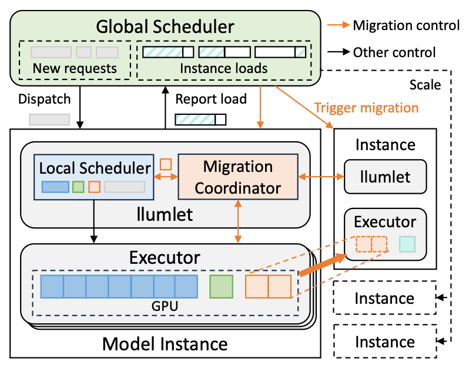
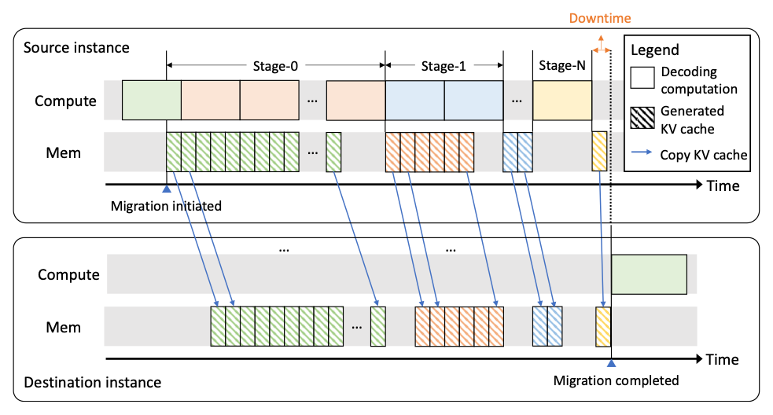
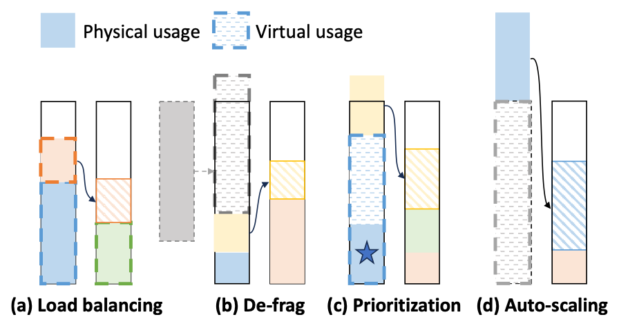

# Llumnix: Dynamic Scheduling for Large Language Model Serving

发表于 [OSDI '24](https://www.usenix.org/conference/osdi24/presentation/sun-biao)。

作者：Biao Sun、Ziming Huang、Hanyu Zhao、Wencong Xiao、Xinyi Zhang、Yong Li、Wei Lin（阿里巴巴）

## 动机和挑战

LLM 推理请求的长度与延迟目标高度异构，且自回归生成的迭代步数与 KV Cache 显存增长无法预知，单次静态分发难以兼顾隔离性、低碎片与优先级。动态显存分配在请求长度未知时会引发抢占与同 batch 干扰，抢占开销可占 P99 decode 延迟的 70%。若将请求分散至多实例以减轻争用，又会产生跨实例外部显存碎片，使长输入请求在集群总空闲显存充足时仍因单实例空间不足而排队。此外，在线交互与离线任务具有不同的 Service-Level Objective（SLO），而静态绑定在单实例上的请求无法利用其他实例的空闲资源化解冲突。

## 整体架构

如图所示，Llumnix 构建全局调度器 Global Scheduler 与实例级调度器 `llumlet` 协同的两层分布式架构，通过运行时跨实例重调度应对动态负载。每个实例内的 `llumlet` 包含 Local Scheduler 与 Migration Coordinator，负责本地队列管理、实例负载计算、待迁移请求选择及显存状态传输。Global Scheduler 不追踪单个运行请求，仅凭 `llumlet` 周期上报的实例级负载执行新请求分发、迁移实例配对与扩缩容，从而保持高可扩展性。

## 请求在线迁移

如图所示，Llumnix 利用历史 token 的 KV Cache 只追加不修改的性质，以多阶段流水线将显存拷贝与 decode 计算重叠，实现近零停机的请求在线迁移。源实例在 `Stage-0` 继续生成新 token 的同时异步传输既有 KV Cache，后续阶段依次拷贝上一阶段产生的少量增量块，直至最后一轮 `Stage-N` 才暂停该请求并拷贝单步增量。该设计使请求停机时间与序列长度无关并稳定在 20–30 ms，相比重计算或阻塞拷贝降低多达 111×。迁移各阶段前后，源与目标实例通过预分配与提交握手协议处理显存不足或请求提前结束等并发异常。

## 虚拟用量与统一动态调度

如图所示，Llumnix 提出虚拟用量（virtual usage）抽象，将负载均衡、碎片整理、优先级隔离与缩容排空统一为基于虚拟负载的均衡调度。常规请求取物理显存占用，队首排队请求取真实显存需求，高优请求叠加预留空间，待下线实例则注入无穷大虚拟用量。Local Scheduler 据此计算实例空闲度：

$$
F = \frac{M - \sum V}{B}
$$

其中 $M$ 为实例总显存，$V$ 为各请求虚拟用量，$B$ 为当前 batch 大小，$F$ 表示当前 batch 还可运行的迭代步数并在虚拟过载时取负值。Global Scheduler 优先将新请求发往 $F$ 最大的实例并周期配对高低 $F$ 实例迁移请求，相比 INFaaS++ 将 P99 prefill 延迟降低多达 15×，并在相近尾延迟下节省最高 36% 成本。
