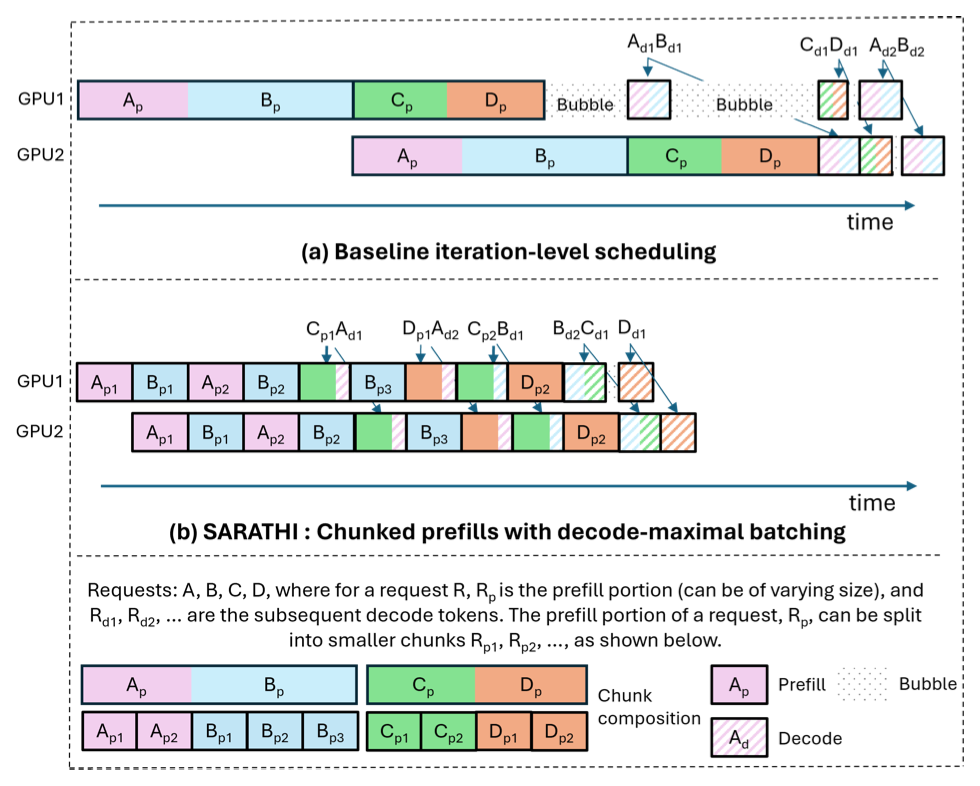
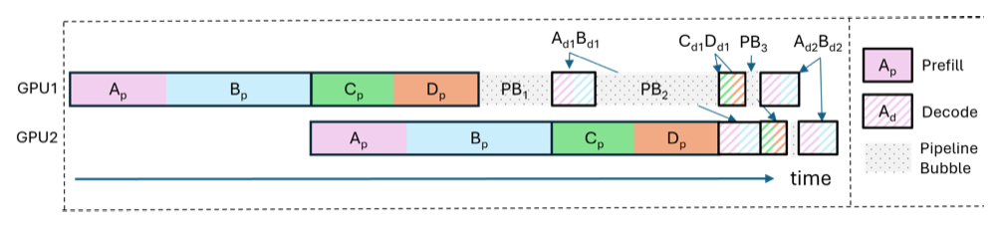
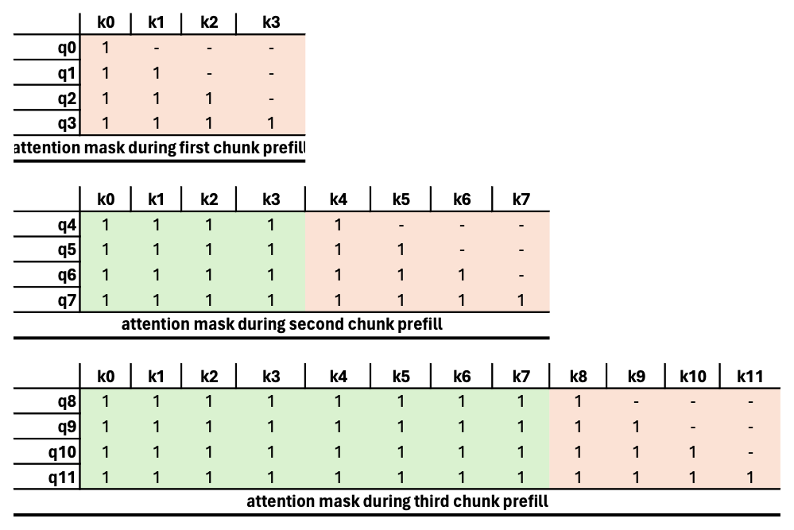

# SARATHI: Efficient LLM Inference by Piggybacking Decodes with Chunked Prefills

arXiv 预印本（[arXiv:2308.16369](https://arxiv.org/abs/2308.16369)）。

作者：Amey Agrawal¹、Ashish Panwar²、Jayashree Mohan²、Nipun Kwatra²、Bhargav S. Gulavani²、Ramachandran Ramjee²（¹Georgia Institute of Technology，²Microsoft Research India）

## 动机与整体思路

如图所示，传统迭代级调度在流水线中产生大量气泡且 decode 低效，SARATHI 则用分块预填充与解码最大化批处理构造均匀混合批次。LLM 的 prefill 阶段并行处理输入即可打满算力，decode 阶段逐 token 生成而受限于显存带宽，小批量下每 token 耗时可达 prefill 的 200 倍。由于 KV Cache 占用显存巨大，单卡难以将纯 decode 批大小扩展到算力饱和区间。SARATHI 将长 prompt 切块并与多条 decode 混合执行，使 decode 吞吐最高提升 10 倍，在流水线并行中减少 6.29 倍气泡并带来 1.91 倍端到端加速。

## 流水线气泡成因

如图所示，即便推理仅含前向传播且采用迭代级微批次调度，两路流水线并行处理请求时仍会出现三类空闲气泡。$PB_1$ 源于相邻微批次的 prefill 长度不同所造成的执行时间差异。$PB_2$ 源于高耗时 prefill 微批次与低耗时 decode 微批次交替时的阶段失配。$PB_3$ 源于不同 decode 微批次累积的上下文长度不一所引起的注意力开销波动。消除上述气泡的关键在于使每个微批次承载均匀的计算量。

## 分块预填充

如图所示，分块预填充将单条长 prompt 切分为等长小块跨多轮迭代执行，并通过递进扩展因果注意力掩码保证计算结果与完整 prefill 严格等价。首块仅在块内采用下三角因果掩码，后续分块的每个 query 则同时关注前序所有分块的全部键值与当前块内的前序位置。由于单次 prefill 吞吐在数百个 token 后便趋于饱和，切分长 prompt 可在不显著损失算力利用率的前提下创造更多混合批处理轮次。尽管分块会导致注意力核重复从显存读取历史分块的 KV Cache，但注意力在总前向耗时中占比较小，合理块大小下的整体额外开销可控。

## 解码最大化批处理

解码最大化批处理将单个 prefill 分块与尽可能多的在途 decode 请求合并执行，把访存受限的 decode 转化为计算受限操作。设可用显存为 $M_G$、参数显存为 $M_S$、最大长度为 $L$、单 token 缓存为 $m_{kv}$，最大批大小为：

$$
B = \left\lfloor \frac{M_G - M_S}{L \cdot m_{kv}} \right\rfloor
$$

该上界表示扣除模型权重后剩余显存按最大序列长度可承载的并发槽位数。SARATHI 在每轮混合批次中放入 1 个 prefill 块，并将剩余至多 $B - 1$ 个槽位填满 decode 请求。注意力仍按两阶段分别计算，而线性层将两类 token 合并为单次矩阵乘法，使加载一次的模型权重直接复用于全部搭便车的 decode token。

## 块大小选择与分块量化效应

预填充块大小需要在单块计算效率与可搭载 decode 数量之间权衡。较小的块能切出更多混合批次以覆盖更多 decode，但会降低算术强度并增加缓存重读。此外，GPU 矩阵乘法按固定分片并行执行，总 token 数一旦略超分片整数倍就会触发分块量化效应，单轮耗时可骤增 32%。因此 SARATHI 会将 prefill 块长度与同批 decode 数量之和严格对齐分片尺寸的整数倍，以消除尾部线程块的无效计算。
