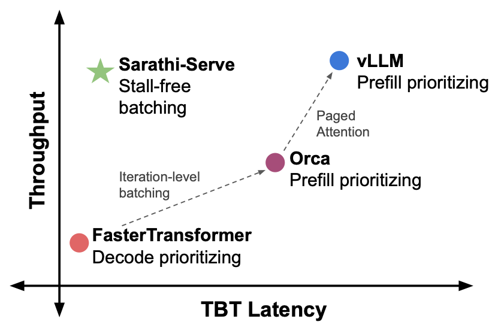
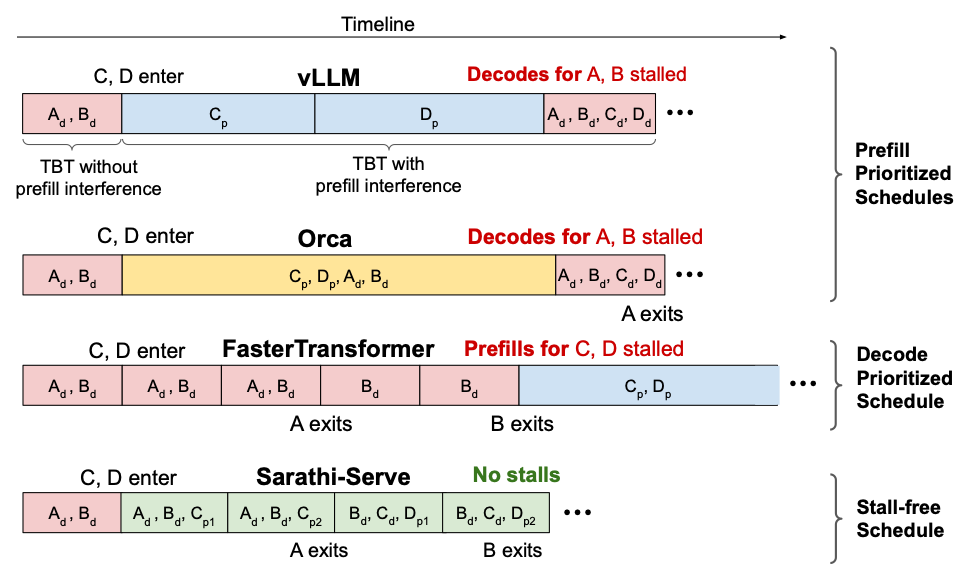
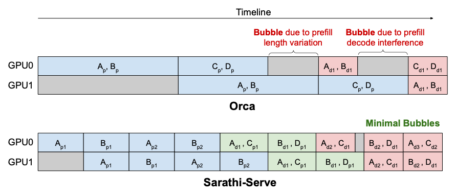

# Taming Throughput-Latency Tradeoff in LLM Inference with Sarathi-Serve

发表于 [OSDI '24](https://www.usenix.org/conference/osdi24/presentation/agrawal)。

作者：Amey Agrawal¹、Nitin Kedia²、Ashish Panwar²、Jayashree Mohan²、Nipun Kwatra²、Bhargav S. Gulavani²、Alexey Tumanov¹、Ramachandran Ramjee²（¹Georgia Institute of Technology，²Microsoft Research India）

## 吞吐与延迟的权衡困境

如图所示，现有在线推理调度器受制于吞吐与 Time-Between-Tokens（TBT）尾部延迟的权衡，而 Sarathi-Serve 通过无停顿批处理同时实现高吞吐与低延迟。FasterTransformer 等解码优先系统在当前批次全部完成前不接纳新请求，虽能维持低 TBT，但请求提前退出会使有效批大小持续萎缩。Orca 与 vLLM 等预填充优先系统立即插入新请求的完整 prefill，虽提升了批处理吞吐，却会阻塞在途 decode 并引发数秒的生成停顿。在严格延迟约束下，Sarathi-Serve 相比 vLLM 在单卡、多卡与跨节点流水线场景中可将服务容量提升 2.6 至 5.6 倍。

## 算术强度松弛与搭便车空间

纯 decode 批次处于显存带宽受限区间，存在充足的算术强度松弛可供额外计算搭便车。Transformer 前向传播中线性算子占总耗时的 80% 以上，其执行时间可近似为：

$$
T = \max(T_{\mathrm{math}},\, T_{\mathrm{mem}})
$$

其中 $T_{\mathrm{math}}$ 与 $T_{\mathrm{mem}}$ 分别为算术计算耗时与模型权重访存耗时。Decode 批次仅处理少量单 token 请求，耗时由权重读取主导，在跨过临界规模前增加 token 数几乎不延长单轮耗时。因此在 decode 批次中并入适量 prefill token 可直接复用已读取权重，在不拉高单步延迟的前提下填满闲置算力。

## 分块预填充与无停顿批处理

如图所示，Sarathi-Serve 将长 prompt 拆分为多个小块并按固定单轮 token 预算与在途 decode 混合执行，消除了新请求准入引发的生成停顿。在线负载的 prompt 常达数千 token，若像 Orca 那样将完整长 prompt 直接并入 decode 批次，单轮延迟最高可激增至纯 decode 的 28.3 倍。无停顿批处理每轮优先装入所有在途 decode，再用剩余预算容纳未完成 prefill 的下一分块，最后有余量时才接纳新请求分块。因此新到达请求的分块可顺次搭便车并入在途解码批次，使单轮迭代耗时仅受固定预算约束而与总 prompt 长度解耦。

## 消除流水线并行气泡

如图所示，Sarathi-Serve 通过构造计算量近似恒定的混合微批次，消除了传统迭代级调度在跨节点流水线并行中的大段空闲气泡。在普通以太网多机环境下，跨节点张量并行的中位解码延迟比流水线并行高出 2 倍以上，大模型跨机扩展需依赖流水线并行。然而 Orca 等系统的微批次因长短不一的 prefill 以及 prefill 与 decode 切换而耗时悬殊，极易引发严重的级间等待。Sarathi-Serve 借助分块预填充与统一 token 预算规整各微批次的计算耗时，使跨机流水线并行在严格延迟约束下依然保持高吞吐。

## Token 预算确定与系统实现

单轮 token 预算需要在满足尾部 TBT 目标与控制分块额外开销之间折中。较小的预算可压低单步延迟并减小微批次方差，但过度切分会降低算术强度并增加历史分块 KV Cache 的重复读取。预算选取还需对齐 GPU 矩阵乘法的线程块分片尺寸，以避免分块量化效应引发耗时跳变。Sarathi-Serve 使用推理仿真器 Vidur 针对目标硬件、并行配置与延迟指标自动搜索最优预算，并在 vLLM 上结合分页式分块注意力核完成实现。
