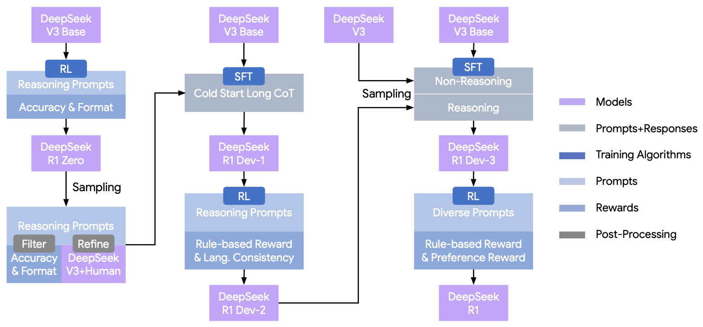
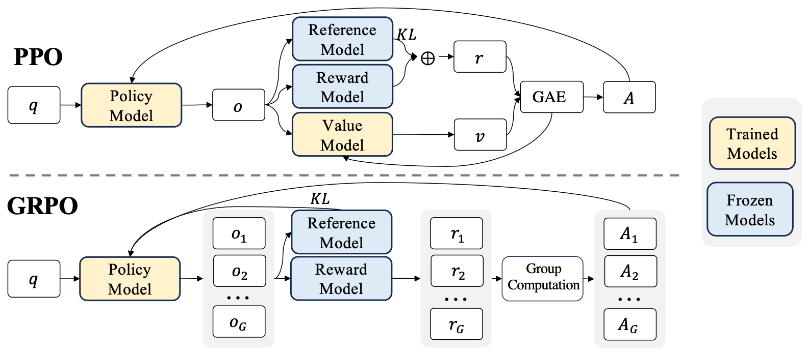
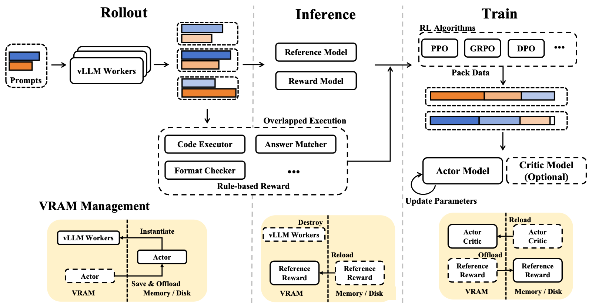

# DeepSeek-R1: Incentivizing Reasoning Capability in LLMs via Reinforcement Learning

arXiv 技术报告（[arXiv:2501.12948](https://arxiv.org/abs/2501.12948)），正式版发表于 Nature（2025）。

作者：DeepSeek-AI（团队署名）

## 动机与整体流程

如图所示，本文绕开大规模人工思维链标注，直接通过 RL 在 DeepSeek-V3-Base（671B 总参数、37B 激活参数）上激励模型涌现推理能力，构建了 DeepSeek-R1-Zero 与 DeepSeek-R1 两条路线。DeepSeek-R1-Zero 完全跳过 SFT，仅凭规则奖励从基座模型直接强化学习。针对纯 RL 带来的可读性欠佳与语种混杂问题，DeepSeek-R1 引入少量冷启动长思维链微调与面向推理的 RL。随后模型通过拒绝采样融合通用微调数据，并经全场景 RL 对齐人类偏好。

## Group Relative Policy Optimization

如图所示，Group Relative Policy Optimization（GRPO）移除 Proximal Policy Optimization（PPO）中与策略模型同规模的 Value Model，大幅降低显存与计算开销。算法对每个问题 $q$ 从旧策略采样一组输出，最大化如下目标：

$$
\mathcal{J}_{\mathrm{GRPO}}(\theta) = \mathbb{E}_{q \sim P(Q),\, \{o_i\}_{i=1}^G \sim \pi_{\theta_{\mathrm{old}}}(O \mid q)} \left[ \frac{1}{G} \sum_{i=1}^G \left( \min\!\left( \frac{\pi_\theta(o_i \mid q)}{\pi_{\theta_{\mathrm{old}}}(o_i \mid q)} A_i,\, \mathrm{clip}\!\left( \frac{\pi_\theta(o_i \mid q)}{\pi_{\theta_{\mathrm{old}}}(o_i \mid q)}, 1-\varepsilon, 1+\varepsilon \right) A_i \right) - \beta \mathbb{D}_{\mathrm{KL}}(\pi_\theta \parallel \pi_{\mathrm{ref}}) \right) \right]
$$

其中优势 $A_i$ 由组内 $G$ 个输出奖励减均值除标准差得到，避免在长思维链反复修正时用局部前缀预测最终回报。同时 GRPO 将无偏 KL 散度直接加入损失而非按 token 计入奖励，防止隐式惩罚长序列，并定期更新参考策略 $\pi_{\mathrm{ref}}$。

## DeepSeek-R1-Zero 纯强化学习自演化

DeepSeek-R1-Zero 证明无需任何人工推理轨迹监督，仅靠结果级规则奖励即可激发基座模型的复杂推理行为。训练仅用轻量模板要求模型将思考过程与最终答案分别放入 `<think>` 与 `<answer>` 标签。奖励由数学答案匹配或代码测试通过等准确性奖励与格式奖励相加构成，规避了神经网络奖励模型的 reward hacking。随着训练推进，模型自发拉长思考序列并涌现中途回溯重审的“aha moment”，反思词频增长 5 至 7 倍，AIME 2024 `pass@1` 准确率从 15.6% 跃升至 77.9%。

## DeepSeek-R1 多阶段后训练

DeepSeek-R1 通过两轮 SFT 与两轮 RL 交替迭代，在保留强推理能力的同时解决可读性、语种一致性与通用任务表现。第一阶段用数千条经润色核验的第一人称长思维链做冷启动 SFT，再开展推理 RL，并引入目标语言词占比奖励消除中英文混杂。第二阶段从上一轮模型拒绝采样约 60 万条推理样本，联合约 20 万条写作与问答等非推理样本重新微调基座。最终的全场景 RL 对推理任务沿用规则奖励，对通用任务结合仅评估摘要的有用性奖励模型和评估全文的安全性奖励模型完成对齐。

## 强化学习训练基础设施

如图所示，RL 训练系统解耦为 Rollout、Inference、Rule-based Reward 与 Training 四个模块，以支撑大规模 MoE 模型的高效采样与更新。Rollout 阶段基于跨节点专家并行与热点专家冗余副本加速推理，并启用 MTP 自推测解码缩短长尾生成耗时。无需 GPU 的代码执行与答案匹配等规则校验通过异步调度与前向推理重叠，隐藏评测延迟。Training 阶段采用 Best-Fit 紧凑打包变长序列并结合 DualPipe 流水线并行，各模块切换时自动在显存与内存或磁盘间卸载重载模型。

## 小模型蒸馏与失败尝试

将强模型探索出的长思维链直接蒸馏给小模型，比在小模型上从零执行大规模 RL 更经济且效果更好。作者用 80 万条监督样本微调 Qwen2.5 与 Llama 基座，所得 32B 蒸馏模型在推理基准上显著优于直接经上万步纯 RL 训练的同基座模型。这表明突破能力上限依赖强基座与大规模 RL，而能力下放更适合通过蒸馏完成。此外，过程奖励模型因步骤难界定且易触发 reward hacking 未能奏效，蒙特卡洛树搜索也受阻于指数级搜索空间与细粒度价值模型训练难题。
