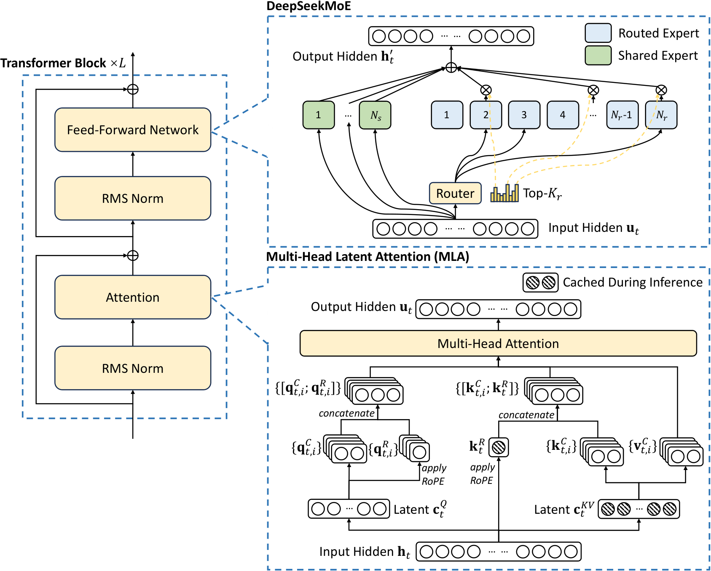
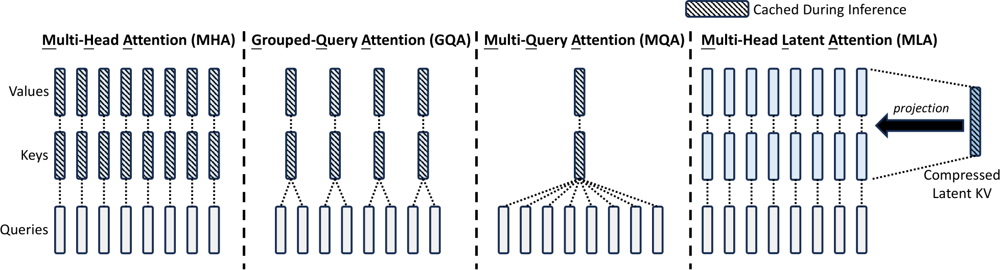

# DeepSeek-V2: A Strong, Economical, and Efficient Mixture-of-Experts Language Model

arXiv 技术报告（[arXiv:2405.04434](https://arxiv.org/abs/2405.04434)）。

作者：DeepSeek-AI（团队署名）

## 整体架构

如图所示，DeepSeek-V2 在 Transformer 框架下协同改造注意力与前馈网络，总参数量 236B、每 token 激活 21B，支持 128K 上下文窗口。注意力模块引入 MLA 压缩推理阶段的键值缓存，除首层外的前馈层采用结合共享专家与细粒度路由专家的 DeepSeekMoE 进行稀疏计算。两项架构设计相互配合，在超越前代稠密模型性能的同时显著降低了训练算力成本与推理显存开销。

## Multi-head Latent Attention

如图所示，分组或多查询注意力以折损性能换取缓存缩减，而 MLA 借低秩键值联合压缩兼顾了小缓存与强建模能力。MLA 将隐状态 $\mathbf{h}_t$ 降维为潜向量，再经上投影还原键和值：

$$
\mathbf{c}_t^{KV} = W^{DKV}\mathbf{h}_t, \quad \mathbf{k}_t^C = W^{UK}\mathbf{c}_t^{KV}, \quad \mathbf{v}_t^C = W^{UV}\mathbf{c}_t^{KV}
$$

推理时仅缓存 $\mathbf{c}_t^{KV}$，且 $W^{UK}$ 与 $W^{UV}$ 可吸收进查询和输出投影矩阵，无需显式展开键值。针对旋转位置编码（RoPE）阻碍矩阵吸收的问题，MLA 解耦出少量位置查询与跨头共享位置键并同内容向量拼接。配合查询压缩与量化，模型较前代稠密基线削减 93.3% 的 KV Cache，最大生成吞吐提升至 5.76 倍。

## DeepSeekMoE 与通信负载均衡

为控制跨卡专家并行下细粒度专家引发的通信与负载倾斜开销，DeepSeek-V2 在 DeepSeekMoE 之上配套了受限路由与多重均衡机制。设备受限路由先为每个 token 选出包含最高亲和度专家的至多 3 个设备，再仅在这些设备的专家内执行 top-$K$ 选择以限制跨卡发送频次。训练目标在专家级和设备级均衡损失之外新增通信均衡损失，约束各设备接收的 token 数量同样保持均衡。训练时还按设备平均算力预算丢弃最低亲和度的溢出 token，并保留约 10% 训练序列永不丢弃以保证训推一致。

## 预训练与长上下文扩展

DeepSeek-V2 在高质量多源双语语料上完成预训练，借助流水线并行与专家并行协同优化较前代稠密模型节省了 42.5% 的训练开销。底层训练框架依靠较低的激活参数量与算子重计算省去了张量并行，并将共享专家计算与跨卡通信相互重叠以提升吞吐。预训练结束后，模型采用 YaRN 将上下文窗口平滑扩展至 128K，且仅将其作用于负责携带位置编码的解耦共享键。配合针对 MLA 结构修正的注意力温度缩放系数，模型只需短暂长序列续训即可在全窗口范围内稳定检索信息。

## 对齐训练

对齐流程依次执行 SFT 与两阶段在线 RL，兼顾指令遵循、数理推理与人类偏好对齐。SFT 阶段融合有用性与安全性对话样本，实验验证了充足的高质量微调数据是保障指令遵循能力的必要前提。RL 阶段采用 Group Relative Policy Optimization（GRPO），通过对同一问题采样一组输出并在组内标准化奖励来估计优势，省去了同规模的 critic 模型。训练先用基于编译反馈与标准答案的推理奖励模型强化代码和数学能力，再组合有用性、安全性与规则奖励对齐人类偏好。工程上结合训推混合引擎与 CPU-GPU 卸载调度保障了在线训练效率。
