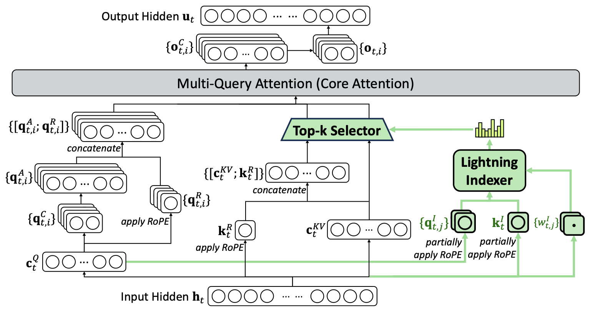
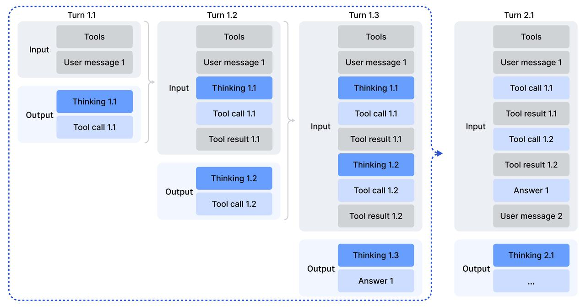

# DeepSeek-V3.2: Pushing the Frontier of Open Large Language Models

arXiv 技术报告（[arXiv:2512.02556](https://arxiv.org/abs/2512.02556)）。

作者：DeepSeek-AI（团队署名）

## 动机与整体概览

开源模型在复杂任务上落后于前沿闭源模型，主要受制于长序列注意力的二次复杂度、后训练 RL 算力不足及 Agent 泛化能力薄弱。DeepSeek-V3.2 针对这三项瓶颈引入细粒度稀疏注意力 DeepSeek Sparse Attention（DSA），并将后训练 RL 算力扩展至预训练成本的 10% 以上。模型同时构建了覆盖逾 1,800 个环境与 8.5 万条复杂指令的大规模 Agent 任务合成流水线，并推出放宽长度限制以探索推理上限的变体 DeepSeek-V3.2-Speciale。

## DeepSeek Sparse Attention 架构

如图所示，DSA 在 MLA 的 Multi-Query Attention（MQA）模式下实例化，由轻量级 lightning indexer 与细粒度 top-$k$ 选择器组成，将主注意力复杂度从 $\mathcal{O}(L^2)$ 降至 $\mathcal{O}(Lk)$。针对当前查询 $\mathbf{h}_t$ 与历史位置 $\mathbf{h}_s$，索引器计算相关性得分：

$$
I_{t,s} = \sum_{j=1}^{H^I} w_{t,j}^I \cdot \mathrm{ReLU}\!\left( \mathbf{q}_{t,j}^I \cdot \mathbf{k}_s^I \right)
$$

该索引器仅用少量头 $H^I$ 并配合 ReLU 与 FP8 低精度实现，使全局打分开销远低于主注意力。随后选择器根据 $I_{t,:}$ 仅检索得分最高的 top-$k$ 个潜向量键值条目，并在当前 token 的所有查询头间共享以保证访存效率。

## 两阶段持续预训练

DeepSeek-V3.2 从 128K 上下文的 DeepSeek-V3.1-Terminus 基座出发，通过稠密预热与稀疏训练两阶段平滑引入 DSA。稠密预热阶段保持全注意力并冻结主模型，将主注意力各头分数求和归一化作为目标分布，仅用少量步数最小化 KL 散度使 lightning indexer 快速对齐主注意力分布。稀疏训练阶段启用每个查询筛选 2,048 个键值 token 的稀疏模式，并在近万亿 token 上解冻全部参数联合训练。该阶段在计算图上截断索引器输入的梯度，使主模型仅由语言建模损失更新，而索引器仅在所选 token 子集上继续对齐主注意力。

## 专家蒸馏与可扩展 GRPO 后训练

后训练先在数学、编程、逻辑及三类 Agent 领域分别用大规模 RL 训练专精模型，蒸馏汇总后再将推理、Agent 与人类对齐合并至单一混合 Group Relative Policy Optimization（GRPO）阶段以规避灾难性遗忘。为支撑高算力 RL 并抑制多步更新与训推差异带来的 off-policy 失稳，算法引入四项稳定改进。首先用重要性采样比修正 KL 估计器以消除低概率 token 的无界噪声梯度，并对偏离当前策略过大的负优势序列予以掩码丢弃。同时训练严格复用推理采样时的 MoE 专家路由路径（Keep Routing）与采样截断掩码（Keep Sampling Mask），保证训推激活参数与动作空间一致。

## 工具调用中的思考上下文管理

如图所示，DeepSeek-V3.2 改进了多轮工具调用中的思考内容保留规则，避免像 DeepSeek-R1 那样在每次新消息到来时丢弃历史推理而重复思考整道题。在同一轮用户请求内，只要后续追加的是工具调用及返回结果，历史 Thinking 块就全程保留在上下文中。仅当对话引入新的用户消息时，系统才清理旧思考块，同时完整保留历史工具调用与结果记录。配合冷启动提示词引导模型在思考中穿插调用工具，以及超长搜索超过 128K 窗口 80% 时的历史工具清空策略，模型得以高效扩展串行测试期计算。

## 大规模 Agent 任务合成

为提升陌生工具环境中的泛化能力，作者围绕真实与合成沙箱构建了搜索、编程、代码解释器与通用 Agent 四类共 8.5 万余个强化学习任务。Search Agent 通过多智能体搜索长尾实体并做多轮交叉核验，仅保留标准答案正确且候选均被证伪的高难样本。Code Agent 基于海量 GitHub Issue-PR 自动配置依赖，并通过单元测试筛选可复现的多语言修复环境。通用场景则按“难求解、易验证”原则自动合成 1,827 个沙箱，由智能体建立数据库与工具函数，并迭代生成任务及 Python 验证程序。
