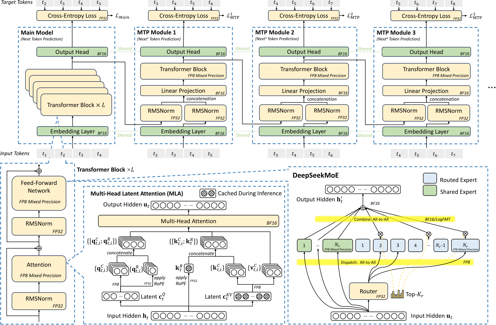
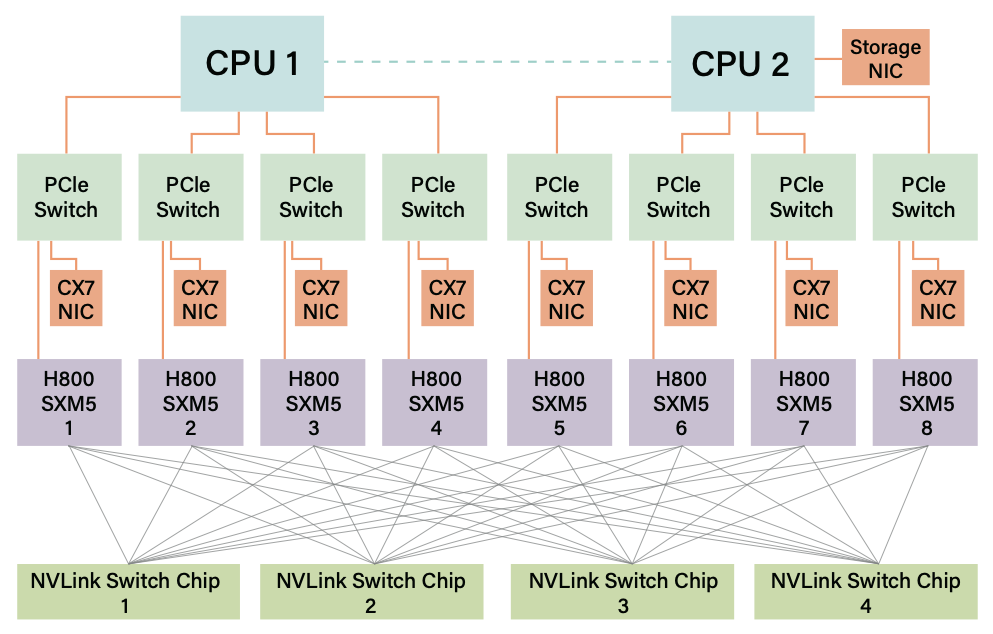
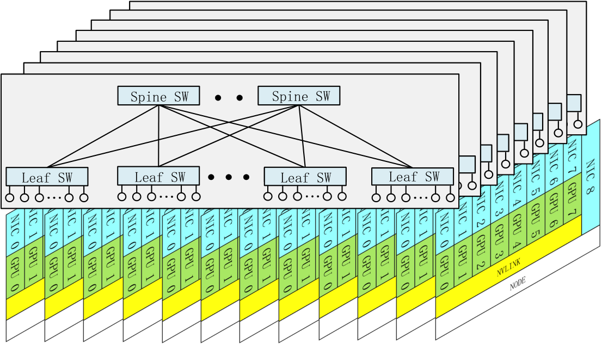

# Insights into DeepSeek-V3: Scaling Challenges and Reflections on Hardware for AI Architectures

发表于 ISCA '25（[arXiv:2505.09343](https://arxiv.org/abs/2505.09343)）。

作者：Chenggang Zhao、Chengqi Deng、Chong Ruan、Damai Dai、Huazuo Gao、Jiashi Li、Liyue Zhang、Panpan Huang、Shangyan Zhou、Shirong Ma、Wenfeng Liang、Ying He、Yuqing Wang、Yuxuan Liu、Y.X. Wei（DeepSeek）

## 模型与硬件协同设计

如图所示，DeepSeek-V3 在 2,048 张 H800 GPU 上围绕显存、算力与通信瓶颈将模型结构与硬件深度协同。模型主干结合 MLA 与 DeepSeekMoE，在 671B 总参数下每 token 仅激活 37B 参数，使训练计算量远低于同档稠密模型。MLA 将多头键值压缩为低维潜向量缓存，大幅降低长上下文推理的 KV Cache 占用。主干线性层采用 FP8 混合精度计算，并配合单层 MTP 模块做自推测解码，将生成速度提升 1.8 倍。

## 低精度计算与通信压缩

DeepSeek-V3 将 FP8 混合精度首次用于超大规模开源 MoE 预训练，使权重与激活开销减半且相对 BF16 精度损失低于 0.25%。为抑制异常值，训练对激活按 tile、对权重按 block 做细粒度量化，但受限于 Hopper Tensor Core 累加寄存器仅保留 13 位尾数，且反量化需频繁搬回 CUDA Core。在通信侧，跨专家 dispatch 采用 FP8 减半流量，作者还尝试了对数浮点格式 LogFMT，但因 GPU 缺乏高速对数指数单元而带来过高编解码开销。论文据此建议未来硬件支持高精度累加、Tensor Core 原生块级缩放以及专用通信压缩单元。

## 节点内互连与受限节点路由

如图所示，H800 节点的 NVLink 带宽受限而每张 GPU 均配独立 InfiniBand（IB）网卡，使节点内外有效带宽比约为 4:1。针对该带宽结构，训练弃用通信密集的张量并行，改用双向流水线并行 DualPipe 重叠计算与通信。模型同时引入受限节点路由，限制每个 token 最多发往 4 个节点，使发往同节点多专家的数据仅经 IB 传输一次再由 NVLink 节点内转发去重。由于跨网域转发与规约在训练中需占用多达 20 个 GPU SM，作者呼吁通过专用 I/O 协处理器融合 scale-up 与 scale-out 网络。

## 多平面扩展网络与低延迟通信

如图所示，集群采用八平面双层 Multi-Plane Fat-Tree（MPFT）替代传统三层 Fat-Tree，显著降低万卡级组网成本与跳数延迟。每节点 8 对 GPU 与网卡分别接入独立网络平面，借助 NCCL PXN 节点内跨平面转发，取得了与单平面多轨网络一致的 all-to-all 带宽和训练吞吐。针对微秒级延迟敏感的专家并行通信，低延迟 IB 仍优于以太网 RDMA over Converged Ethernet（RoCE），若改用 RoCE 则需引入自适应路由与虚拟输出队列避免拥塞。控制面进一步采用 InfiniBand GPUDirect Async（IBGDA）由 GPU 直接下发通信请求，消除 CPU 代理线程延迟。

## 面向下一代 AI 硬件的展望

围绕大规模集群暴露出的系统瓶颈，论文为下一代 AI 硬件归纳出四项演进方向。容错层面，硬件需提供超越传统纠错码的校验机制与诊断工具，以及时捕获静默数据损坏。互连与控制层面，应以高带宽互连直连 CPU 与 GPU 消除 PCIe 卸载瓶颈，并在网卡内原生实现远程内存语义的保序原语与网内规约。存储层面，可通过 3D DRAM 堆叠或晶圆级集成突破高带宽显存的带宽墙，进一步释放稀疏 MoE 模型的极速推理潜力。
