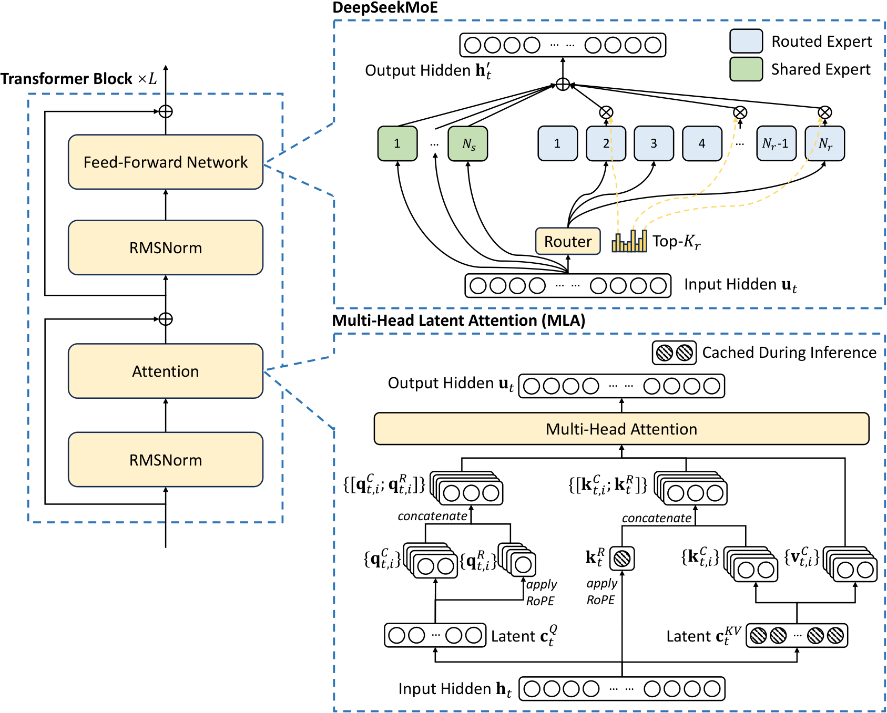
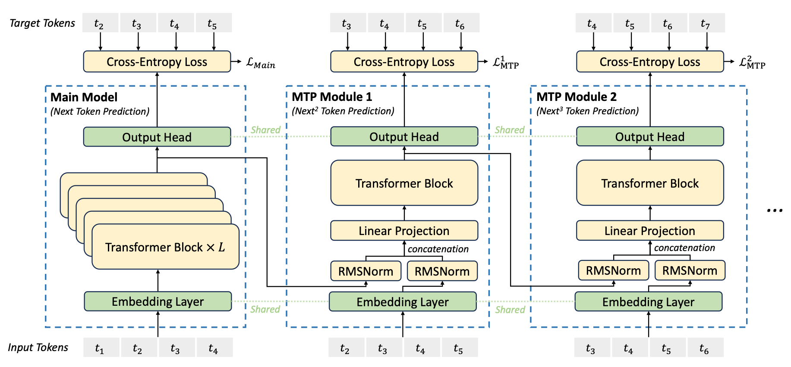
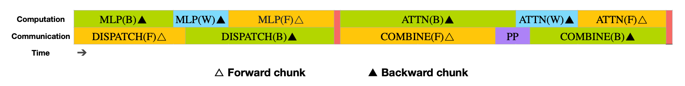

# DeepSeek-V3 Technical Report

arXiv 技术报告（[arXiv:2412.19437](https://arxiv.org/abs/2412.19437)）。

作者：DeepSeek-AI（团队署名）

## 基础架构与无辅助损失负载均衡

如图所示，DeepSeek-V3 总参数量 671B、每 token 激活 37B，沿用 MLA 与 DeepSeekMoE 并首创无辅助损失负载均衡。为避免大权重辅助损失损害性能，该策略给每个路由专家维护仅用于路由筛选的动态偏置 $b_i$：

$$
g'_{i,t} = \begin{cases} s_{i,t}, & s_{i,t} + b_i \in \operatorname{Topk}(\{s_{j,t} + b_j \mid 1 \leqslant j \leqslant N_r\}, K_r), \\ 0, & \text{otherwise}, \end{cases}
$$

门控加权仍用归一化的原始 Sigmoid 亲和度 $s_{i,t}$，每步按全局 batch 负载对过载专家调低 $b_i$、欠载专家调高 $b_i$。这种 batch 级调节放宽了单序列均摊约束，提升了专家领域特化度，使训练与推理全程无需丢弃 token。

## Multi-Token Prediction

如图所示，DeepSeek-V3 引入保留完整因果链的串行 MTP 目标，借多步预测增加监督信号密度并促使模型提前规划表征。各预测深度复用主模型的嵌入层与输出头，拼接上一深度隐状态与未来 token 嵌入后经单层 Transformer 预测下一位置。各深度的交叉熵损失取均值加权后并入主训练目标。推理时可直接丢弃 MTP 模块，也可将其用于投机解码以获得约 1.8 倍生成加速。

## DualPipe 与通信推理优化

如图所示，针对跨节点专家并行约 1:1 的计算通信比，DualPipe 双向流水线算法在一对前反向块内实现了计算与通信完全重叠。该算法从流水线两端注入微批次，切分前反向阶段并调配 SM 比例，隐藏跨节点通信且大幅缩减流水线气泡。配合单 token 至多发往 4 个节点的受限路由，定制算子重叠了节点间与节点内传输，结合重计算省去了张量并行。在线推理采用 prefill 与 decode 分离部署，借高负载专家周期性冗余复制与双微批次交错消除负载倾斜和通信延迟。

## FP8 混合精度训练

DeepSeek-V3 首次在超大规模预训练中验证了细粒度 FP8 混合精度框架，兼顾算力加速、显存压缩与数值稳定。线性层的前向与两类反向矩阵乘均以 FP8 执行，而嵌入层、输出头、门控、归一化及注意力算子保留高精度。为抑制激活异常值误差，框架在线对激活按 $1 \times 128$ 分块量化、对权重按 $128 \times 128$ 分块量化。每乘加 128 个元素便将部分和移至 CUDA Core 做 FP32 累加，配合低精度缓存与通信将相对损失误差控制在 0.25% 以内。

## 预训练与长上下文扩展

模型在提高了数学、代码与多语言占比的大规模语料上稳定完成预训练，全程无不可恢复的损失尖峰或回滚。数据构建采用文档拼接并融入上下文中间补全目标，同时随机拆分标点与换行组合 token 以缓解边界偏置。预训练后模型仅对解耦共享位置键施加两阶段 YaRN 扩展，将上下文窗口平滑推进至 128K。

## 后训练与推理蒸馏

后训练通过知识蒸馏将长思维链模型 DeepSeek-R1 的推理能力迁移至常规模型，并结合 RL 完成偏好对齐。针对 R1 输出易过度思考且冗长的问题，作者先训练融合反思模式的领域专家模型，再经拒绝采样生成简洁准确的 SFT 数据。RL 阶段继续采用免 critic 模型的 Group Relative Policy Optimization（GRPO）更新策略。奖励信号综合了数学与代码的抗刷分规则验证、带偏好推理链的模型奖励以及基于自身投票的自奖励机制。
