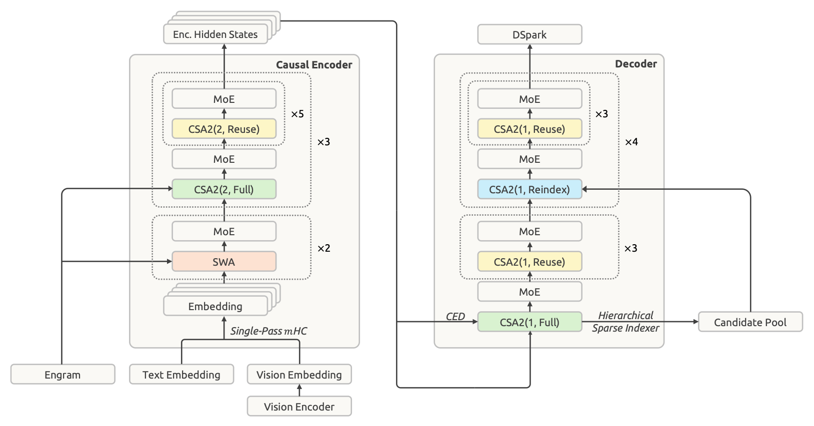
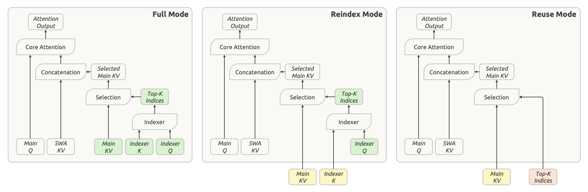

# DeepSeek-V4.1-Flash: Pushing the Limits of KV Cache Compression

arXiv 技术报告（[arXiv:2609.19969](https://arxiv.org/abs/2609.19969)）。

作者：DeepSeek-AI（团队署名）

## 整体与多模态架构

如图所示，DeepSeek-V4.1-Flash 是支持 1M 上下文的原生多模态 MoE 模型，含 552B 骨干参数与 196B 条件记忆参数。骨干网络等分为因果编码器与解码器，使 prefill 每 token 仅激活 8B 参数、decode 激活 16B 参数。从零训练的视觉编码器支持可变分辨率，经空间下采样后与文本联合输入，并为图文分别维护独立的负载均衡偏置。通过架构与精度协同压缩，其全局 KV Cache 降至前代 Flash 的约 1/4，持久化缓存降至约 1/8。

## Causal Encoder-Decoder 与 SWA Bounded Replay

为削减 Agent 高频工具调用的开销，模型提出 Causal Encoder-Decoder（CED）架构与 SWA Bounded Replay 策略。CED 将前一半层作为因果编码器，使后一半解码器层的全局键值直接由编码器末层输出 $H_{L/2}$ 线性投影生成：

$$
C_l = H_{L/2} W_l^{KV}, \qquad Z_l = H_{L/2} W_l^Z, \qquad l > \frac{L}{2}
$$

局部 Sliding Window Attention（SWA）仍逐层计算，prefill 时仅向解码器重放末尾单窗口 token 即可将长序列计算量减半。持久化层移除 SWA 缓存并改存主机内存池，未命中时同样仅重放缓存前缀末尾单窗口 token 以恢复近似状态。

## CSA2 跨层注意力复用

如图所示，Compressed Sparse Attention 2（CSA2）将跨层 KV 共享与稀疏索引复用解耦为三种静态模式。Full Mode 完整生成全局主 KV、索引器键并选出 Top-$K$ 索引，而 Reindex Mode 复用前序键值仅重新打分筛选。占多数层的 Reuse Mode 同时复用前序主 KV 与 Top-$K$ 索引，完全跳过索引计算直接执行稀疏注意力。解码器进一步引入分层稀疏索引器，由首层筛选共享候选池，将后续重索引复杂度由线性降为常数阶。

## FP4 KV Cache 与高效架构扩展

为进一步压缩显存流量与解码延迟，模型引入了 FP4 主缓存量化及三项轻量架构扩展。通过后训练量化感知训练，全局主 KV Cache 压缩为分组缩放的 FP4 格式，在保持 SWA 为 FP8 的同时再减半主缓存。Single-Pass mHC 将输入混合系数错位一层以消除跨维归约依赖，使部署端单算子单次读写残差流并减半访存流量。此外，模型集成了后台 RDMA 预取的 Engram 条件记忆模块，以及动态调度验证长度的 DSpark 投机解码器。

## 优化器与训练推理基础设施

优化器与底层系统针对异构参数及跨层共享结构进行了协同适配。注意力权重采用按头拆分的分头 Muon，词嵌入与 Engram 表则采用单动量缓冲区的 Sinkhorn 行列均衡更新以节省显存。训练系统解耦视觉与语言骨干、跨卡均衡分片加载图像，并通过影子索引器支持跨流水线 stage 的 CSA2 共享。推理系统采用视觉编码、prefill 与 decode 分离部署，结合深度算子融合将 Reuse 层单步解码压至 11 个 kernel。

## 预训练与规模化异步后训练

模型在文本与多模态 7:1 混合的 45T 语料上预训练，无需稠密预热即从零训练稀疏注意力并扩展至 1M 上下文。后训练沿用 SFT、RL 与数十个异构教师的全词表在线蒸馏，依靠自动合成可验证任务与百万并发沙箱平台驱动泛化。RL 在提示词中注入标量推理强度并施加指数衰减的长度惩罚，使单一模型在部署时可平滑调节开销与质量。异步后训练系统在同组设备上时分复用采样与训练，通过样本级派发、逐 token 中断续生与陈旧度掩码消除长尾瓶颈。
