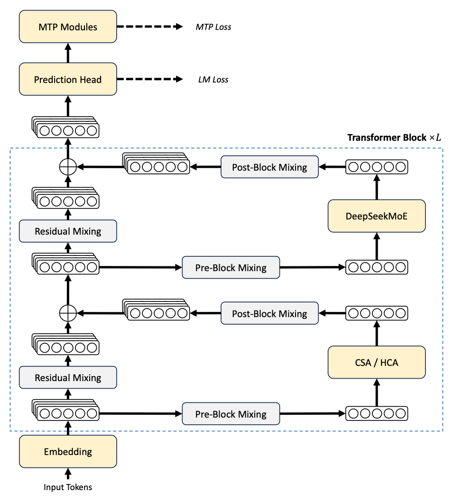
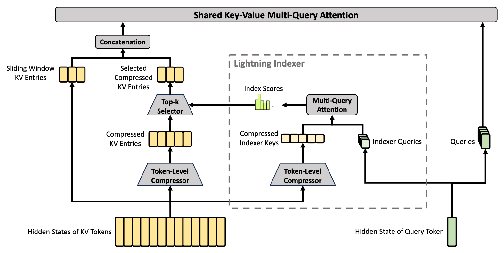

# DeepSeek-V4: Towards Highly Efficient Million-Token Context Intelligence

arXiv 技术报告（[arXiv:2606.19348](https://arxiv.org/abs/2606.19348)）。

作者：DeepSeek-AI（团队署名）

## 整体架构

如图所示，DeepSeek-V4 系列支持 1M 上下文，包含 1.6T 参数（激活 49B）的 Pro 与 284B 参数（激活 13B）的 Flash。模型沿用 DeepSeekMoE 与 MTP 框架，在残差路径引入 Manifold-Constrained Hyper-Connections（mHC）拓宽残差流，并交替堆叠两类压缩注意力。MoE 层改进了路由亲和度函数并取消目标节点限制，同时将前几层稠密网络替换为哈希路由 MoE 层。在 1M 上下文下，Pro 的单 token 推理计算量与 KV Cache 体积分别降至 DeepSeek-V3.2 的 27% 和 10%。

## CSA 与 HCA 混合注意力

如图所示，模型交替组合 Compressed Sparse Attention（CSA）与 Heavily Compressed Attention（HCA）以兼顾检索精度与压缩率。CSA 对相邻重叠窗口加权求和，将每 4 个 token 压缩为单个条目，再由 FP4 索引器筛选 Top-$k$ 条目执行稀疏注意力。HCA 则将每 128 个 token 无重叠聚合为单个条目，直接执行稠密注意力以捕获全局粗粒度信息。两类层均共享键值并拼接局部 Sliding Window Attention（SWA）分支，配合 BF16 与 FP8 混合存储进一步减半缓存。

## Muon 优化器

除嵌入层、预测头和归一化层外，模型对绝大多数矩阵参数采用 Muon 优化器以加快收敛并提升稳定性。Muon 结合解耦权重衰减，并对更新矩阵做均方根缩放以直接复用 AdamW 的学习率配置。核心正交化采用两阶段共 10 步的混合 Newton-Schulz 迭代，前段快速推近奇异值至 1，末段精确稳定于 1。由于注意力层已对查询和键值直接施加归一化，训练无需引入 QK-Clip 裁剪即可防止注意力分数爆炸。

## 训练与推理基础设施

系统层围绕通信掩盖、确定性计算与异构缓存管理进行了协同优化。专家并行将专家切分为多个 wave 放入单一流水化算子，并发重叠跨卡通信与计算，最高取得 1.96 倍推理加速。底层算子库实现逐比特确定性与 batch 无关性，并配合混合分桶与两阶段上下文并行支持 Muon 与跨卡压缩。推理端将缓存拆分为定长状态缓存与按压缩率最小公倍数对齐的分页主缓存，并结合磁盘前缀缓存避免重复计算。

## 预训练与稳定性保障

基座模型在超过 32T 的高质量多领域语料上完成预训练，原生支持 1M 上下文长度。训练先在短序列与稠密注意力下预热，随后逐步扩展上下文窗口并平滑切换至稀疏注意力。针对 MoE 路由放大离群值引发的 loss 突增，预判路由在异常回滚后临时使用历史参数提前计算路由以阻断恶性循环。此外，模型全程对 SwiGLU 激活的线性分支与门控分支施加数值截断，从源头抑制极端离群值。

## 后训练与在线策略蒸馏

后训练采用“领域专家培养 + 多教师在线策略蒸馏”两阶段流程，替代传统的混合强化学习。第一阶段通过 SFT 与 Group Relative Policy Optimization（GRPO）独立训练各领域专家，由策略网络兼任生成式奖励模型并跨轮次保留思考轨迹。第二阶段引入超过 10 个领域教师，在学生自采样轨迹上通过全词表 On-Policy Distillation（OPD）最小化逆向 KL 散度：

$$
\mathcal{L}_{\text{OPD}}(\theta) = \sum_{i=1}^N w_i D_{\text{KL}}(\pi_\theta \parallel \pi_{E_i})
$$

蒸馏时仅缓存教师末层隐状态并在线重构词表分布，同时对专家权重与索引器引入 FP4 量化感知训练以降低部署开销。
