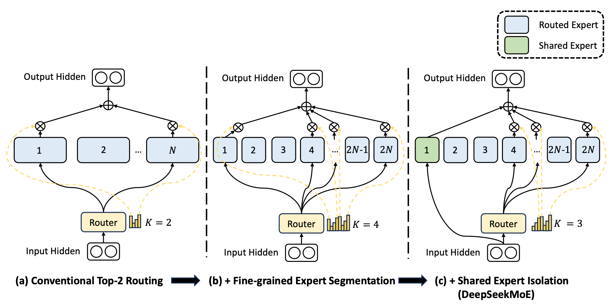

# DeepSeekMoE: Towards Ultimate Expert Specialization in Mixture-of-Experts Language Models

发表于 ACL '24（[arXiv:2401.06066](https://arxiv.org/abs/2401.06066)）。

作者：Damai Dai¹²、Chengqi Deng¹、Chenggang Zhao¹³、R.X. Xu¹、Huazuo Gao¹、Deli Chen¹、Jiashi Li¹、Wangding Zeng¹、Xingkai Yu¹⁴、Y. Wu¹、Zhenda Xie¹、Y.K. Li¹、Panpan Huang¹、Fuli Luo¹、Chong Ruan¹、Zhifang Sui²、Wenfeng Liang¹（¹DeepSeek，²北京大学，³清华大学，⁴南京大学）

## 动机和挑战

如图所示，DeepSeekMoE 在保持总参数量与单 token 计算量不变的前提下，从常规 top-2 路由（a）出发依次引入细粒度专家切分（b）和共享专家隔离（c），以实现充分的专家特化。传统 MoE 用多个前馈网络专家替代稠密层，但专家总数较少时，分配到同一专家的 token 覆盖多样领域，迫使单个专家混杂异质知识。同时，路由至不同专家的 token 往往依赖相同的基础信息，导致多个专家各自重复学习公共知识并造成参数冗余。

## 细粒度专家切分

细粒度专家切分通过缩小单个专家尺寸并同比例增加激活专家数，在不增加参数与算力的条件下大幅提升知识拆解精度。具体做法是将每个标准专家的中间层维度缩减为原来的 $\frac{1}{m}$，把 $N$ 个专家切分为 $mN$ 个细粒度专家，同时将单 token 激活的专家数扩大至 $mK$。这一改动使激活专家的组合空间呈指数级扩展，多样化知识得以被更精细地拆分到不同专家中独立学习。消融实验表明切分粒度越细，模型整体表现越强，路由专家之间的参数冗余也显著降低。

## 共享专家隔离

共享专家隔离通过固定部分专家处理所有 token，将跨上下文的通用知识集中存储并消除路由专家间的冗余。模型从细粒度专家中划出 $K_s$ 个共享专家始终激活，其余路由专家减少等量激活名额以维持计算量恒定：

$$
\mathbf{h}_t^l = \sum_{i=1}^{K_s} \operatorname{FFN}_i(\mathbf{u}_t^l) + \sum_{i=K_s+1}^{mN} g_{i,t} \operatorname{FFN}_i(\mathbf{u}_t^l) + \mathbf{u}_t^l
$$

其中 $\mathbf{u}_t^l$ 为注意力层输出，稀疏门控权重 $g_{i,t}$ 仅在路由专家亲和度的前 $mK - K_s$ 项上非零。分析实验表明共享专家承载了路由专家无法替代的基础知识，使路由专家得以专注于差异化特征。

## 负载均衡与模型扩展

为兼顾专家训练均衡与跨卡并行效率，DeepSeekMoE 联合采用专家级和设备级两类负载均衡损失。专家级损失取较小权重以防路由坍缩且避免过度约束损伤性能，设备级损失则在跨卡部署时约束各设备组的平均计算负载趋于一致。扩展模型规模时保留首层为稠密层以规避首层负载收敛缓慢，并将共享专家与激活路由专家固定为 1:3 配比。由此构建的 16B 模型仅激活 2.8B 参数，消耗约 40% 的算力即可匹敌同语料 7B 稠密模型，且在 SFT 后保持同等优势。
