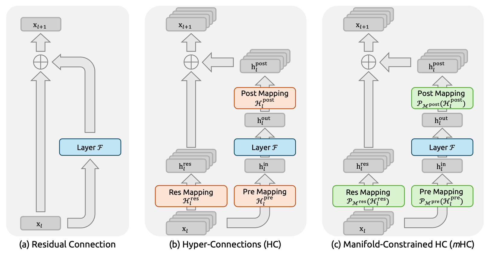
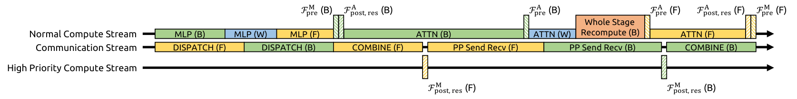

# mHC: Manifold-Constrained Hyper-Connections

arXiv 预印本（[arXiv:2512.24880](https://arxiv.org/abs/2512.24880)）。

作者：Zhenda Xie、Yixuan Wei、Huanqi Cao、Chenggang Zhao、Chengqi Deng、Jiashi Li、Damai Dai、Huazuo Gao、Jiang Chang、Kuai Yu、Liang Zhao、Shangyan Zhou、Zhean Xu、Zhengyan Zhang、Wangding Zeng、Shengding Hu、Yuqing Wang、Jingyang Yuan、Lean Wang、Wenfeng Liang（DeepSeek）

## 动机和挑战

如图所示，Manifold-Constrained Hyper-Connections（mHC）通过流形投影解决多流残差网络的训练失稳与访存开销问题。标准残差连接依靠恒等映射保证深层信号稳定传递，但单一残差流限制了跨层表征容量。Hyper-Connections（HC）将残差流拓宽 $n$ 倍并引入可学习混合矩阵，在不增加主干计算量的前提下提升了性能。但无约束混合矩阵多层连乘后会破坏均值守恒，在 27B 模型中信号增益峰值近 3000 并导致训练崩溃，且成倍增加访存开销。

## 双随机流形约束

mHC 将残差混合矩阵 $\mathcal{H}_l^{\mathrm{res}}$ 投影至双随机矩阵构成的 Birkhoff 多面体，以兼顾多流交互与跨层稳定性：

$$
\mathbf{x}_{l+1} = \mathcal{H}_l^{\mathrm{res}}\mathbf{x}_l + \mathcal{H}_l^{\mathrm{post}\,\top}\mathcal{F}(\mathcal{H}_l^{\mathrm{pre}}\mathbf{x}_l, \mathcal{W}_l)
$$

其中 $\mathcal{H}_l^{\mathrm{res}}$ 元素非负且行列和均为 $1$，$\mathcal{H}_l^{\mathrm{pre}}$ 与 $\mathcal{H}_l^{\mathrm{post}}$ 负责层输入聚合与输出写回。双随机矩阵的谱范数不超过 $1$，保证了单层映射的非扩张性并抑制梯度爆炸。同时该流形对矩阵乘法封闭，跨层复合映射仍守恒信号均值，而输入与输出映射的非负约束则避免了信号抵消。

## 参数化与流形投影

mHC 结合动态与静态分量生成连接系数，并通过迭代归一化完成流形投影。模型先将多流残差展平归一化，再将输入相关的线性投影动态项与静态偏置相加得到原始系数。输入映射与输出映射直接通过 Sigmoid 函数约束为非负有界值。残差混合矩阵采用 Sinkhorn-Knopp 算法，经指数变换取正后交替执行 20 步行列归一化以逼近双随机矩阵。

## 算子融合与激活重计算

为消除多流残差的访存与显存瓶颈，mHC 联合设计了算子融合与分块激活重计算。算子层将归一化权重吸收进投影矩阵，把系数计算、迭代投影与残差合并封装为混合精度融合 kernel 以减少重复读写。显存层在前向传播后丢弃 mHC 中间激活，按固定层数分块仅保存分块首层输入。反向传播时跳过重型主干层、仅重算轻量的 mHC 算子，并与流水线 stage 边界对齐以降低峰值显存。

## DualPipe 通信重叠

如图所示，mHC 扩展了 DualPipe 调度，将多流残差的跨 stage 通信与边界重计算隐藏在常规计算之下。MLP 层的残差合并算子运行在独立高优先级计算流上，避免阻塞专家并行和流水线通信。注意力层取消持久化 kernel 以支持灵活抢占，且本地缓存的起始激活使重计算脱离跨卡通信依赖。在 4 倍扩展率下，mHC 在大规模训练中仅引入 6.7% 的额外时间开销。
