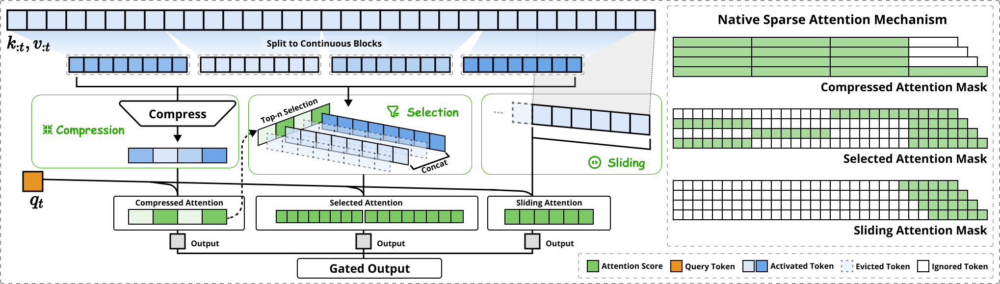
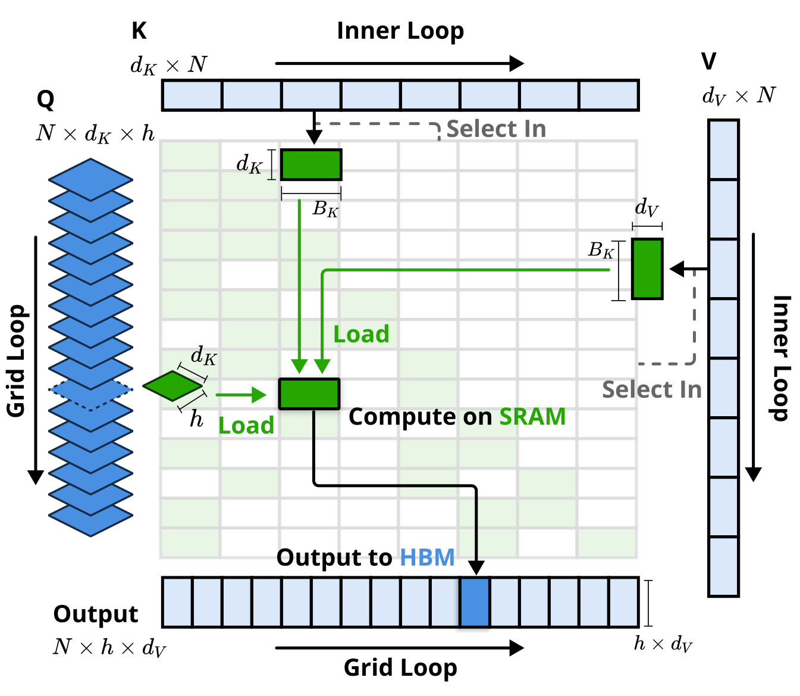

# Native Sparse Attention: Hardware-Aligned and Natively Trainable Sparse Attention

发表于 ACL '25（[arXiv:2502.11089](https://arxiv.org/abs/2502.11089)）。

作者：Jingyang Yuan¹²、Huazuo Gao¹、Damai Dai¹、Junyu Luo²、Liang Zhao¹、Zhengyan Zhang¹、Zhenda Xie¹、Y. X. Wei¹、Lean Wang¹、Zhiping Xiao³、Yuqing Wang¹、Chong Ruan¹、Ming Zhang²、Wenfeng Liang¹、Wangding Zeng¹（¹DeepSeek，²北京大学，³University of Washington）

## 动机和挑战

长上下文建模中注意力计算占据 64k 解码延迟的 70%–80%，但现有稀疏注意力难以兼顾实际硬件加速与端到端训练。推理侧，多数方法仅加速 prefill 或 decode 单一阶段，且逐头独立挑选 KV 的方式与 Grouped-Query Attention（GQA）不兼容，同组仍需读取所有查询头所选 KV 的并集。训练侧，事后稀疏剪枝偏离预训练分布导致精度受损，聚类或哈希等离散筛选阻断梯度回传，而逐 token 随机访存又无法利用 Tensor Core 的连续分块吞吐。

## 三分支分层稀疏架构

如图所示，Native Sparse Attention（NSA）通过粗粒度压缩、细粒度分块选择和局部滑动窗口三条并行分支重映射历史键值，兼顾全局感知与局部精度。给定当前查询 $\mathbf{q}_t$，三条分支的注意力输出按门控加权融合：

$$
\mathbf{o}_t^* = \sum_{c \in \{\mathrm{cmp}, \mathrm{slc}, \mathrm{win}\}} g_t^c \cdot \mathrm{Attn}(\mathbf{q}_t, \tilde{K}_t^c, \tilde{V}_t^c)
$$

其中 $\tilde{K}_t^c, \tilde{V}_t^c$ 为各分支构造的紧凑键值集合，$g_t^c \in [0, 1]$ 为经 MLP 与 Sigmoid 预测的门控分数。压缩分支用可学习 MLP 将连续块聚合为块级表示以捕获全局语义，滑动窗口分支则以独立键值投影保留近期上下文，防止局部模式形成捷径学习。

## GQA 一致的分块 Token 选择

选择分支以空间连续的键值块为单位保留关键细粒度信息，既契合注意力分数的块状聚集特性，又保证 GPU 连续内存访问效率。为避免引入额外打分网络和辅助损失，NSA 直接利用压缩分支已算出的块级注意力分数折算各候选块的重要性。针对共享键值缓存的 GQA 架构，算法将同一组内所有查询头的重要性分数求和，统一选取组内得分最高的 top-$n$ 个原始键值块拼接参与注意力计算。这种组内一致筛选确保同组查询头在解码时共享完全相同的稀疏 KV 块，从根源上消除冗余显存读取。

## 硬件对齐的 Kernel 与加速效果

如图所示，压缩与滑动窗口分支可直接调用 FlashAttention-2，而稀疏选择分支在 Triton 中改以 GQA 组为中心设计专用算子。若沿用按连续查询位置分块的加载方式，不同位置查询所需的稀疏 KV 块互不重合，会导致片上缓存利用率低下。NSA 外层循环按查询位置加载同一 GQA 组内的全部查询头至片上 SRAM，内层循环按共享索引顺序读取连续的稀疏 KV 块并在片上完成计算。在 27B 总参数、3B 激活参数的 MoE 模型从头预训练中，NSA 精度持平乃至超越全注意力基线，并在 64k 长度下取得最高 9.0 倍前向、6.0 倍反向及 11.6 倍解码加速。
