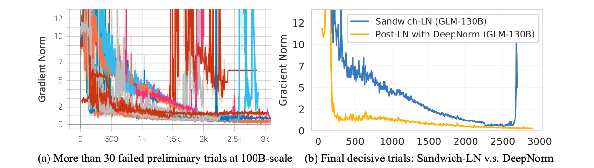
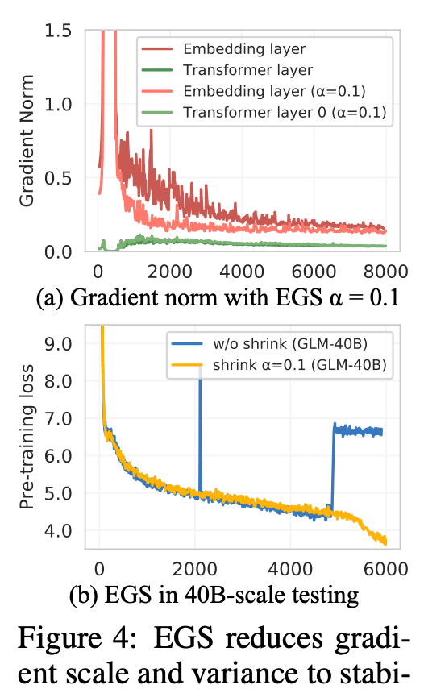
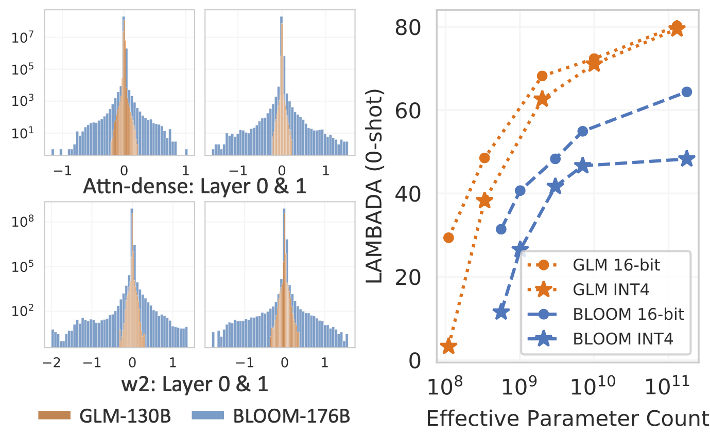

# GLM-130B: An Open Bilingual Pre-trained Model

发表于 ICLR '23（[arXiv:2210.02414](https://arxiv.org/abs/2210.02414)）。

作者：Aohan Zeng¹、Xiao Liu¹、Zhengxiao Du¹、Zihan Wang¹、Hanyu Lai¹、Ming Ding¹、Zhuoyi Yang¹、Yifan Xu¹、Wendi Zheng¹、Xiao Xia¹、Weng Lam Tam¹²、Zixuan Ma¹、Yufei Xue²、Jidong Zhai¹、Wenguang Chen¹、Peng Zhang²、Yuxiao Dong¹、Jie Tang¹（¹清华大学，²智谱）

## 动机和挑战

千亿参数稠密 LLM 展现出零样本与少样本涌现能力，但早期主流模型大多闭源且仅面向英文。同期开源尝试在规模放大时普遍面临预训练数值发散、loss 尖峰崩溃以及推理硬件门槛过高的问题。GLM-130B 旨在构建开源的高精度中英双语稠密预训练模型，并将参数规模定为 130B，使其在 FP16 精度下可直接运行于单台 8×40GB A100 服务器。

## 双向上下文架构与 DeepNorm

如图所示，百亿规模以上的 30 余次早期试验以及 Pre-LN、Sandwich-LN 均在训练中出现剧烈梯度爆炸，而引入 DeepNorm 的 Post-LN 使梯度范数始终平稳。不同于 GPT 系列的单向自回归架构，GLM-130B 以 General Language Model（GLM）为骨干，对未掩码上下文采用双向注意力，并以自回归空白填充恢复被掩码片段。模型混合句内短掩码 `[MASK]` 与句末长掩码 `[gMASK]` 两类目标，从而在统一架构内兼顾语言理解与长文本生成。此外，模型采用一维 RoPE 位置编码与 GeGLU 前馈网络，并通过 DeepNorm 按层数缩放残差支路与初始化权重，将深层主干数值严格限制在有界范围内。

## 混合预训练目标与 3D 并行

GLM-130B 将自监督学习与多任务指令预训练结合，在不损害自由生成能力的前提下提升零样本泛化。预训练在中英文均衡语料上共训练 400B tokens，其中 95% 采用自监督空白填充，其余 5% 引入涵盖自然语言理解、生成与信息抽取的 Multi-Task Instruction Pre-training（MIP）。为突破单机 40GB 显存限制并避免跨机张量并行拖慢通信，训练组合数据并行、张量并行与基于 PipeDream-Flush 的流水线并行构成 3D 并行策略。模型还通过缩减中间流水线 stage 的层数来平衡首尾词嵌入层的显存开销，将流水线气泡率压低至 3.8%。

## 嵌入层梯度缩放

如图所示，输入词嵌入层在训练早期的梯度范数比常规 Transformer 层高出数个数量级且剧烈震荡，而缩小词嵌入梯度后波动与 loss 尖峰均被消除。GLM-130B 为兼顾跨平台硬件兼容性与显存效率采用 FP16 混合精度训练，但语言模型无法像视觉模型那样直接冻结输入层来抑制梯度异常。为此，论文采用 Embedding Layer Gradient Shrink（EGS）按缩放因子 $\alpha = 0.1$ 衰减词嵌入层的反向传播梯度：

$$
\mathrm{word\_embedding} = \alpha \cdot \mathrm{word\_embedding} + (1 - \alpha) \cdot \mathrm{detach}(\mathrm{word\_embedding})
$$

该操作通过截断算子保持前向传播数值不变，仅将词嵌入梯度缩减至原来的十分之一，从根源上消除了滞后数步触发的全局数值崩溃。

## INT4 权重量化与低资源推理

如图所示，GLM-130B 线性层的权重分布显著窄于 BLOOM-176B，对称量化分箱误差更小，且模型规模越大，INT4 与 FP16 的精度差距越小。由于 GLM-130B 约有 30% 的激活维度存在极端离群值，难以做 INT8 激活量化。推理方案因此将激活保持为 FP16，仅对线性层权重做逐行对称 INT4 量化并在运行时动态反量化。这一设计无需量化后训练即可保持近无损精度，将权重显存压至 70GB，支持单机 4×RTX 3090 或 8×RTX 2080 Ti 推理。
