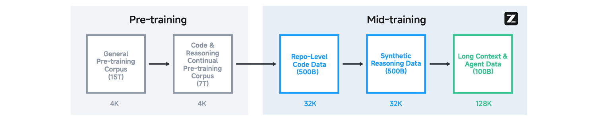
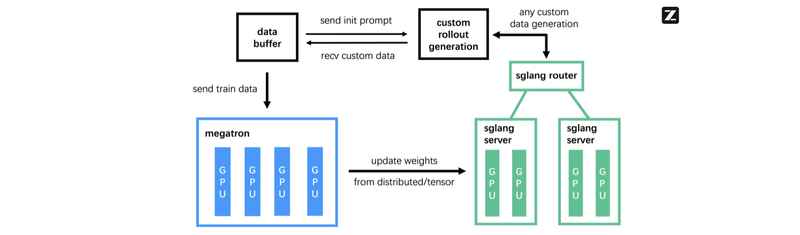

# GLM-4.5: Agentic, Reasoning, and Coding (ARC) Foundation Models

arXiv 技术报告（[arXiv:2508.06471](https://arxiv.org/abs/2508.06471)）。

作者：GLM-4.5 Team（智谱、清华大学）

## 整体架构

GLM-4.5 系列将智能体、推理与编码三类核心能力统一于单个 MoE 基座，并原生支持深度思考与直接回复两种混合推理模式。旗舰版总参数为 355B、激活参数为 32B，紧凑版 GLM-4.5-Air 总参数为 106B、激活参数为 12B。相比同代超宽 MoE 模型，GLM-4.5 缩减模型宽度并加深网络层数以提升多步推理表现，路由采用无辅助损失的负载均衡策略。自注意力模块采用带部分 RoPE 的 GQA，成倍增加查询头数量并引入 Query-Key Normalization（QK-Norm）稳定注意力分数，同时附加一层 MoE 结构的 MTP 层用于投机解码。

## 多阶段预训练与中期训练

如图所示，基座训练在约 23T tokens 上依次经历两阶段预训练与三阶段中期训练，并将上下文长度从 4K 逐步扩展至 32K 与 128K。预训练先在经质量分桶与语义去重的通用及多语言语料上学习基础表征，再上采样高质量代码、数学与科学文档强化专业知识。中期训练改用最佳适配拼接防止截断长样本，分阶段引入跨文件仓库级代码与提交记录、合成竞赛推理轨迹以及长文档与智能体交互轨迹。训练全程对非嵌入参数采用 Muon 优化器配合余弦学习率衰减，加速收敛并容忍更大批次规模。

## 专家模型迭代与混合推理微调

后训练通过专家迭代与自蒸馏将多领域专长融合进同一模型。第一阶段先用少量长思维链数据冷启动 SFT，再通过领域 RL 分别训练推理、智能体与通用对话三个专家模型。第二阶段从各专家采样数百万条 128K 上下文样本执行统一 SFT 自蒸馏，并平衡含完整思考过程与直接作答的样本比例，使模型兼顾复杂推理与即时响应。针对函数调用参数含代码时 JSON 需大量转义的问题，模型改用类 XML 标签封装键值以原生输出代码，并结合用户模拟器自动合成多轮轨迹。

## 推理强化学习

推理 RL 基于去除 KL 正则项的 GRPO 框架，围绕样本难度、输出长度与探索多样性优化数学、代码与科学推理。训练采用两阶段难度课程学习，后期切换至早期难以解出但答案严格可验的高难题目池，防止奖励全对或全错导致梯度消失。输出长度上，直接在完整 64K 长度上执行单阶段 RL，避免多阶段渐进扩长导致已具备长输出能力的 SFT 模型在短窗口阶段发生不可逆退化。此外，训练在奖励进入平台期后动态上调采样温度以维持探索，并在代码 RL 中改用 token 加权平均损失以消除序列长度偏置。

## 智能体与通用强化学习

智能体 RL 聚焦结果可自动验证的网页搜索与软件工程任务，通过知识图谱多跳合成与隔离沙箱单元测试提供客观奖励信号。训练仅优化模型生成的 token 而忽略环境反馈，对格式错误的工具调用直接置零奖励，并在收敛后回流轨迹更新冷启动模型以迭代推高上限。通用 RL 协同确定性规则、人类偏好奖励模型与 AI 评分准则，覆盖综合对齐、细粒度约束指令遵循及多轮函数调用。最后阶段还在高诱发样本集上专门执行 Pathology RL，定点消除语种混杂、重复生成与格式错误等低频病态输出。

## Slime 强化学习基础设施

如图所示，自研 RL 框架 Slime 由负责参数更新的 Megatron 模块、基于 SGLang 的 Rollout 模块以及管理采样策略的 Data Buffer 组成。系统依托 Ray 同时支持训推同卡同步模式与训推分离异步模式，分别用于消除常规 RL 空闲和持续生成长耗时智能体轨迹。异构智能体环境通过统一 HTTP 接口将消息列表轨迹写入中心数据池，实现任务逻辑与训练循环解耦。每轮策略更新后系统还对权重执行在线分块 FP8 量化，在保持 BF16 训练精度的同时加速 rollout 吞吐。
