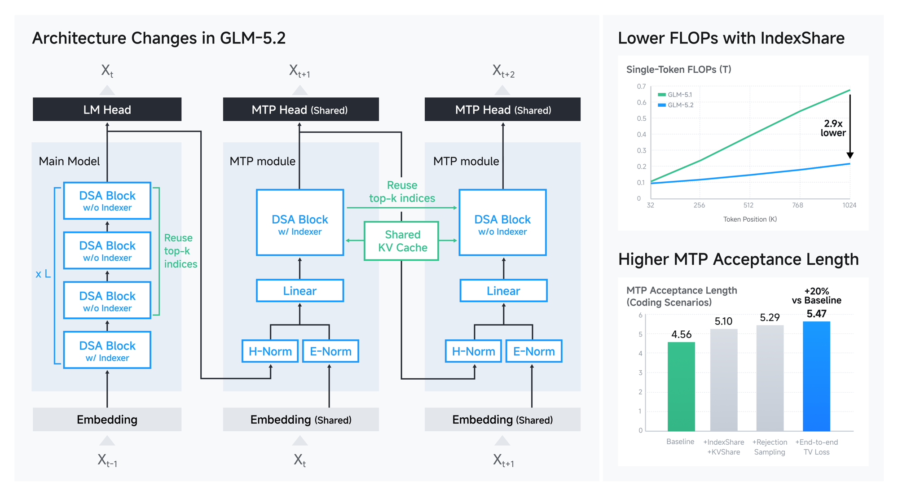
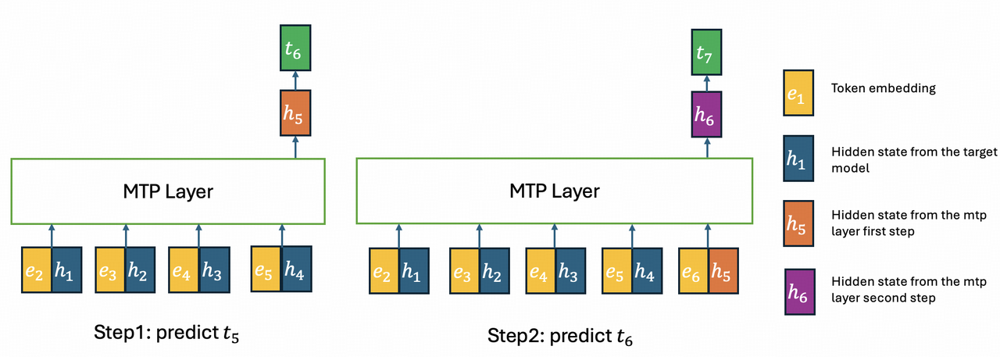

# GLM-5.2: Built for Long-Horizon Tasks

来源：[官方博客](https://z.ai/blog/glm-5.2)。

作者：Z.ai（智谱）

## IndexShare 与 1M 上下文架构

如图所示，GLM-5.2 在主干与 MTP 模块中引入跨层索引共享机制 IndexShare，将有效上下文窗口扩展至 1M tokens，并支持多档思考强度调节以平衡性能与延迟。在 DeepSeek Sparse Attention（DSA）主干中，每 4 个稀疏注意力层仅在第 1 层放置轻量 indexer，其余 3 层直接复用其选出的 top-$k$ 索引，在 1M 上下文下将单 token 计算量降低 2.9 倍。模型自中期训练起即结合 IndexShare 训练，并大幅扩充面向编码智能体场景的 1M 上下文数据。针对 KV Cache 容量未随计算量等比缩小的问题，推理引擎基于 LayerSplit 细化显存切分，并协同优化长序列 kernel、缓存传输与 CPU 调度以减少 GPU 流水线气泡。

## MTP 投机解码改进

如图所示，多步 MTP 投机解码在第二步混入了第一步 MTP 生成的隐藏状态，常规做法下其 KV Cache 同时包含目标模型与草稿模型键值，造成训推不一致。GLM-5.2 在多步 MTP 参数共享的基础上仅于第一步放置 indexer，并在后续步同时复用第一步的 top-$k$ 索引与 KV Cache。这既降低了草稿模型开销，又使后续步只关注来自目标模型隐藏状态的键值，从结构上消除训推偏差。再结合投机解码拒绝采样与端到端 Total Variation（TV）损失训练，编码场景下的平均投机接受长度提升 20%。

## 长程智能体强化学习与在线反作弊

后训练依托 slime 框架统一组织异构多轮 rollout，并通过并行在线策略蒸馏将十余个专家模型融合进最终模型。超长轨迹经上下文压缩切分后，同一问题下不同 rollout 的子轨迹条数与长度差异悬殊，因此 RL 改用基于 critic 的单轨迹 PPO 并施加 token 级损失。针对编码 RL 易出现读取隐藏评测文件或拉取上游源码等奖励作弊行为，系统在每步工具调用时串联高召回规则过滤与高精度 LLM 意图判别。一旦检出作弊，护栏当场拦截该调用并返回虚拟占位结果，允许模型继续完成剩余 rollout，从而避免频繁中断整条轨迹引发训练震荡或模型坍塌。
